# SkyBlink NASA ? SPHEREx SkyBlink

**Public source snapshot:** [SkyBlink-NASA](https://github.com/tureisD/SkyBlink-NASA).
Start with the [two-speaker demo and recorded examples](docs/video.md):
a real WISE 0855 field comparison and an honest unavailable R Draconis measurement.

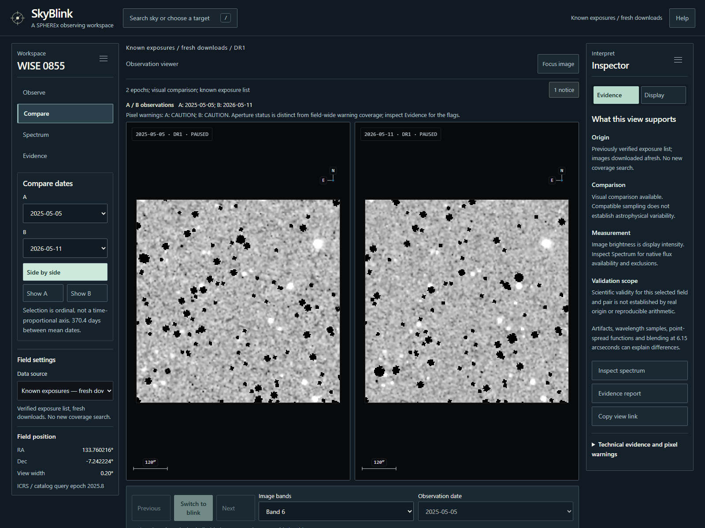

*Unchanged retained real-response playback, not a new live archive search.
[Capture provenance](docs/screenshots/video/origins.json).*

**Documentation:** start with the [documentation index](docs/README.md) for user
guides, current priorities, reproducibility, architecture/mathematics writing
plans and dated verification reports.

**Latest search status (2026-11-15):** live archive discovery is still failing
in the tested environment, including through the official SPHEREx Explorer.
Known-exposure downloads remain an explicit, catalog-only workaround. See the
[renewed investigation](docs/verification/phase6-archive-search-renewed.md) and
[current limitations](docs/current-limitations-and-next-steps.md). Earlier local
release checks below do not establish current upstream availability.

> **Local Phase 6 checkpoint (2026-11-15):** target and task navigation now live in the compact left sidebar. A failed catalog spectrum can explicitly use **Fetch known spectrum online** without changing the image source; zero eligible samples remain an honest successful measurement outcome. See [Phase 6 verification](docs/verification/phase6-verification.md) and the [current deployment guide](docs/guides/deployment.md). Website deployment and event submission are deferred; the current container has not been executed on this machine.

> **Current API 1.6 / explicit outage recovery (2026-11-15):** fresh archive search remains the default. If it fails for a named catalog target, choose **Fetch known exposures online**, or **Data source → Known exposures — fresh downloads**. This explicitly uses a bounded, previously verified exposure list and downloads the FITS files again; it does not search for newer observations or guarantee a comparison. It never activates automatically. Arbitrary coordinates still require live discovery. See [outage and recovery verification](docs/verification/phase5-discovery-outage-verification.md).

> **Centered observing workspace (2026-11-15):** the blink image now sits between Fields and Inspector sidebars, with collapsible panels, Focus image and a responsive phone layout. See [layout verification](docs/verification/phase5-centered-workspace-verification.md). For what remains beyond deployment, read [current limitations and next steps](docs/current-limitations-and-next-steps.md): a matched field, supported target photometry, measured motion and a validated astrophysical claim are different outcomes.

> **Visual and live-comparison refinement (2026-11-15):** unified typography and controls, readable responsive charts, spectrum filters/sorting, recent query settings and explicit single-epoch recovery. Live acquisition now prioritizes potential epoch pairs before downloading more candidates, while retaining the wavelength and usable-image checks. See [polish verification](docs/verification/phase5-polish-verification.md), [retrieval decision and results](docs/decisions/comparison-retrieval-decision.md), and [why a live view may have one epoch](docs/guides/why-a-live-view-has-one-epoch.md). A visual match is not a confirmed astrophysical change.

> **Phase 5 observing workspace (2026-11-15):** a calmer interface now centers Observe, Compare, Spectrum and Evidence. Views start paused; comparisons have explicit A/B dates and shared-camera side-by-side inspection. Search and recovery remain available during loading/failure. Signed spectral samples, exclusions, source limitations and reproducible view recipes are explained alongside the data. Start with the [observing guide](docs/guides/observing-guide.md), [design decision](docs/plans/phase5-design.md) and [verification](docs/verification/phase5-verification.md). Participant comprehension, assistive-technology and flash-threshold acceptance remain separate from automated browser checks. API 1.5 and scientific processing are unchanged.

Current screenshots: [compact desktop workspace](docs/screenshots/phase6/workspace-1440.png),
[phone](docs/screenshots/phase6/workspace-390.png),
[keyboard shortcuts](docs/screenshots/phase6/shortcuts-1440.png), and
[real excluded spectrum](docs/screenshots/phase6/known-spectrum-320.png).
These use explicitly selected historical real data or unchanged actual API responses in isolated browser checks; [capture origins](docs/screenshots/phase6/origins.json)
record source, build and input hashes. Older screenshots below are historical.

> **Phase 4 continuation / API 1.5.0 (2026-11-14):** archive acquisition is now the default for named targets and arbitrary coordinates, using DR1 + QR3 and corrected target astrometry. Saved revision-3 data is explicit and unchanged. New products carry exact input hashes, acquisition receipts and replay records. Independent screened controls support the existing aperture method; a proposed refinement failed and was not adopted. This is not universal calibrated photometry. See [current verification](docs/verification/phase4-online-verification.md), [scientific results](docs/verification/phase4-science-online-verification.md), [reproducibility](docs/guides/reproducibility.md) and [reading a result](docs/guides/result-meaning.md).

Earlier evidence: [real-only asset policy](docs/guides/real-data-policy.md), [live-service limits](docs/verification/phase2-verification.md), [Phase 3 failed scientific gates](docs/verification/phase3-verification.md), and [Phase 4 independent holdout](docs/verification/phase4-science-verification.md). Historical screenshots and container results below do not certify the audited release.

**NASA Space Apps Challenge 2026 — Planet X and SPHEREx**

SkyBlink shows you the same patch of sky at different times using NASA's
SPHEREx images. Pick one of the five challenge targets—or paste your own sky
coordinates—press play, and the viewer flips between survey passes. You can
also open a spectrum to see how bright the target is at different wavelengths,
and check which pixels have warnings before you trust a measurement.

The app is built for looking and comparing. It uses real public data in normal
operation and never swaps in a development fixture automatically.

> **Repository:** <https://github.com/tureisD/SkyBlink-NASA> is the public source snapshot, with a new history. Public source availability does not imply a hosted application.
>
> **No public URL yet (2026-11-14). Historical container evidence, before the audit changes:** the single-container image
> `skyblink:final` (**844 MB** on disk, 195 MB compressed) has been built from
> the pre-audit `main` snapshot with saved target data (**revision 3**, the
> `golden_cache/` folder) and verified locally: it serves the API and the built
> frontend from one origin, reports version **1.2.0** at `/api/v1/health`, runs
> healthy under a 2 GB memory limit at **105.7 MiB idle**, and passes the
> five-target container smoke test **5/5**. Public hosting is pending; do not
> cite a live URL until one is published. Until then, run the image locally
> (see [Quick start](#quick-start)) or use the
> [screenshots](#4-screenshots).
>
> **Data-release note (2026-11-13).** The current saved data is **revision 3**,
> built from live IRSA **SPHEREx Data Release 1 (DR1) + Quick Release 3 (QR3)**
> after the **B10** release-detection fix. DR1 is the reprocessed QR2 set and is
> intended to be used with QR3. Revision 3 contains **no QR2 data**: WISE 0855
> uses DR1 for all three epochs; Barnard's Star, Epsilon Indi B, and R Draconis
> use DR1 plus the QR3 pass where present; RW Aurigae's newest epoch is QR3.
> The current API contract is **1.6.0**; explicit known-exposure recovery supplements archive/saved access and existing lineage, observation ranges, measurement reasons and telemetry meaning. Unsupported background still produces null/unused photometry. See [the semantic decision](docs/decisions/phase3-contract-decision.md) and
> [`docs/reference/resource-release-2026-11-13.md`](docs/reference/resource-release-2026-11-13.md).
>
> **Screenshot note.** The four primary screenshots below
> (`final-main.png`, `final-spectrum.png`, `final-curtain.png`, and
> `final-mobile.png`) are current **revision 3 (DR1+QR3)** captures. The
> supplementary feature captures later in §4 are still revision-2 views of
> features that did not change.

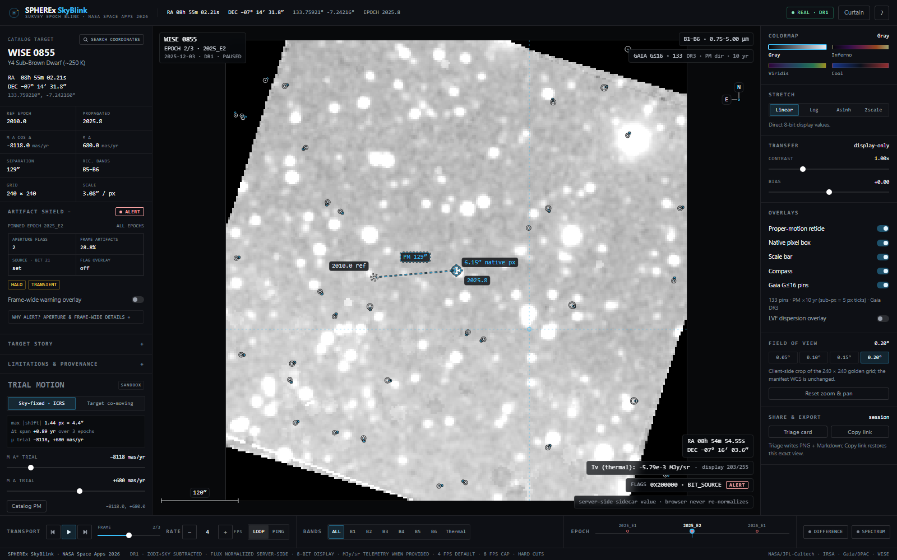

*Historical revision-3 capture: WISE 0855 in `2025_E2`, release DR1, with the
2010.0→2025.8 proper-motion marker, the historical cursor readout (not calibrated source flux), and the
Artifact Shield. The `REAL · DR1` badge in the top-right corner means these are
real NASA images.*

## Start here

SkyBlink is a browser viewer for NASA's SPHEREx infrared sky survey: it shows
the same patch of sky from different survey passes so you can blink between
them and inspect apparent changes. Fresh online archive search is the default
for both named targets and arbitrary coordinates. Choose **Saved catalog data**
explicitly to use the five historical real datasets without an internet connection.

It is a viewer, not an automatic discovery tool.

### Try it

1. **Choose a target or search coordinates.** Pick one of the five targets in
   the left rail, or click **Search coordinates** at the top of that rail and
   paste a position in decimal degrees or RA/Dec.
2. **Press play.** The **Play** button is in the bottom deck; Space does the
   same thing. Use the band buttons and the epoch timeline beside it to change
   what is blinking. The default is 4 frames per second.
3. **Check the warnings and open the spectrum.** The **Artifact Shield** in the
   left rail explains pixel warnings. The **Spectrum** button at the bottom
   right opens the brightness-versus-wavelength plot.

If you get lost, press the **?** button in the top right. It opens Help, a
plain-language guide to the whole screen.

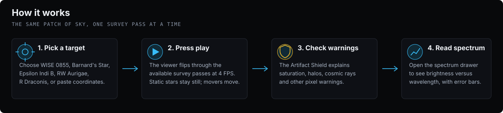

*The basic loop: choose a target, blink the survey passes, check the warning
panel, then read the spectrum.*

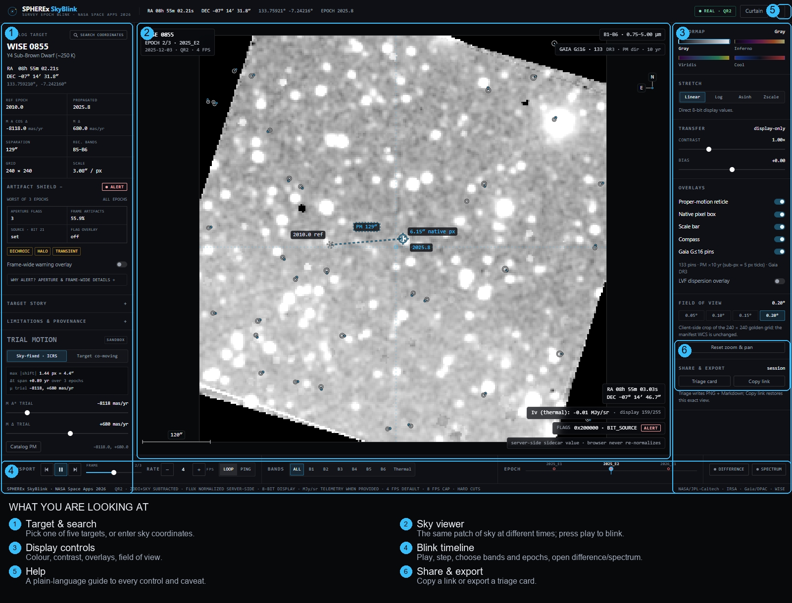

*The same screen with the six main areas marked. The legend is part of the
image: target and search (1), sky viewer (2), display controls (3), blink
timeline (4), Help (5), and Share & export (6).*

### Words you'll see

| Word | What it means here |
|---|---|
| **Target** | One of the five objects the challenge asks about, or any sky position you choose. |
| **Epoch / survey pass** | A block of observations taken around the same time. SPHEREx revisits the sky, so the same target can appear in several epochs. |
| **Band** | One of SPHEREx's six wavelength ranges (B1–B6). A band is a slice of infrared color, not a separate telescope. |
| **Blink** | Flip quickly between epochs. Static stars stay put; a moving or changing object stands out. |
| **Difference** | One measurement image minus another. Residuals can reflect variability, wavelength/PSF mismatch, registration, blending or artifacts. |
| **Artifact / flag** | A pixel warning such as saturation, a cosmic-ray hit, or a halo. Flags tell you where a measurement may be unreliable. |
| **Spectrum** | Brightness measured at many wavelengths. A spectrum can reveal temperature, molecules, or dust. |
| **Saved target data / golden cache** | Real derived images, spectra and pixel files committed for offline use; source identity does not certify the interpretation. |
| **Pixel data file / telemetry sidecar** | A display-intensity plane and pixel flags. New metadata identifies band and normalization; missing legacy metadata must not be interpreted as raw source flux. |
| **MJy/sr** | Megajansky per steradian, a unit of surface brightness used in infrared astronomy. |
| **LVF** | Linear variable filter, the part of SPHEREx that spreads light into wavelengths. The app can draw each detector's wavelength direction on the sky. |
| **RA / Dec** | Right ascension and declination: the sky equivalent of longitude and latitude. |
| **FOV** | Field of view: how much sky the viewer shows at once. |

Full definitions, including the technical and flag-specific terms, are in the
[Glossary](#glossary).

## Project at a glance

| Item | State |
|---|---|
| **What it is** | Browser viewer for NASA SPHEREx images: blink one patch of sky across survey passes, inspect pixel warnings, and read a spectrum. |
| **Status** | Phase 4 archive-first provenance/replay and scoped validation implemented. Phase 5 observing workspace implemented; participant/accessibility acceptance and Phase 6 release checks remain. |
| **Saved target data** | **Revision 3, 5/5 targets** (the repository folder is `golden_cache/`), built 2026-11-13 from live IRSA **DR1+QR3** data (17 epochs, 17 pixel data files, real SkyView/Gaia reference layers). **No QR2 data** remains in the current cache; revision 2 is the rollback. |
| **Latest IRSA release** | **DR1** (November 2026, reprocessed QR2) + **QR3** are recommended over QR2 and are what revision 3 uses. DR1 also includes a 102-channel all-sky cube; it is **not** integrated in this build. |
| **Tests** | **242 passed**, no skips with retained real audit inputs at the Phase 4 checkpoint; software tests do not establish scientific acceptance. |
| **Five-target card** | Historical **5/5 display smoke**; not a raw-unit scientific acceptance result. |
| **Container** | Historical pre-audit `skyblink:final`: 844 MB, API 1.2.0. A new audited container build and release smoke test remain required. |
| **API contract** | **1.6.0**: explicit live/known discovery, archive/saved source policy, discovery/comparison limits and stricter eligibility; optional lineage, observation ranges, measurement reasons and telemetry semantics; creation timestamps remain stable across requests. |
| **Live arbitrary query** | **Real data only.** Latest three candidate epochs, up to three visits per band, returning a wavelength-compatible pair when found; TAP timeout **60 s**, backend sky deadline **120 s**, frontend request timeout **130 s**, cutout request timeout **20 s**. |
| **Repository** | **Public source:** <https://github.com/tureisD/SkyBlink-NASA>. Application hosting remains separate. |
| **Public URL** | **None yet.** No live deployment exists. |
| **License** | **MIT** — see [`LICENSE`](LICENSE). |

## Quick start

Shell snippets in this README are **bash**. On Windows, run them in WSL or Git
Bash, or adapt PowerShell quoting and line continuations.

### Run the container (recommended)

From the repository root:

```bash
docker build -t skyblink:final . \
  && docker run --rm -p 8000:8000 --memory=2g \
       -v skyblink-cache:/data/cache skyblink:final
```

Open **<http://localhost:8000>**. The health endpoint is
**<http://localhost:8000/api/v1/health>**. Online archive search contacts IRSA for
named targets and arbitrary coordinates. If discovery is unavailable for a named
target, explicitly choose **Known exposures — fresh downloads**; this uses only
a historical bounded list and still needs online file access. **Saved catalog
data** is the separate offline option. No recovery mode activates automatically.

Compose alternative (service image tag `skyblink:local`, 2 GB limit, persistent
`/data/cache` volume, health check):

```bash
docker compose up --build
```

On Windows without Docker Desktop, run the same Docker commands through the
WSL2 engine (see [Docker](#87-docker)).

### Run locally (Python 3.11 + Node 20+)

```bash
python -m venv .venv311
# Windows: .venv311\Scripts\activate
# macOS/Linux: . .venv311/bin/activate
pip install -r backend/requirements.txt

cd frontend
npm ci
npm run build
cd ..

python scripts/serve.py          # API + built frontend on http://localhost:8000
```

Development with hot reload:

```bash
# terminal 1 — API
python scripts/dev_api.py        # run from the repository root

# terminal 2 — UI; Vite proxies /api to :8000
cd frontend
npm run dev                      # http://localhost:5173
```

### What works offline

- **Explicit saved mode (`source=saved`):** `/sky`, `/spectrum`, frames, spectra, pixel data
  files, reference overlays, and Gaia pins are all served from
  `golden_cache/`. IRSA is not contacted.
- **Default archive mode, including named targets:** the pipeline needs IRSA TAP/SIA2 and network
  access. It searches the latest three candidate epochs and up to three visits
  per band for a spectrally comparable pair (**60 s** TAP timeout, **120 s**
  backend sky deadline, **130 s** frontend request timeout);
  a cold field can take up to about two minutes. It may return
  `503 UPSTREAM_UNAVAILABLE` or `404 NO_DATA`.
- **Errors are clean:** a failed live request shows a retry/benchmark-target
  message. The frontend does **not** request `/mock` and does not display
  automatic fixture fallback text.
- **Real-only product:** retired fixtures and model spectra are removed; offline UI work uses the five saved real targets.

## Table of contents

- [Start here](#start-here)
- [Project at a glance](#project-at-a-glance)
- [Quick start](#quick-start)
- [1. Why it matters](#1-why-it-matters)
- [2. Feature tour](#2-feature-tour)
- [3. Using the app](#3-using-the-app)
- [4. Screenshots](#4-screenshots)
- [5. The five official targets](#5-the-five-official-targets)
- [6. Architecture](#6-architecture)
- [7. Data products and caches](#7-data-products-and-caches)
- [8. Setup and running](#8-setup-and-running)
- [9. API examples](#9-api-examples)
- [10. Validation](#10-validation)
- [11. Known limitations](#11-known-limitations)
- [12. What is intentionally not built / deferred](#12-what-is-intentionally-not-built--deferred)
- [13. Submission status](#13-submission-status)
- [14. SI / LLM disclosure](#14-si--llm-disclosure)
- [15. Data sources and attribution](#15-data-sources-and-attribution)
- [16. Repository map](#16-repository-map)
- [Working on this project](#working-on-this-project)
- [Glossary](#glossary)
- [License and team](#license-and-team)

---

## 1. Why it matters

NASA's SPHEREx telescope scans the sky in infrared light and repeats the scan
over time. Each sweep gives another look at the same stars, galaxies, and dust.
Astronomers compare those looks to find objects that move, brighten, fade, or
appear and disappear.

Four words make the rest of this README easier:

- **Epoch** (also called a **survey pass** in the app): one block of
  observations taken around the same time. SPHEREx revisits the sky, so a
  target can have several epochs.
- **Band**: one of SPHEREx's six wavelength ranges, B1–B6. A band is a slice of
  infrared color.
- **Spectrum**: brightness measured at many wavelengths. A spectrum can show
  temperature, molecules, or dust.
- **Difference**: one epoch minus another. Static stars mostly cancel, so
  changes and artifacts stand out.

Comparing epochs by eye is harder than it sounds. The data arrive as FITS
files, a format made for software rather than browsing. A target can shift
position between passes. Pixels are 6.15 arcseconds wide (a tiny angle on the
sky), so nearby objects blend together. And some pixels carry
**artifacts**—saturation, cosmic rays, halos, and similar problems—that can look
like real changes. Flags mark those pixels, but you have to know which flags
matter.

SkyBlink puts that comparison in a browser:

- **Blink between epochs** with one shared brightness scale, so static stars do
  not flicker while the target moves or changes.
- **Switch bands** to see what appears at short versus long infrared
  wavelengths.
- **Subtract epochs** to isolate motion and variability.
- **Check the warnings** before reading a measurement.
- **Open a spectrum** for the target, with error bars and per-channel flags.
- **Share a paused view recipe** with selected observations, display settings and an expected analysis identity; archive results can change.

The goal is a quick first look: see whether something moves or changes,
whether the measurement is contaminated, and whether the data deserve a closer
look.

## 2. Feature tour

This section starts with the controls you will use first, then explains what
each panel means. Technical details sit below the beginner explanation or in a
short **Advanced details** note. The [Glossary](#glossary) has the full list of
terms.

### Choose a target or search coordinates

The left rail lists the five challenge targets: WISE 0855, Barnard's Star,
Epsilon Indi B, RW Aurigae, and R Draconis. Each has a short story and a
recommended starting band. Click one to load its saved data.

If you have coordinates, click **Search coordinates** at the top of the left
rail. The box accepts decimal degrees such as `133.79513`, or sexagesimal
positions such as `08h55m10.831s -7d14m42.53s` or `08:55:10.831`. A position
within 5 arcminutes of one of the five targets loads that target's saved data
and shows a toast naming the match. Any other position starts a bounded live
search from IRSA for a spectrally comparable pair. A genuine single-epoch archive
result is displayed as a single observation; a failed comparison returns an error.

**Advanced details:** the five targets are queried at their propagated 2025.8
positions, because high-proper-motion stars have moved since their reference
epoch (WISE 0855's reference is 2010.0; the others are J2000). A catalog share
link that carries the reference position is normalized to the 2025.8 center
before the saved data loads. A live result is labeled **LIVE QUICK-LOOK** and is
not the same product as the multi-epoch saved data.

### Play, pause, and step

Press **Play** in the bottom deck, or press Space. The viewer flips through the
available survey passes at 4 frames per second by default; the maximum is 8 FPS
for photosensitivity. The left and right arrow keys step one epoch at a time,
and the epoch timeline shows where you are.

Blinking is the core trick. A static star stays in the same place from pass to
pass. An object with high proper motion—a real shift across the sky—drifts
between passes. A source that brightens or fades changes between passes while
staying put.

**Advanced details:** frames of the same band share one flux normalization
across epochs, based on static background and star percentiles, not on the
target. Playback is a hard cut, not a fade, and the canvas is pre-decoded and
painted by a persistent animation loop so the page does not re-render on every
tick.

### Bands, All, and Thermal

Use the band buttons above the timeline to switch between B1 and B6. **All**
combines the available bands into one image; **Thermal** combines B5 and B6,
the longest wavelengths, where cool objects and warm dust are easiest to see.

**Advanced details:** missing bands are omitted, never filled in. Per-band
frames are inverse-variance weighted; `all` and `thermal` use equal band
weights. WISE 0855, for example, is faint in the short bands and emerges in
B5/B6.

### Difference mode

Difference mode subtracts one survey pass from another. Static stars mostly
cancel out, leaving anything that moved or changed. The **Difference** button
is at the bottom right, beside the **Spectrum** button; the epoch pair picker is
in the bottom deck.

**Advanced details:** differences are direct subtraction of un-normalized,
zodiacal-light-subtracted, background-subtracted coadds. (Zodiacal light is
sunlight scattered by dust in the Solar System.) This build does not do PSF
matching or optimal transient detection; artifacts and saturation residuals can
remain.

### Field of view

The right display rail has FOV presets at 0.05°, 0.10°, 0.15°, and 0.20°. FOV
means field of view: how much sky the viewer shows at once. Smaller values zoom
in.

**Advanced details:** catalog frames are saved as a full 240×240 grid at
3.075″ per pixel (0.205° across). Changing FOV crops that grid in the browser;
the saved pixel scale does not change.

### What the panels mean

The controls above change what you see. These panels tell you whether to trust
it and what else the data contain.

#### Artifact Shield

**What it does:** shows whether the pixels around the target are clean, and
names any warnings.

The left rail shows a status for each epoch: **NOMINAL**, **CAUTION**, or
**ALERT**. The status is based on the 12.3-arcsecond aperture around the target,
not the whole frame. A separate number reports the fraction of the whole frame
with warning pixels.

Open the shield to see which flags are active and what they mean. The **FLAG
OVERLAY** toggle paints the union of warning bits across bands on the canvas.
Hard-bad pixels are hidden; warning pixels are shown but named. Pixels that
contain known catalog sources are not treated as bad.

**Advanced details:** the app follows the Table 16 bit definitions. `BIT_SOURCE`
(bit 21) is preserved and is excluded only from the background estimate.
`DICHROIC` pixels are excluded from photometry; `HALO` is visible in the display
for the five targets but remains excluded from photometry and
`is_flagged_bad`. `GHOST_FPA` (bit 23) is unused but kept in the warning mask
for future data.

#### Spectrum

**What it does:** plots how bright the target is at each wavelength.

Open it with the **Spectrum** button at the bottom right. The plot uses a fixed
12.3″ aperture and a 3.0–5.0 native-pixel background annulus. Hover a point to
read its wavelength and flux; the same point highlights its detector on the
canvas when the LVF overlay is available.

The drawer also shows error bars, molecular-feature markers, per-epoch release
labels, and warnings. Amber diamonds mean a channel has a low clean fraction or
is excluded from photometry; red means hard-bad.

**Advanced details:** dense saved spectra have up to 72 channels per epoch
(6 detectors × up to 12 visits), not 102 bands. Measured counts are 24–72
channels per epoch. `confidence: "high"` means a precomputed target spectrum;
`"low"` means a live, best-effort extraction. It describes extraction quality,
not certainty that an object is interesting. Error bars are approximate.

#### Cross-mission curtain

**What it does:** shows a reference image beside the SPHEREx frame, on the same
patch of sky, so you can compare what different telescopes see.

Click **Curtain** in the top right and drag the divider. The saved reference
layers are real SkyView DSS2 Red and WISE images for all five targets, plus Gaia
DR3 star positions. WISE 0855 uses WISE 4.6 µm because the Y dwarf is fainter at
3.4 µm; the other targets use WISE 3.4 µm. The curtain hides a side that is not
available.

**Advanced details:** reference images are display-only, not calibrated
photometry and not SPHEREx data.

#### Cursor pixel readout

**What it does:** shows the physical brightness and the flag names under the
cursor, instead of the color of the screen pixel.

Every saved epoch has a pixel data file—the code calls it a
`telemetry_*.bin.gz` sidecar—containing a 240×240 `float16` MJy/sr plane and a
240×240 `uint32` flag plane. The browser decodes it locally, so moving the
cursor does not call the server.

**Advanced details:** the app uses `DecompressionStream` and checks the gzip
header. If the file is already decompressed, it accepts the exact 345,600-byte
payload. If decoding is unavailable, the readout says “telemetry unavailable”
rather than inventing a value. The WebP frame remains an 8-bit display preview.

#### Trial-motion and parallax sandbox

**What it does:** shifts the frames as if the target moved at a chosen speed, so
you can test whether a motion fits the images.

Switch between the sky-fixed ICRS frame and a target co-moving frame, then drag
the `μ_α*` and `μ_δ` sliders (or reset to the catalog proper motion). A
parallax-reflex overlay can use the catalog distance or a 400 AU test distance.
Sub-pixel parallax is drawn as a labelled inset, not as fake on-sky motion.

**Advanced details:** this is display-only. It does not fit an orbit, measure a
parallax, or establish a detection. The HUD says “TRIAL-MOTION VISUALIZATION —
NOT A DETECTION”, and the settings round-trip through the URL without changing
frames, normalization, or spectra.

#### LVF visualizer

**What it does:** draws the direction in which each detector spreads light into
wavelengths.

SPHEREx uses a linear variable filter (LVF) instead of moving parts. The saved
manifest records each detector's position angle and wavelength gradient. Toggle
the overlay to see six color-coded axes; hover a spectrum point to highlight its
detector, or hover an axis to highlight the matching spectrum point.

**Advanced details:** targets or live responses without LVF geometry hide the
overlay and say why; the app does not draw a guess.

#### Sonification

**What it does:** turns the spectrum into sound so you can hear the pattern of
bright and faint wavelengths.

Click **Enable audio** to start. Wavelength 0.75–5.0 µm maps to 220–1760 Hz
(three octaves), channel gain follows relative flux, and short beeps mark epoch
changes. A sweep reports how many channels sounded, were muted, or were
attenuated. Epoch ticks are disabled when reduced motion is requested.

**Advanced details:** this is exploratory accessibility audio, not a
measurement or a detection.

#### Triage card

**What it does:** makes a one-page summary image and a short report of the
current view.

The card combines epoch A, epoch B, the difference, and the spectrum into a
1600×1180 PNG, plus a Markdown report with coordinates, baselines, flags,
context, and a reproducible URL. Download or copy both from the **Share &
export** section at the bottom of the right rail. The title uses the measured
channel count; missing data is written as “not available”.

**Advanced details:** the report is a summary of what is loaded. It is not a
discovery claim.

The illustrative model-spectrum comparator was removed in audit Phase 1.

### Overlays and readouts

- The proper-motion reticle runs from the target's reference epoch (2010.0 for
  WISE 0855, J2000 for the others) to the propagated 2025.8 position.
- A 6.15″ native-pixel box shows the true SPHEREx pixel size; the compass and
  scale bar help you orient the image.
- The cursor readout gives RA/Dec and, when the pixel data file is available,
  the surface brightness in MJy/sr and the active flag names.
- The right rail toggles the reticle, pixel box, scale bar, compass, Gaia pins,
  and LVF overlay.
- The badge identifies the real data release (`DR1`, `QR3`, or `DR1+QR3`). Historical revision-2 screenshots may show `QR2`.

### Share, keyboard, and accessibility

- **Copy link** in the right rail's **Share & export** section restores the
  current view: target, coordinates, field of view, band, epoch, playback,
  frame rate, difference mode, and overlays.
- Keyboard shortcuts cover play/pause, stepping, bands, difference mode, reset,
  and closing dialogs. They are listed in Help.
- `prefers-reduced-motion` disables autoplay and pins the viewer to manual
  stepping. The 8 FPS cap applies everywhere.

### Help

Help is a plain-language guide to every control and caveat, including the
keyboard map. Open it with the **?** button in the top right. Escape closes it
and returns focus to where you were.

### Interface and performance

The interface is a dark, canvas-first workstation: the image is the main
element, and controls sit in rails around it. The four colormaps (grayscale,
inferno, viridis, cool–warm) and four stretches (linear, log, asinh, zscale)
are applied in the browser, so changing them does not download new frames.

**Advanced details:** the canvas pre-decodes frames to `ImageBitmap` objects and
paints them from a persistent `requestAnimationFrame` loop; React owns the HUD,
not the pixels. The design uses the `#08090b` / `#0e1015` palette with no
external fonts.

---

## 3. Using the app

### Controls

| Input | Action |
|---|---|
| Target list (left rail) | Click one of the five targets to load its saved data. |
| **Search coordinates** (left rail) | Open the coordinate resolver; decimal or sexagesimal RA/Dec, 5′ target match. |
| **Play** (bottom deck) or `Space` | Play / pause blinking. |
| `←` / `→` | Step one epoch backward / forward. |
| Band buttons (bottom deck) or `1`–`6` | Select detector band B1–B6. |
| `A` / `T` | All-band coadd / thermal coadd (B5+B6). |
| **Difference** (bottom right) or `D` | Toggle difference mode. |
| **Spectrum** (bottom right) | Open the spectrum drawer. |
| **Artifact Shield** (left rail) | Show the target-aperture status and the flag explanations. |
| `R` | Reset pan and zoom. |
| Drag | Pan the canvas. |
| Wheel | Zoom. |
| Double-click | Reset the view. |
| `Esc` | Close the open dialog; focus returns to the trigger. |
| Triage card / Copy link (right rail, Share & export) | Export the 4-panel PNG + Markdown triage report, or copy the URL restoring the current view. |
| `?` Help (top right) | Open the plain-language guide, including the keyboard map. |

### URL parameters

The view is encoded in the URL. Invalid values fall back to defaults with a
non-blocking warning.

| Parameter | Values | Meaning |
|---|---|---|
| `ra`, `dec` | decimal degrees, ICRS | Query center. Catalog targets must be within 1.0″ of their 2025.8 position. |
| `size` | `0.05`–`0.20` | Field of view in degrees (clamped). Catalog assets are crop-independent; `size` is a client-side crop of the 240×240 grid. |
| `target` | `wise_0855`, `barnards_star`, `eps_indi_b`, `rw_aurigae`, `r_draconis` | Loads the saved target data. |
| `bands` | `all`, `thermal`, `1`…`6` | Selected band. Multi-band lists in the URL collapse to the first valid band; `All` and `Thermal` are server-provided coadds. |
| `epoch` | `all` or an epoch ID (e.g. `2025_E1`) | Selected or visible epoch. |
| `mode` | `blink`, `still` | Playback mode. |
| `fps` | `1`–`8` | Blink rate; default 4, cap 8. |
| `diff` | `0`, `1` | Difference mode on/off. |
| `overlay` | comma-separated `reticle`, `box`, `scale`, `compass`, `flags`, `gaia`, `lvf`, or `none` | Overlay set. |
| `track` | `0`, `1` | Sky-fixed (`0`) or target co-moving trial frame (`1`). Display-only. |
| `pmra`, `pmdec` | mas/yr | F6 trial proper-motion vector (`μ_α*`, `μ_δ`); omitted values use the catalog PM. |
| `parallax` | `0`, `1` | F6 parallax-reflex overlay. |
| `au` | AU | F6 parallax distance; the catalog distance or the labelled 400 AU test distance. |

Catalog share links that carry the reference-epoch position (for example
`?target=wise_0855&ra=133.79513&dec=-7.24515`) are normalized to the target's
2025.8 centre before the saved data loads. A 5′ coordinate match shows a toast
naming the matched position. Single-epoch arbitrary live results show the
persistent **LIVE QUICK-LOOK** banner with benchmark links; saved 3–4 epoch
results do not.

---

## 4. Screenshots

> **Current revision-3 captures.** The four **real-data** primary captures
> below (`final-main.png`, `final-spectrum.png`, `final-curtain.png`, and
> `final-mobile.png`) are WISE 0855 from the committed **revision-3** saved
> data. The UI badge reads **REAL · DR1**. They are actual SPHEREx frames and
> measured spectra. The spectrum capture also shows the custom
> hover tooltip and the LVF sync card. The feature captures later in this
> section are revision-2 views, kept for features not visible in the four
> primary images.

| Real blink comparator (WISE 0855, `2025_E2`) | Real spectrum drawer (WISE 0855) |
|---|---|
|  | 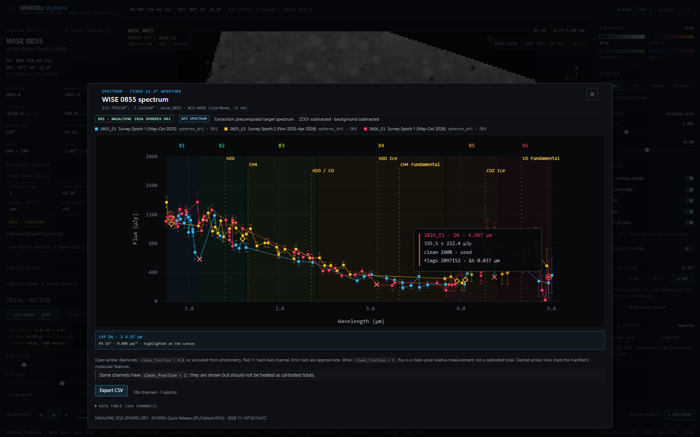 |
| Three DR1 epochs; 2010.0→2025.8 reticle; physical MJy/sr loupe; Artifact Shield status `ALERT` because the target aperture includes `TRANSIENT` (an ALERT-level warning) alongside `DICHROIC` and display-only `HALO`. | 164 channels across 3 epochs (**158 used**); `WCS-WAVE` with `sip=None`; fixed 12.3″ aperture. The capture shows the custom hover tooltip (epoch, detector, wavelength, flux/error, clean fraction, flags) and the LVF sync card. Amber markers mean `clean_fraction < 1`; those fluxes are relative clean-pixel measurements, not calibrated totals. |

| Real cross-mission curtain | Real mobile layout |
|---|---|
| 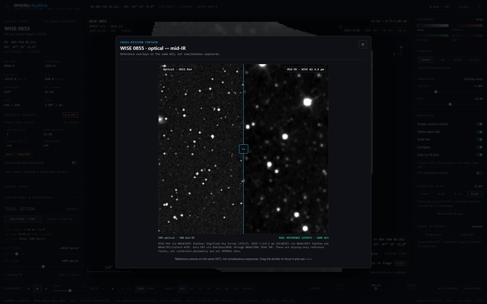 | 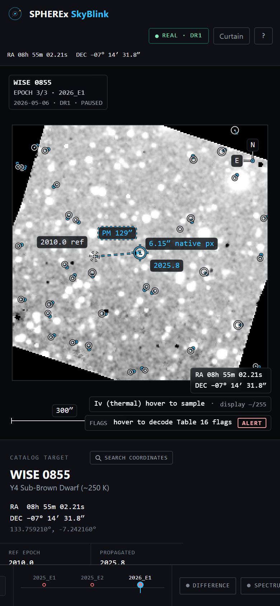 |
| Real SkyView DSS2 Red and WISE 4.6 µm (W2) cutouts on the same 240×240 WCS. WISE 0855 defaults to W2 because the Y dwarf is fainter at 3.4 µm; W1 remains in use for the other targets and as the fallback for legacy manifests. Display-only reference data; not SPHEREx and not calibrated photometry. | 780×1688 capture of the 390 px-class layout. Canvas-first, no horizontal overflow, same real WISE 0855 DR1 frames. |

| Real final F8 workstation layout | Real Help guide |
|---|---|
| 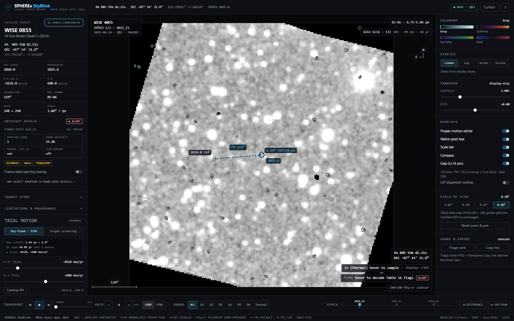 | 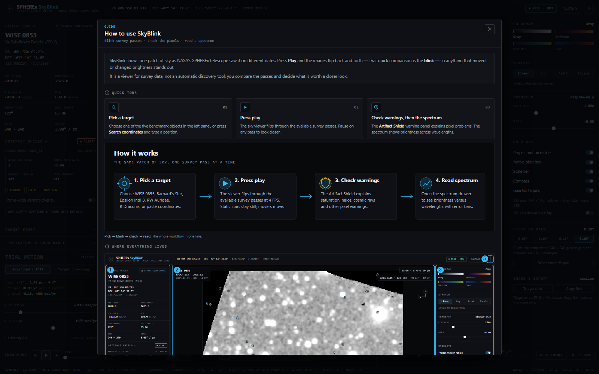 |
| **Real revision-2 UI** — WISE 0855 layout: **Search coordinates** sits in the left target rail; **Triage card** and **Copy link** sit under **Share & export** at the bottom of the right rail; the top right shows the data-source badge, **Curtain**, and **`?` Help**. | **Real revision-2 UI** — F8 Help dialog: a scrollable plain-language guide covering what it is, quick start, coordinate search, left rail, canvas/overlays, bottom deck, right rail, panels/actions, what to look out for, keyboard shortcuts, and data credits. Escape closes it and restores focus. |

The **feature captures** below are also real revision-2 saved data. They are
supplementary views of trial-motion mode, the triage card, LVF hover sync,
sonification, the parallax sandbox, the Barnard's Star parallax inset, and the
historical UI features; the model-comparator capture has since been removed. All feature captures, the
search dialog, and the live quick-look banner were refreshed for the **F8
layout**.

| Real F6 trial-motion sandbox (WISE 0855) | Real F6 dynamic-channel triage card (WISE 0855) |
|---|---|
| 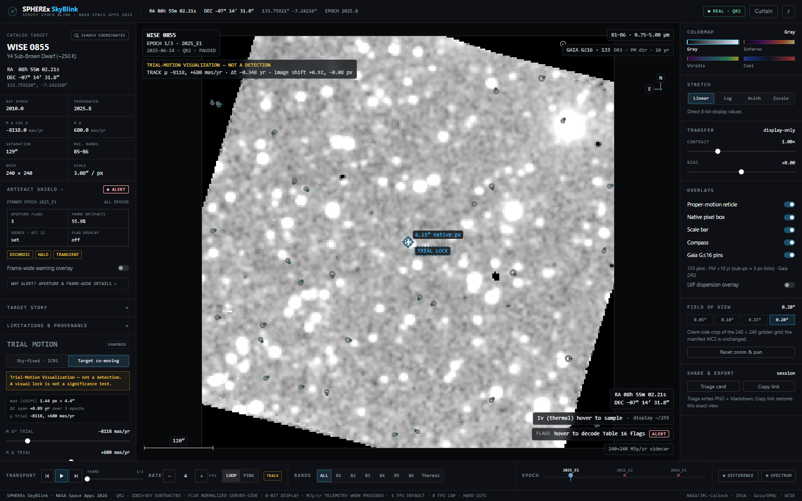 | 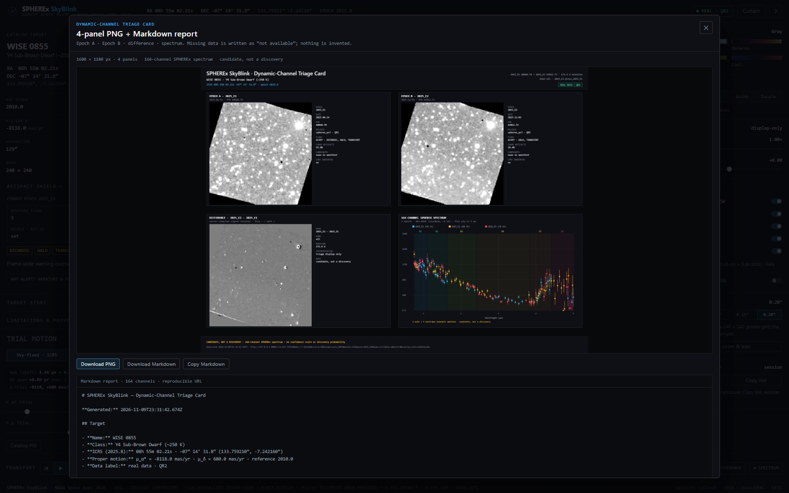 |
| Real QR2 WISE 0855 (`2025_E1`) in target co-moving mode; the trial shift is display-only and the HUD states “TRIAL-MOTION VISUALIZATION — NOT A DETECTION”. | Real 4-panel PNG + Markdown report from the committed WISE 0855 manifest and spectrum; **164 channels**, with “candidate, not a discovery”. |

| Real F6 LVF visualizer + spectrum hover (WISE 0855) | Real F6 sonification (WISE 0855) |
|---|---|
| 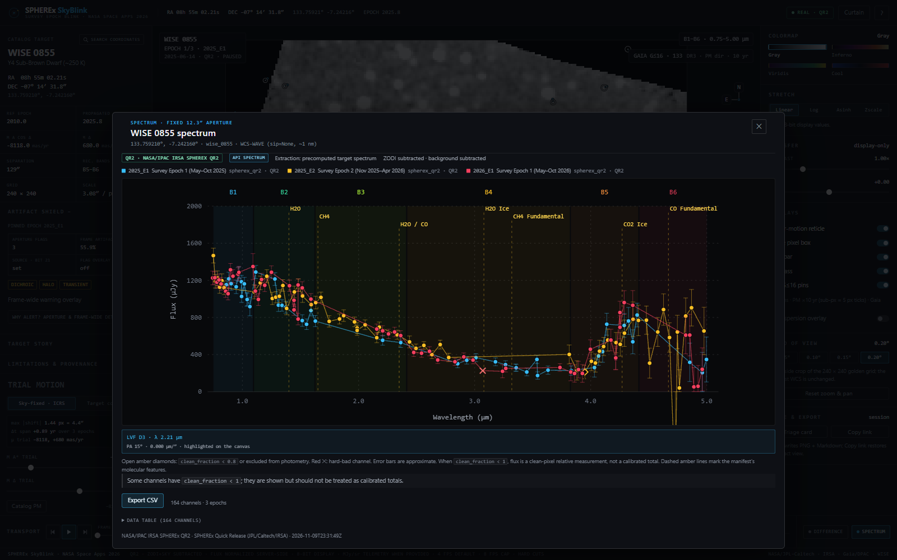 | 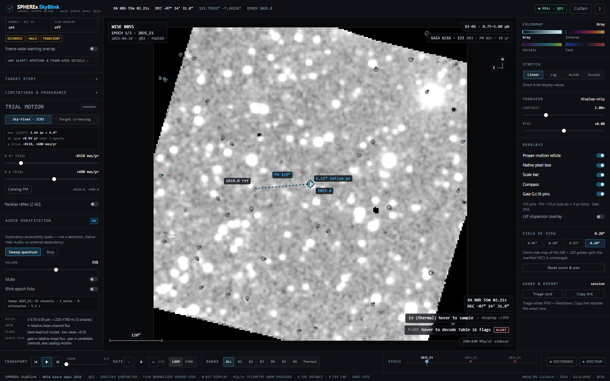 |
| Hovering D3 in the real WISE 0855 spectrum highlights its LVF axis on the canvas; the caption shows λ 2.21 µm and PA 15°. | Explicit **Enable audio** click; the real `2025_E1` sweep reports 45 channels, 1 muted, 0 attenuated, 6.3 s. |

| Real F6 parallax reflex at 400 AU (WISE 0855) | Real F6 Barnard's Star parallax inset |
|---|---|
| 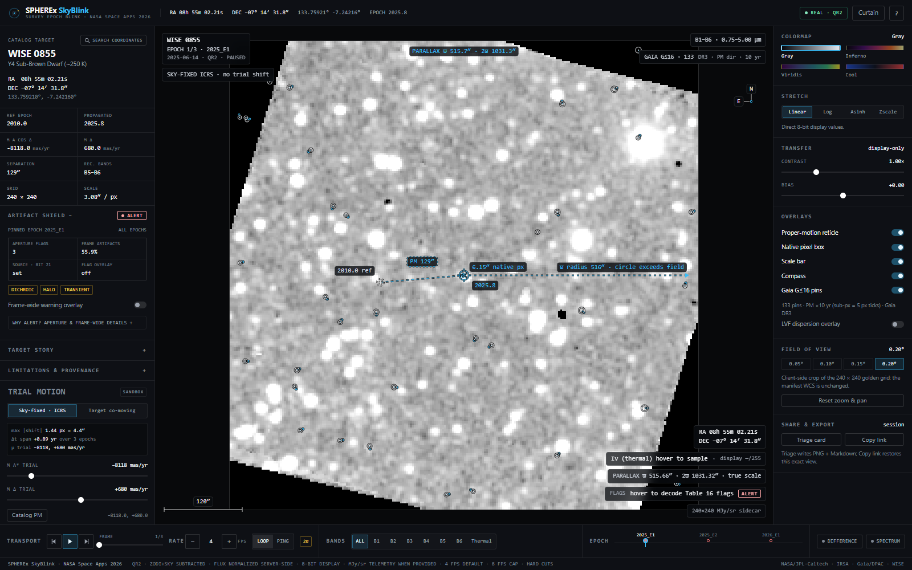 | 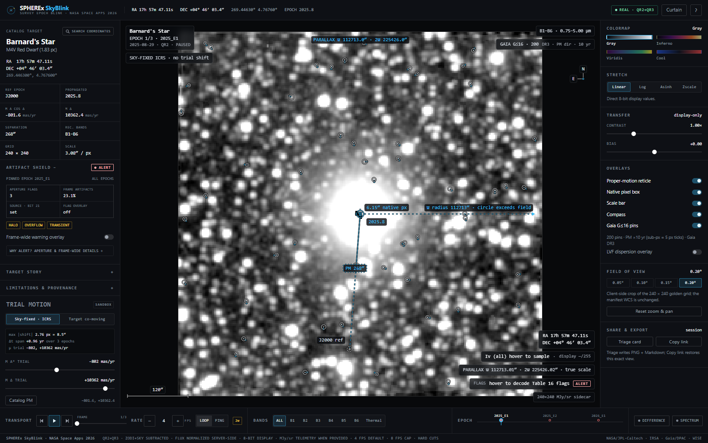 |
| Real QR2 WISE 0855 frames; the 400 AU test distance is a visual scale, not a measurement, and the circle exceeds the 0.205° field in this capture. | Real Barnard's Star QR2+QR3 frames; the parallax-reflex circle is labelled as a scale, not a measurement. The saturated core/halo is the documented limitation. |

The historical model-comparator screenshot was removed in audit Phase 1.

The F7 coordinate-search captures below are also **real revision-2 UI**.

| Real coordinate-search dialog | Real matched-target toast |
|---|---|
| 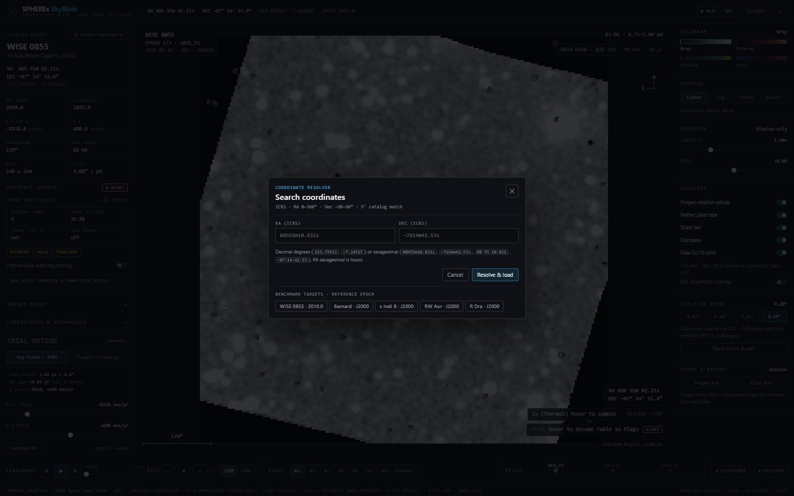 | 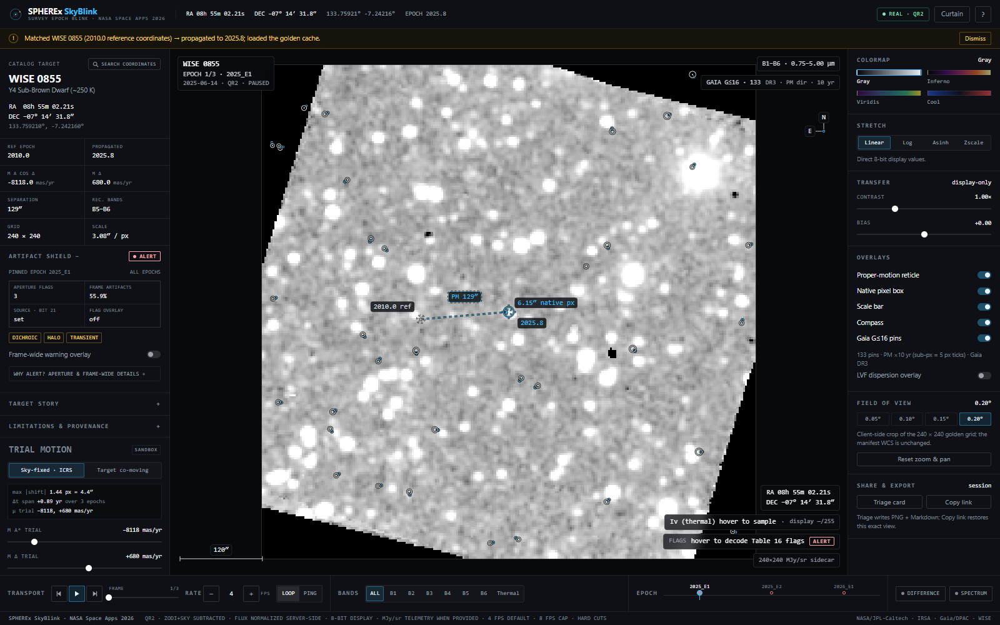 |
| Left target rail **Search coordinates** (F8 layout): decimal degrees or sexagesimal RA/Dec, with a 5′ catalog match against the five targets. | Real WISE 0855 match from the 2010.0 reference position; the toast states the propagation to 2025.8 and that the saved data loaded. |

| Real arbitrary-coordinate live search, with single-epoch coverage labeled |
|---|
| 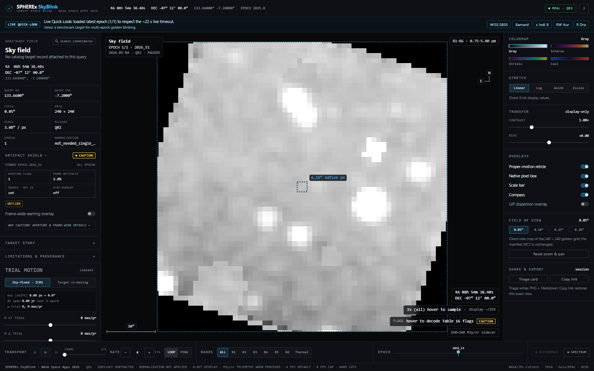 |
| Persistent **LIVE QUICK-LOOK** banner for an arbitrary 1/1 live result, with benchmark links to the multi-epoch saved targets. It is not shown for saved 3–4 epoch results. |

## 5. The five official targets

Coordinates are the propagated **2025.8** query centers (LAW 5); the reference
positions and proper motions are in `backend/core/targets.py`.

| Target | What to look for | Caveat |
|---|---|---|
| **Barnard's Star** | ~10.4″/yr proper motion; a position shift of ~1.7 output px per six-month epoch and a difference dipole. | The stellar core is saturated (`OVERFLOW`) and hard-masked (`SUR_ERROR`); the display shows a saturated halo with a black core hole, and the position is measured from the halo centroid. Only **2** of **215** dense spectrum channels are usable (1/71, 1/72, 0/72). |
| **Epsilon Indi B** | A T1+T6 brown-dwarf pair blended inside one native pixel; composite NIR spectrum. | Ba/Bb are 0.6″ apart — **unresolved** at 3.075″/px. The tool must explain the blend, never claim a resolved pair. **228/246** dense spectrum channels are used. |
| **WISE 0855** | A ~250 K Y4 sub-brown dwarf: a very red, fast-moving source that is faint in the short bands and emerges in B5/B6. | **All three epochs use DR1** (`spherex_dr1`); there is no QR2 in the current cache. **158/164** dense spectrum channels are used (43/46, 59/60, 56/58), but the 12.3″ aperture is contaminated. The field is crowded; band-dependent detection is clearest in difference frames, not single short-band frames. |
| **RW Aurigae** | A young T Tauri disk: epoch-to-epoch brightness/spectral-shape changes and a strong NIR excess. | The bright core is saturated; **102/216** dense spectrum channels are usable (23/72, 41/72, 38/72) and several frames are flagged. Variability is not a calibrated light curve. |
| **R Draconis** | A Mira with P ≈ 245.6 d: large brightness changes plus saturation/artifact flags. | The core is saturated and hard-masked; **0/240** dense spectrum channels are usable. The display shows a halo/hole. `2024_E1` has only B3 and B6 (24 channels). |

### Saved-data epochs

The values below are read from the **revision-3** manifests and spectra at
`golden_cache/{target}/`. `mixed` means the epoch uses DR1 and QR3 for different
bands; the per-epoch `collection`/`release` fields in the API state the exact
truth. **QR2 is not used anywhere in revision 3.**

| Target | Epoch IDs | Release per epoch | Used/total spectrum channels |
|---|---|---|---|
| WISE 0855 | `2025_E1`, `2025_E2`, `2026_E1` | DR1, DR1, DR1 | 43/46, 59/60, 56/58 |
| Barnard's Star | `2025_E1`, `2025_E2`, `2026_E1` | DR1, DR1, mixed DR1+QR3 | 1/71, 1/72, 0/72 |
| Epsilon Indi B | `2024_E1`, `2025_E1`, `2025_E2`, `2026_E1` | DR1, DR1, DR1, mixed DR1+QR3 | 50/55, 64/72, 67/69, 47/50 |
| RW Aurigae | `2025_E1`, `2025_E2`, `2026_E1` | DR1, DR1, QR3 | 23/72, 41/72, 38/72 |
| R Draconis | `2024_E1`, `2025_E1`, `2025_E2`, `2026_E1` | DR1, DR1, DR1, mixed DR1+QR3 | 0/24, 0/72, 0/72, 0/72 |

R Draconis `2024_E1` is missing B1, B2, B4, and B5 (only B3 and B6), so its
spectrum has 24 channels instead of 72. The dense tier is measured: it does not
fabricate visits, and epochs/bands with fewer distinct LVF samples report fewer
channels. Used channels are those with `is_used_in_photometry: true`; missing
channels are omitted, never fabricated. The same epoch set is used for the DR1
refresh, so the epoch IDs did not change; only the release labels and measured
counts did.

`scripts/run_five_target_card.py` is now explicitly a **display smoke test**,
not scientific acceptance. Its default output is
`docs/five-target-display-smoke.json`; the committed
`golden_cache/validation_report.json` remains historical revision-3 evidence.
Raw-unit checks and their failed/open gates are in the Phase 3 report.

## 6. Architecture

```text
IRSA TAP (primary) / SIA2 (fallback)
        │
        ▼
Level 2 MEF cutouts  —  IMAGE / FLAGS / VARIANCE / ZODI / PSF or EPSF / WCS-WAVE
        │                 (accessed by EXTNAME; never hdul[0].data;
        │                  QR3/DR1 use EPSF; QR2 used the PSF cube)
        ▼
ZODI + local background subtraction
only HARD_BAD_MASK → NaN; BIT_SOURCE preserved
        │
        ▼
reproject to 240×240 north-up TAN @ 3.075″/px
inverse-variance coadd per band/epoch
        │
        ▼
shared cross-epoch p99.5 static-source normalization (LAW 8)
        │
        ├──▶ WebP display frames: 6 bands, all, thermal, flag overlay
        ├──▶ adjacent-epoch difference frames (un-normalized coadds)
        ├──▶ per-epoch flag summaries + data-source record + normalization
        ├──▶ gzip pixel data file (telemetry sidecar): float16 MJy/sr + uint32 Table 16 flags
        ├──▶ exact LVF geometry (detector, PA, µm/arcsec) for F6
        └──▶ saved spectrum: golden_cache/{target}/spectrum.json
             (dense 12-visit tier; live extraction path)
        │
        ▼
FastAPI  /api/v1/{health,targets,sky,spectrum,assets}
        │
        ▼
React + TypeScript + Vite  (built into frontend/dist, served at /)
```

Key implementation choices:

- **Archive first:** named targets and arbitrary coordinates query upstream
  under a bounded budget. `/targets?source=archive` supplies corrected catalog
  query positions. Only explicit `source=saved` reads historical revision-3
  products and uses `/targets?source=saved` coordinates. Saved data is never an
  automatic replacement for an archive error.
- **Physical telemetry and LVF:** each saved epoch ships a gzip
  `float16` MJy/sr + `uint32` Table 16 sidecar and, where available, exact LVF
  geometry. The frontend decodes both locally; no server round-trip per cursor
  move, and no invented substitute when a field is absent.
- **Real reference layers:** SkyView DSS2 Red / AllWISE cutouts and IRSA Gaia
  DR3 pins are generated once by `scripts/build_reference_overlays.py` and
  validated by hash; they are display-only and never feed photometry.
- **HALO display-only mode:** when the O1 §9 gate triggers, displayed frames use
  `HARD_BAD_MASK & ~(1 << 28)` so HALO pixels are visible; HALO remains in
  `PHOTOMETRY_EXCLUDE_MASK` and `is_flagged_bad`, so photometry stays
  conservative. All five target manifests record `halo_display_mode: true`.
- **24-hour live cache:** downloaded cutouts and successful live results are
  cached under `CACHE_DIR` and reused until `CACHE_TTL_SECONDS` (default 86400 s,
  24 h) expires. Saved assets are static and served directly.
- **Build hygiene:** the root `.dockerignore` excludes local caches, FITS files,
  tests, docs, and `node_modules` from the image build context.
- **One origin in production:** `scripts/serve.py` mounts `frontend/dist` at
  `/` after the API routers. No CORS, no separate web server, one port.

### API summary

| Endpoint | Purpose |
|---|---|
| `GET /api/v1/health` | Status, contract version, IRSA reachability, cache entries |
| `GET /api/v1/targets` | Five target records, reference/2025.8 coordinates, stories |
| `GET /api/v1/sky?ra=…&dec=…&size=0.2&target_id=…` | Multi-epoch frames, differences, flags, data-source record |
| `GET /api/v1/spectrum?ra=…&dec=…&target_id=…&epoch_id=…` | Per-epoch spectral channels with flags/clean fractions |
| `GET /api/v1/assets/{target_id}/{filename}` | Saved WebP/JSON assets or live cache assets |

Each saved `/sky` epoch also carries the additive 1.1.0 `telemetry` object
(240×240 `float16` MJy/sr + `uint32` Table 16 flags, gzip) and `lvf_geometry`
(6 detector entries, or 2 for R Draconis `2024_E1`). `/spectrum` channels carry
`clean_fraction`, `is_used_in_photometry`, and the fixed 12.3″ aperture; catalog
spectra are served from the dense saved `spectrum.json`. The 1.1.0 additions
retain their types in contract **1.6.0**, which adds optional lineage, observation ranges, measurement reasons and telemetry quantity metadata. Photometry additionally requires supported background subtraction.

**Release labels:** the current revision-3 cache returns `DR1`, `QR3`, or
`mixed`/`DR1+QR3`. Contract 1.2.0 accepts those values plus the historical
`QR2`/`QR2+QR3` used only by revision 2. A `/dr1/` URI must never be returned
as `release="unknown"`.

`/sky` query parameters:

- `ra`, `dec` (required): ICRS decimal degrees.
- `size` (default `0.2`): clamped to `0.05`–`0.2` degrees. For catalog targets
  this is a client-side crop of the full 240×240 (0.205°) saved grid.
- `target_id`: one of the five IDs; requires `ra`/`dec` within `1.0″` of the
  target's 2025.8 coordinate, otherwise 422.
- `epochs` (default `all`): comma-separated epoch IDs. Filters the returned
  epochs and differences only; IDs, adjacent pairs, and normalization are
  computed on the full available set.
- `bands` (default `all`): comma-separated `1`–`6`, or `all`. Filters only the
  six band keys; `all`, `thermal`, and `flag_overlay` are always returned when
  available.
- `include_diff` (default `true`): include difference frames.

`/spectrum` query parameters:

- `ra`, `dec`: required.
- `target_id`: optional; same `1.0″` rule as `/sky`.
- `epoch_id`: optional; must be a full-set epoch ID, otherwise 422. Filters the
  returned `epochs[]` only. The aperture is fixed at 12.3″; there is no
  `aperture_arcsec` parameter in the MVP.

Catalog targets are saved-data first: their `/sky` and `/spectrum` responses come
from the committed cache and do not depend on IRSA. Arbitrary positions use the
bounded live path: `LIVE_SKY_MAX_EPOCHS=3` candidate epochs (minimum two),
up to three visits per band, TAP primary with complete SIA fallback, a
**60 s** TAP read timeout inside a **120 s** backend sky deadline, and a **130 s**
frontend request timeout (cutout requests: **20 s**). Live results may return
`503 UPSTREAM_UNAVAILABLE` on an IRSA timeout or `404 NO_DATA` when the position
is uncovered. Normal operation never falls back to a development fixture.
Contract details are frozen in `AGENTS.md` §3 and
`docs/decisions/o1-contract-decisions.md`, [the 1.3.0 semantic decision](docs/decisions/phase3-contract-decision.md),
and [the 1.4.0 provenance/time decision](docs/decisions/phase4-contract-decision.md).

## 7. Data products and caches

### Saved target data (committed)

`golden_cache/` is the offline product. It contains real IRSA data for the five
catalog targets and is committed to the repository; it is **not** a runtime
cache and the app does not modify it. **Current revision: 3 (DR1+QR3), built
2026-11-13.** It contains **no QR2 data**. Revision 2 (QR2+QR3) remains the
documented rollback. The directory layout is unchanged.

```text
golden_cache/
├── validation_report.json          # revision 3, five-target card, W0 findings
├── wise_0855/
│   ├── manifest.json               # /sky payload + source record + normalization
│   ├── spectrum.json               # dense 12-visit spectrum + 1.1.0 fields
│   ├── 2025_E1_D1.webp … D6.webp   # per-band normalized display frames
│   ├── 2025_E1_ALL.webp            # all-band coadd
│   ├── 2025_E1_B56.webp            # thermal coadd (B5+B6)
│   ├── 2025_E1_FLAGS.webp          # union warning overlay
│   ├── diff_2025_E2_minus_2025_E1_*.webp
│   ├── telemetry_2025_E1.bin.gz    # float16 MJy/sr + uint32 Table 16 flags
│   ├── ref_optical.webp            # SkyView DSS2 Red, 240×240
│   ├── ref_wise.webp               # SkyView WISE 3.4 µm, 240×240
│   ├── ref_wise_w2.webp            # WISE 0855 only: WISE 4.6 µm
│   ├── ref_attribution.json        # structured credit bundle
│   └── gaia_dr3.json               # Gaia DR3 G≤16 pins (200 cap)
├── barnards_star/                  # same layout
├── eps_indi_b/
├── rw_aurigae/
├── r_draconis/
└── w0_metrics.json, w0_overlay_metrics.json
```

- **Current saved cache:** **9,259,188 bytes across 292 files**, after removing synthetic fallback products. The five real target directories are unchanged; no raw FITS files are committed.
- **17 pixel data files (telemetry sidecars)** across the five targets,
  **1,730,788 bytes total**.
  Individual gzip sizes are **82.6–111.4 KiB**: WISE 0855 100.0–102.3 KiB
  (`thermal`), Barnard's Star 107.7–111.4 KiB, Epsilon Indi B 89.1–93.6 KiB,
  RW Aurigae 106.4–109.3 KiB, R Draconis 82.6–95.2 KiB. Every sidecar
  decompresses to exactly **345,600 bytes**: 240×240 `float16` (115,200 bytes)
  followed by 240×240 `uint32` (230,400 bytes).
- **Epochs:** WISE 0855 3, Barnard's Star 3, Epsilon Indi B 4, RW Aurigae 3,
  R Draconis 4. Each manifest records `collection`/`release` per epoch,
  `flux_normalization`, `flag_summary`, `halo_display_mode`, and the telemetry
  and LVF objects. WISE 0855 is DR1 for all three epochs; Barnard's Star,
  Epsilon Indi B, and R Draconis use DR1 plus a DR1+QR3 mixed 2026 epoch;
  RW Aurigae uses DR1 for the first two epochs and QR3 for 2026.
- **Reference assets:** 11 real 240×240 WebP overlays (DSS2 Red ×5, WISE
  3.4 µm ×5, WISE 4.6 µm ×1), five `gaia_dr3.json` files (74–200 pins each),
  and five `ref_attribution.json` bundles. All are
  `is_simulated_fallback: false`; they are real survey/catalog data used only
  for display.

`manifest.json` is the source of truth for `/sky`; `spectrum.json` for
`/spectrum`. The saved-manifest loader checks the recorded SHA-256 values when
it loads a manifest, and the offline verifier re-hashes every referenced asset.

### Live cache (runtime, not committed)

Downloaded cutouts and successful arbitrary-coordinate responses are stored
under `CACHE_DIR`:

| Path | Purpose |
|---|---|
| `backend/.cache/cutouts/` | IRSA cutout FITS files, keyed by artifact and cutout size |
| `backend/.cache/live/` | Generated live WebP/JSON assets, keyed by the canonical query hash |

The default TTL is 24 hours (`CACHE_TTL_SECONDS=86400`). In the container,
`CACHE_DIR=/data/cache` and the Compose volume `skyblink-cache` persists it
across restarts. Deleting this directory or volume is safe: it only forces live
queries to be fetched again. Catalog targets never depend on it.

### Product data policy

Only the five approved real target datasets are packaged. Synthetic fixtures,
their generator, and mock modes were removed in audit Phase 1. See the
[real-data policy](docs/guides/real-data-policy.md).

### What is committed vs runtime

| Path | Committed | Notes |
|---|---|---|
| `golden_cache/<target>/` | yes | Real data; static; served read-only |
| `frontend/dist/` | no | Vite build output; rebuild with `npm run build` |
| `backend/.cache/` | no | Local inputs, products and replay lineage; preserve or back up before cleanup |
| `/data/cache` in the container | no | Named volume `skyblink-cache` |
| `.env`, `.env.local` | no | Environment only; never commit secrets |

## 8. Setup and running

### 8.1 Prerequisites

- **Python 3.11** (tested with 3.11.9) and `pip`.
- **Node.js 20+** (tested with Node 24.13.0, npm 11.6.2) for the frontend build.
- **Docker Engine + Compose v2** optional, for the one-container path (tested
  with Docker Engine 29.1.3 and Compose 2.40.3 inside WSL2 Ubuntu 26.04).
- **Network access** only for arbitrary-coordinate live queries. The five
  catalog targets work offline.
- About **2 GB RAM** for the container and **2 GB disk** for the image; the
  committed saved target data is about 13 MB.

### 8.2 Clone and repository layout

```bash
git clone https://github.com/tureisD/SkyBlink-NASA.git spherex-skyblink
cd spherex-skyblink
```

This public repository contains a fresh snapshot without the previous development history.
The layout is summarized in
[Repository map](#16-repository-map). The runtime pieces are:

```text
backend/        FastAPI app, core policy, services, Pydantic contract, tests
frontend/       React/TypeScript/Vite UI and historical Playwright QA
golden_cache/   real committed data products for the five targets
scripts/        saved-data builder, overlay builder, card, serve.py
Dockerfile      multi-stage frontend build + Python 3.11 runtime
docker-compose.yml
```

**Windows and WSL notes**

- If you use the multi-worktree developer layout, the shared Python 3.11 venv
  lives at `../.venv311` relative to a worktree; run it explicitly as
  `../.venv311/Scripts/python.exe`. From a normal clone, create `.venv311` in
  the repository root.
- The Windows Store `python` alias may be Python 3.14 without Astropy. Use the
  venv interpreter, not the bare `python` alias.
- Docker Desktop's service may require administrator rights. The WSL2 Docker
  Engine is the supported fallback; keep the WSL distro alive while a container
  runs (see [Docker](#87-docker)).
- Git may check out JSON with CRLF on Windows. Reference-asset SHA-256 checks
  are line-ending stable and the test suite covers this; do not hand-edit hashed
  assets. If you do, re-run the saved-data verification.

### 8.3 Python environment

```powershell
python -m venv .venv311
.venv311\Scripts\activate
python -m pip install --upgrade pip
pip install -r backend/requirements.txt
```

```bash
# macOS / Linux
python3.11 -m venv .venv311
. .venv311/bin/activate
python -m pip install --upgrade pip
pip install -r backend/requirements.txt
```

The backend requirements include FastAPI, Uvicorn, Pydantic, NumPy, SciPy,
Astropy, `reproject`, `photutils`, `sep`, Pillow, `diskcache`, HTTPX, PyVO,
`python-dotenv`, pytest, and pytest-asyncio. See
[`backend/requirements.txt`](backend/requirements.txt).

### 8.4 Node and frontend

```bash
cd frontend
npm ci
npm run typecheck
npm run build
```

`npm run build` runs `tsc --noEmit` and Vite, writing `frontend/dist/`. The
Dockerfile uses the same locked install and build.

### 8.5 Local development (hot reload)

```bash
# terminal 1 — API
python scripts/dev_api.py        # run from the repository root

# terminal 2 — UI
cd frontend
npm run dev
```

Open **<http://localhost:5173>**. Vite proxies `/api` to
`http://127.0.0.1:8000` (see `frontend/vite.config.ts`), so the browser uses one
origin. The backend also allows the local Vite origins through `CORS_ORIGINS`.

The development launcher watches only backend source directories, excluding the
large FITS/live/research cache. It accepts `--host` and `--port` (defaults
`127.0.0.1:8000`). After changing processing code, check the startup log for the
loaded image method and worker PID; a matching API schema version alone does not
prove that an existing process loaded the latest implementation. Restart an old
server explicitly before launching a replacement on the same port.

For a hidden/background Windows process, use `python scripts/dev_api.py --no-reload`
and restart it explicitly after source changes. In this environment, the Windows
reload supervisor detected a change but its child did not receive the expected
shutdown event; narrowing watch directories alone did not resolve that behavior.

### 8.6 Production-style server (one origin)

```bash
python scripts/serve.py             # http://localhost:8000
```

`scripts/serve.py` imports the FastAPI app, mounts `frontend/dist` at `/` after
the API routers, and runs Uvicorn with proxy headers. If the frontend build is
missing it prints `frontend build not found ...; serving API only` and keeps the
API available.

Environment variables read by the wrapper: `SPHEREX_FRONTEND_DIST` (default
`frontend/dist`), `PORT` (default `8000`), `HOST` (default `0.0.0.0`), and
`LOG_LEVEL`.

### 8.7 Docker

Build and run from the repository root:

```bash
docker build -t skyblink:final .
docker run --rm -p 8000:8000 --memory=2g \
  -v skyblink-cache:/data/cache skyblink:final
```

Or use Compose:

```bash
docker compose up --build
```

The image:

- is a multi-stage build: `node:24-alpine` runs `npm ci && npm run build`, then
  `python:3.11-slim` runs the API;
- serves `/api/v1/*` and the built frontend from **one container and one
  origin**, on port **8000**;
- has a `HEALTHCHECK` against `/api/v1/health` every 30 s, with a 30 s start
  period and three retries;
- persists live cutouts/results in the **`/data/cache`** volume;
- uses the Compose image tag `skyblink:local`; the current container has not
  been executed in the local validation environment;
- has an explicit **2 GB** Compose memory limit. Historical API 1.2 measurements
  (844 MB image, 195 MB compressed, 105.7 MiB idle) do not certify this build.

Check the container:

```bash
docker ps
docker inspect --format '{{.State.Health.Status}}' <container>
curl -fsS http://localhost:8000/api/v1/health
```

**WSL2 Docker Engine (Windows fallback).** If Docker Desktop's service cannot
start without administrator rights, run the engine inside WSL:

```powershell
wsl -d Ubuntu -u root -- docker build -t skyblink:final .
wsl -d Ubuntu -u root -- docker run --rm -p 8000:8000 --memory=2g `
  -v skyblink-cache:/data/cache skyblink:final
```

The WSL engine uses the legacy builder by default; install `docker-buildx`
inside WSL if you need BuildKit. Keep the distro running while the container is
needed: shutting down WSL stops the engine and any running containers.

**Build from a clean clone** or move a populated `backend/.cache` and
`frontend/node_modules` out of the build context first. They are gitignored and
never needed at runtime (the saved target data is committed). The root
`.dockerignore` already excludes local caches, FITS products, tests,
most documentation, and `node_modules`; it includes `scripts/serve.py`,
`verify_real_data.py` and the approved runtime inventory.

**Retained evidence:** `backend/.cache` and the `/data/cache` volume include
input bytes, generated products and immutable analysis records needed for replay.
Back them up before any deliberate cleanup. Removing them loses that local
lineage; it is not a harmless freshness reset. Archive mode already acquires
fresh inputs. The committed saved target data is separate and unchanged.

### 8.8 Tests and QA

```bash
# Python: astrometry, bitmasks, API contract, spectra, 1.1.0/1.2.0,
#         telemetry, reference overlays, live budget, clean-error behavior,
#         five-target card
pytest backend/tests -q                      # current results: docs/verification/phase3-verification.md

# Frontend typecheck and production build
cd frontend && npm run typecheck && npm run build

# Saved-data verification: frames, spectra, overlays, pixel data files
python scripts/build_golden_cache.py --target all --verify-only --require-telemetry

# Display smoke only -> docs/five-target-display-smoke.json
python scripts/run_five_target_card.py
```

The saved-data verification is offline (`--verify-only`) and decodes every pixel
data file. `--require-telemetry` fails if any epoch lacks a valid data file. The
five-target card writes a separate display-smoke report and does not rewrite
the historical golden validation report by default. For raw science checks,
run `python scripts/phase3_science_validation.py`; subsequent
`--analyze-only` runs use the ignored local FITS cache without archive traffic.

**Real-only frontend verification:** run `npm run test:real-data` and `npm run build` in `frontend/`. The retired F5/F6 fixture-based QA harnesses were removed; use saved real catalog data for browser QA.

### 8.9 Environment variables

Frontend variables are **build-time** Vite variables. Copy
[`frontend/.env.example`](frontend/.env.example) to `.env.local` to override
them; rebuild after changing them.

| Variable | Default | Meaning |
|---|---|---|
| `VITE_API_BASE` | `/api/v1` | API prefix. Use an absolute URL only when the frontend is hosted separately. |

Backend runtime variables are read from the **process environment** by
`backend/core/config.py`; this build does not auto-load a `.env` file. Export
them in your shell or pass them through Docker/Compose. The root
[`.env.example`](.env.example) is the reference file; `backend/core/config.py`
is authoritative when they differ.

| Variable | Default | Meaning |
|---|---|---|
| `CACHE_DIR` | `backend/.cache` | Live/cutout cache. The image uses `/data/cache`. |
| `GOLDEN_CACHE_DIR` | `golden_cache/` | Approved real target data only. The image uses `/app/golden_cache`. |
| `SPHEREX_FRONTEND_DIST` | `frontend/dist` | Built frontend mounted by `serve.py`. |
| `PORT` / `HOST` | `8000` / `0.0.0.0` | Bind address for `serve.py` / Uvicorn. |
| `LOG_LEVEL` | `INFO` | Log level. |
| `CORS_ORIGINS` | four local dev origins | Comma-separated allowed origins for development. |
| `IRSA_TAP` | `https://irsa.ipac.caltech.edu/TAP` | TAP endpoint override. |
| `IRSA_SIA2` | `https://irsa.ipac.caltech.edu/SIA` | SIA2 fallback endpoint override. |
| `IRSA_CUTOUT_BASE` | `https://irsa.ipac.caltech.edu/` | Base used to resolve relative artifact URIs. |
| `MAX_WORKERS` | `8` | Parallel cutout workers. |
| `MAX_VISITS_PER_BAND` | `3` | Catalog cutout visits per band. |
| `CACHE_TTL_SECONDS` | `86400` | Live/cutout cache lifetime (24 h). |
| `SPECTRUM_MAX_VISITS_PER_BAND` | `12` | Saved/offline spectrum visits per band/epoch (dense tier). |
| `SPECTRUM_LIVE_MAX_VISITS_PER_BAND` | `1` | Arbitrary/live spectrum visits per band. |
| `SPECTRUM_LIVE_TIMEOUT_SECONDS` | `90.0` | Arbitrary spectrum time budget (may still return a TAP-timeout 503 earlier). |
| `LIVE_SKY_DEADLINE_SECONDS` | `120.0` | Shared arbitrary-sky network and processing deadline. CPU checks occur between stages. |
| `LIVE_SKY_MAX_EPOCHS` | `3` | Latest candidate epochs searched for a compatible pair; values below two are normalized to two. |
| `LIVE_REQUEST_TIMEOUT_SECONDS` | `20.0` | Per-request live cutout timeout. |
| `LIVE_TAP_TIMEOUT_SECONDS` | `60.0` | Live TAP read timeout (random field TAP needs ~35–60 s). |
| `LIVE_CONNECT_TIMEOUT_SECONDS` | `10.0` | Live connect timeout. |
| `LIVE_RETRIES` | `3` | Live retry count within the shared request deadline. |
| `LIVE_RETRY_BACKOFF_SECONDS` | `0.25` | Live retry backoff. |
| `REQUEST_TIMEOUT_SECONDS` | `60.0` | Catalog cutout request timeout. |
| `TAP_TIMEOUT_SECONDS` | `120.0` | Catalog TAP timeout. |
| `IRSA_RETRIES` | `4` | Catalog IRSA retry count. |
| `IRSA_RETRY_BACKOFF_SECONDS` | `1.5` | Catalog retry backoff. |

`API_CONTRACT_VERSION` is code-owned (`backend/models/version.py`, currently
`1.4.0`) and is not an environment override.

### 8.10 Troubleshooting

| Symptom | Likely cause | What to do |
|---|---|---|
| `503 UPSTREAM_UNAVAILABLE` on arbitrary `/sky` after up to ~2 min, or on `/spectrum` after up to ~90 s | IRSA timeout/outage or no responsive TAP | Retry later; the catalog targets are unaffected. Check `irsa_reachable` in `/health`. Cached cutouts make warm queries fast (often 0.02–0.7 s; the verified warm repeat was 0.014 s). |
| `404 NO_DATA` | No SPHEREx coverage at that position, or the target was not matched | Verify the coordinates; `target_id` requires `ra`/`dec` within 1.0″ of the target's 2025.8 position. Try a catalog target first. |
| `422` with `target_id` | Request coordinates are not the target's 2025.8 coordinates | Use `ra_epoch2025`/`dec_epoch2025` from `/api/v1/targets` (or the UI's Copy link). |
| Cold arbitrary query takes up to ~2 min | Bounded latest-three-epoch compatibility search; upstream latency and up to 54 cutouts can exhaust the shared deadline | The historical one-epoch profile returned a field in **39.6 s**; that timing does not validate the current pair-selection profile. The budget allows 120 s backend / 130 s frontend. The five catalog targets are saved-data first and return in milliseconds. |
| A live request fails and the UI shows a retry message | IRSA timeout/outage, or no coverage | This is the intended clean-error path: no fixture request and no automatic fallback text. Retry or pick a benchmark target. |
| Container starts but is briefly `starting`/unhealthy | Health start period and the IRSA probe | Wait up to 30–60 s; check `docker logs`. `/health` returns 200 with `irsa_reachable:false` when IRSA is unreachable but the app is alive. |
| Port 8000 already in use | Another server or the local showcase | `PORT=8010 python scripts/serve.py`, or `docker run -p 8010:8000 …`. |
| `python` cannot import Astropy | Windows Store Python 3.14 on `PATH` | Use the venv: `../.venv311/Scripts/python.exe` or `.venv311\Scripts\python.exe`. |
| Docker Desktop service cannot start | Requires administrator rights | Use the WSL2 Docker Engine; keep the distro alive while the container runs. |
| `serve.py` prints `frontend build not found` | `frontend/dist` is missing | `cd frontend && npm run build`. |
| Telemetry loupe says unavailable | Browser lacks `DecompressionStream`, or the response has no sidecar | Use a modern Chrome/Edge/Safari/Firefox; the UI intentionally does not invent values. |
| A proxy/CDN applies `Content-Encoding: gzip` to the `.gz` sidecar | The browser may transparently decompress it before `arrayBuffer()`, so a naive second gunzip would fail | Handled: the telemetry loader checks gzip magic `0x1f8b`; if the magic is absent and the payload is exactly **345,600 bytes**, it accepts the already-decoded `float16` + `uint32` planes. Anything else is rejected. |
| Hash mismatch after checkout or edit | Hand-edited hashed asset or a line-ending rewrite | Re-run `python scripts/build_golden_cache.py --target all --verify-only`; do not edit hashed assets by hand. The tests cover CRLF-stable JSON hashes. |
| Unexpected result identity | Source mode, upstream availability or an older running process | Check source mode, observation dates, analysis ID and loaded processing version. Preserve retained inputs/records; archive requests already acquire fresh inputs. |
| Saved data looks stale | The saved target data is static by design | Rebuild with the saved-data script; the app never interpolates new epochs silently. |

### 8.11 Deployment requirements

The full hosting checklist — host requirements, build/publish steps,
post-deploy smoke test, and rollback — is in
[`docs/guides/deployment.md`](docs/guides/deployment.md). The summary below is the minimum a
newcomer needs to know.

- **One container, one origin, port 8000.** The image serves both the API and
  the built frontend; no separate web server is required.
- **2 GB memory limit.** Measured idle is **105.7 MiB**; leave headroom for
  live cutout processing. Do not run the container below the 2 GB envelope
  without testing.
- **Persistent `/data/cache`.** Mount a volume so live cutouts/results survive
  restarts. The committed saved target data lives inside the image at
  `/app/golden_cache` and does not need a volume.
- **Health check.** Point the platform at `GET /api/v1/health`; a 200 with
  `"status":"ok"` means the app is alive. `irsa_reachable` is informational.
  Allow a 30–60 s start period.
- **TLS and reverse proxy.** Terminate TLS at the platform or reverse proxy.
  `serve.py` enables `proxy_headers=True` and honors `X-Forwarded-*` from the
  proxy. Set `PORT`/`HOST` only if the platform requires it.
- **No login, no API key, no database.** The public deployment must be usable
  in incognito with no credentials, as required by the challenge.
- **Egress.** Only arbitrary-coordinate live queries need outbound HTTPS to
  `irsa.ipac.caltech.edu`. Catalog targets do not.
- **Public URL.** **Not assigned yet.** Use
  `https://<deployment-host>/` as the placeholder until a real URL exists; do
  not publish or cite one before it is verified.

## 9. API examples

All endpoints are under `/api/v1`; JSON is UTF-8. The examples below use a local
server at `http://localhost:8000`. `python -m json.tool` is optional; it only
pretty-prints. The full schema is in [`backend/openapi.json`](backend/openapi.json),
`AGENTS.md` §3, and [`docs/decisions/o1-contract-decisions.md`](docs/decisions/o1-contract-decisions.md).

### Health

```bash
curl -s http://localhost:8000/api/v1/health
```

```json
{"status":"ok","version":"1.4.0","irsa_reachable":true,"cache_entries":0}
```

`cache_entries` is the number of live cache entries and grows with arbitrary
queries.

### Targets

```bash
curl -s http://localhost:8000/api/v1/targets | python -m json.tool
```

Returns five records. Each has `id`, `name`, `category`, `ra_ref`, `dec_ref`,
`ref_epoch`, `ra_epoch2025`, `dec_epoch2025`, `pm_ra_mas_yr`,
`pm_dec_mas_yr`, `recommended_bands`, `story_headline`, and `story_body`.
`pm_ra_mas_yr` is `μ_α cos δ`.

### Sky (catalog target)

```bash
curl -s "http://localhost:8000/api/v1/sky?ra=133.75921&dec=-7.24216&target_id=wise_0855&size=0.2" \
  | python -m json.tool
```

Key facts for this request (excerpt, not the full payload):

```json
{
  "query": {"ra": 133.75921, "dec": -7.24216, "size_deg": 0.2, "target_id": "wise_0855"},
  "epochs": [
    {
      "epoch_id": "2025_E1",
      "collection": "spherex_dr1",
      "release": "DR1",
      "frames": {
        "1": "/api/v1/assets/wise_0855/2025_E1_D1.webp",
        "6": "/api/v1/assets/wise_0855/2025_E1_D6.webp",
        "all": "/api/v1/assets/wise_0855/2025_E1_ALL.webp",
        "thermal": "/api/v1/assets/wise_0855/2025_E1_B56.webp",
        "flag_overlay": "/api/v1/assets/wise_0855/2025_E1_FLAGS.webp"
      },
      "telemetry": {
        "url": "/api/v1/assets/wise_0855/telemetry_2025_E1.bin.gz",
        "format": "float16_uint32_le_gzip",
        "width": 240,
        "height": 240,
        "byte_size": 102394,
        "flux_band": "thermal"
      }
    }
  ],
  "differences": {"2025_E2_minus_2025_E1": {"1": "…", "6": "…", "all": "…", "thermal": "…"}},
  "provenance": {
    "source": "NASA/IPAC IRSA SPHEREx DR1",
    "collection": "spherex_dr1",
    "release": "DR1",
    "zodi_subtracted": true,
    "background_subtracted": true,
    "is_simulated_fallback": false
  }
}
```

The API field `provenance` records where the data came from: the release and
collection, whether the zodiacal light and background were subtracted, and
the real-data provenance marker (`is_simulated_fallback: false`); simulated or unmarked observation payloads are rejected.

WISE 0855 returns **3 epochs** (all DR1), 9 frame keys per complete epoch, two
adjacent difference pairs, and `flag_summary.status="ALERT"` because the target
aperture includes `TRANSIENT` (an ALERT-level warning) alongside `DICHROIC` and
display-only `HALO`. That is an artifact warning, not a failure.

### Spectrum

```bash
curl -s "http://localhost:8000/api/v1/spectrum?ra=133.75921&dec=-7.24216&target_id=wise_0855&epoch_id=2025_E1" \
  | python -m json.tool
```

Key facts (excerpt):

```json
{
  "target_id": "wise_0855",
  "aperture_radius_arcsec": 12.3,
  "wavelength_calibration": "WCS-WAVE (sip=None; approximate visualization lookup, not CWAVE/CBAND science calibration)",
  "confidence": "high",
  "epochs": [
    {
      "epoch_id": "2025_E1",
      "collection": "spherex_dr1",
      "release": "DR1",
      "channels": [
        {
          "detector": 1,
          "wavelength_um": 0.861253,
          "flux_ujy": 1153.4,
          "flux_err_ujy": 74.3,
          "flags": 2097152,
          "is_flagged_bad": false,
          "clean_fraction": 1.0,
          "is_used_in_photometry": true,
          "photometry_method": "aperture_12.3",
          "aperture_mode": "standard_12.3",
          "aperture_radius_arcsec": 12.3
        }
      ]
    }
  ],
  "provenance": {"zodi_subtracted": true, "is_simulated_fallback": false}
}
```

This epoch has **46 channels**; across all three epochs the committed count is
**164 channels** (**158 used**). `confidence="high"` describes extraction
quality, not a discovery probability.

### Arbitrary coordinates

```bash
curl -s "http://localhost:8000/api/v1/sky?ra=210.0&dec=54.0&size=0.1" \
  | python -m json.tool
```

Arbitrary positions omit `target_id`. The live path searches the latest three
candidate epochs, sampling up to three temporal visits per band (up to 54
cutouts). It selects the most recent compatible pair using measured spectral
WCS first at nine screening positions and then at every retained output pixel;
wavelengths must agree within one quarter of the narrower local bandwidth and
the bandwidth ratio must be at least 0.8. Both outputs use the same bands,
with one exposure per band/epoch and at most a 30-day within-epoch composite
span. Actual contributing times are recorded. This is a conservative
visual-comparison gate, not calibrated spectral resampling or a variability
claim. Live science/display products are cropped to the validated field.
Upstream cutouts are padded by the field diagonal plus two native pixels so a
rotated detector grid can cover the requested north-up field. The user's FOV
and output coordinates are unchanged.
Only genuinely single-epoch archive coverage returns one epoch. Incompatible
multi-epoch samples return `404 NO_DATA` with reason `NO_COMPARABLE_EPOCHS`;
if missing candidate downloads prevent verifying a pair, the response is
`503 UPSTREAM_UNAVAILABLE`. A fully verified pair may still be returned when
an unused candidate fails to download. Spectra remain sparse when some
channels are unavailable; provenance describes the contributing measurements.

The historical one-epoch profile returned Field B in **39.6 s** cold and
**0.014 s** warm; those measurements do not validate this new profile. Current
evidence, limits, and remaining acceptance work are recorded in
[Phase 2 verification](docs/verification/phase2-verification.md). Use the catalog targets for
the deterministic offline demo.

### Telemetry asset

```bash
curl -s -o telemetry_2025_E1.bin.gz \
  -w "%{http_code} %{content_type} %{size_download}\n" \
  "http://localhost:8000/api/v1/assets/wise_0855/telemetry_2025_E1.bin.gz"
```

Expected: `200 application/gzip 102394` (the WISE 0855 `2025_E1` sidecar; WISE
0855 epochs are 100.0–102.3 KiB and all revision-3 sidecars are 82.6–111.4 KiB).
The response carries `Cache-Control: public, max-age=3600`. Decode it with any
gzip reader:

```python
import gzip
import numpy as np

raw = gzip.decompress(open("telemetry_2025_E1.bin.gz", "rb").read())
flux = np.frombuffer(raw[: 240 * 240 * 2], dtype="<f2").reshape(240, 240)   # MJy/sr
flags = np.frombuffer(raw[240 * 240 * 2 :], dtype="<u4").reshape(240, 240)  # Table 16
```

The first plane is physical surface brightness in MJy/sr; the second is the
Table 16 flag plane (`BIT_SOURCE` preserved). The sidecar is display/telemetry
data; the 8-bit WebP remains the rendered display frame.

### Error envelope

```json
{
  "error": {
    "code": "NO_DATA",
    "message": "No SPHEREx observations cover this position.",
    "detail": {"ra": 210.0, "dec": 54.0, "collections_tried": ["spherex_dr1", "spherex_qr3", "spherex_dr1_deep", "spherex_qr3_deep"]}
  }
}
```

| HTTP | Code | Meaning |
|---|---|---|
| 400 | `INVALID_COORDINATES` | RA/Dec out of range or unparsable. |
| 404 | `NO_DATA` | No overlapping observations or missing asset. |
| 422 | `VALIDATION_ERROR` | Bad query parameter or target mismatch. |
| 503 | `UPSTREAM_UNAVAILABLE` | IRSA/TAP/SIA2 timeout or outage. |
| 500 | `INTERNAL_ERROR` | Unexpected server error. |

Contract 1.2.0 keeps the optional 1.1.0 fields: `epochs[].telemetry`,
`epochs[].lvf_geometry`, optional `epochs[].candidates` and
`epochs[].core_inpainted` (not populated in revision 3), and
`channels[].photometry_method` / `aperture_mode` / `aperture_radius_arcsec`; it
extends only the accepted release values to `DR1`/`QR3`/`DR1+QR3`.
`psf_wing_fit` is deliberately **not** in the contract (see
[deferred work](#12-what-is-intentionally-not-built--deferred)).

## 10. Validation

- **Unit/contract tests:** `pytest backend/tests -q` → **83 passed** (B10 added
  16; B12/F11 added 4). The suite covers astrometry/proper motion, Table 16
  bitmasks, the API contract, spectra, contracts 1.1.0/1.2.0, DR1 release
  detection, pixel data files/LVF geometry, the real reference overlay/Gaia
  assets, the live arbitrary-coordinate budget, clean no-fixture error behavior,
  and the five-target card. The astrometry tests use the documented 2025.8 values
  and the Gaia DR3 caveats recorded in `docs/decisions/o1-contract-decisions.md`.
- **Live arbitrary budget (B12):** TAP read timeout **60 s**, backend `/sky`
  deadline **120 s**, frontend arbitrary request timeout **130 s**, cutout
  request timeout **20 s**. A random Field B (`RA 334.622377, Dec 0.806761`)
  returned **HTTP 200 in 39.6 s**, **one real QR3 epoch**, and
  `is_simulated_fallback: false`. The warm repeat returned in **0.014 s**.
  Catalog/golden targets are unchanged and remain fast.
- **Clean failure UI (F11):** a failed live request shows the retry/benchmark
  message and does not request `/mock`; the UI contains no automatic fallback
  fallback text. Verified in the browser against a failing live response.
- **Dense spectra:** `SPECTRUM_MAX_VISITS_PER_BAND=12`. Measured revision-3
  channels/epoch: WISE 0855 43/46, 59/60, 56/58 (158/164); Barnard's Star 1/71,
  1/72, 0/72 (2/215); Epsilon Indi B 50/55, 64/72, 67/69, 47/50 (228/246);
  RW Aurigae 23/72, 41/72, 38/72 (102/216); R Draconis 0/24, 0/72, 0/72, 0/72
  (0/240). The maximum is 72 channels/epoch, never 102 bands; the counts come
  from the committed `spectrum.json`, and nothing is padded.
- **Pixel data files (telemetry sidecars):** all **17** real epochs carry a real
  `telemetry_{epoch}.bin.gz` (`float16` MJy/sr + `uint32` Table 16 flags,
  `BIT_SOURCE` preserved). Total sidecar size is **1,730,788 bytes**; measured
  gzip sizes are **82.6–111.4 KiB** (WISE 0855 100.0–102.3 KiB `thermal`,
  Barnard's Star 107.7–111.4 KiB, Epsilon Indi B 89.1–93.6 KiB, RW Aurigae
  106.4–109.3 KiB, R Draconis 82.6–95.2 KiB). `verify_target(require_telemetry=True)`
  decodes every sidecar and checks its declared size and SHA-256.
- **Real overlays and Gaia pins:** all five saved manifests carry DSS2 Red,
  WISE 3.4 µm (plus WISE 4.6 µm for WISE 0855), a `ref_attribution.json` credit
  bundle, and `gaia_dr3.json` with **74–200 pins per target** (`G ≤ 16`, cap
  200) fetched from IRSA TAP. Every overlay WebP is a 240×240 asset with a
  recorded SkyView request URL, retry history, and SHA-256. The committed
  source record shows the documented blank-response retry in action (WISE 4.6 µm at
  WISE 0855 and WISE 3.4 µm at R Draconis: attempt 1 returned a one-element
  FITS, attempt 2 returned 240×240); the 200×200 → 240 fallback is implemented
  and recorded whenever it is needed. All assets are
  `is_simulated_fallback: false`.
- **Saved-data revision 3 verification:**
  `python scripts/build_golden_cache.py --target all --verify-only
  --require-telemetry` → **5/5 OK**, zero failures, **17/17** decoded sidecars.
  The build log records **38 min 41 s** wall clock, **170** transient IRSA 503
  retries, and **0** failures. The SkyView DSS2 Red / AllWISE overlays and Gaia
  DR3 pins were reused SHA-256-verified (no downloads were needed). The
  committed `golden_cache/validation_report.json` records revision 3, the
  five-target card **5/5**, the W0 findings, the dense used/total counts, the
  per-epoch sidecar sizes, and a `real_overlay_verification` block that
  re-hashes every overlay/Gaia asset (**5/5** target assets verified as real
  240×240 WebP/JSON with `is_simulated_fallback: false`).
- **W0 verdicts recorded:** `golden_cache/validation_report.json` includes the
  measured PSF-wing NO-GO, the R Draconis 520.4-day single-season NO-GO, the
  corrected **82–110 KiB** telemetry budget (not `<45 KB`), the CDS `hips2fits`
  outage, the SkyView/Gaia GO, the 12-visit tier, and the multi-epoch blink
  NO-GO. It also records that IVW/PSF matching was not adopted (residual
  criterion not met) and `crowded_diff_6.8` is not implemented.
- **Five-target card:** `golden_cache/validation_report.json` → **5 pass, 0
  partial, 0 fail** by the recorded metrics, with explicit caveats. The card uses
  saturated-halo centroids for bright targets, difference-frame RMS for WISE
  0855, and used-channel spectra for RW Aurigae.
- **Saved-data integrity:** every referenced WebP is SHA-256 checked by
  `scripts/build_golden_cache.py --target all --verify-only` and by the API
  saved-manifest loader.
- **Frontend:** `npm run typecheck && npm run build` pass.
- **F5/F6 Playwright QA:** the F5 and F6 scripts and captures are committed in
  `frontend/qa/f5/` and `frontend/qa/f6/`. F6 covers trial-motion shifts and
  return-to-ICRS, the 400 AU and catalog parallax insets, LVF toggle + spectrum
  hover sync, explicit-click sonification and sweep reporting, the 1600×1180
  triage PNG/Markdown at the measured channel count, URL round-trip, a real
  Barnard's Star saved manifest, mobile overflow, reduced motion, and zero
  console/page errors. The Playwright QA responses are deterministic test
  fixtures and are labeled as such in the screenshots; the real data claims come
  from the saved target data.
- **Docker/health:** the multi-stage image (`skyblink:final`, **844 MB**
  on-disk, 195 MB compressed) serves `GET /api/v1/health` (200, `version
  1.2.0`), `/` (200, `text/html`), and every saved-data API response. It runs
  under a 2 GB limit at **105.7 MiB idle**, `OOMKilled=false`, with a separate
  `/data/cache` volume.
- **Container five-target smoke:** **5/5** saved-data `/api/v1/sky` responses 200;
  3/3/4/3/4 epochs; every epoch has a telemetry object and the expected LVF
  entry count (6, except R Draconis `2024_E1` = 2); all real overlay keys + Gaia
  URL; dense frame keys (9 per complete epoch, 5 for R Dra `2024_E1`).
  `/api/v1/spectrum` returned the exact revision-3 counts above with
  `confidence="high"` and `zodi_subtracted: true`, and sample responses carried
  `release="DR1"`/`collection="spherex_dr1"`. All **17** telemetry assets
  returned 200 `application/gzip` with gzip magic, decompressed to
  `240×240 float16 + 240×240 uint32` (345,600 bytes), and matched the declared
  `byte_size`. `ref_optical.webp`, `ref_wise.webp` (and `ref_wise_w2.webp` for
  WISE 0855), and `gaia_dr3.json` returned 200; every image is 240×240. The
  image contains **no FITS, no `node_modules`, and no `backend/tests`**.

## 11. Known limitations

1. **Bright-target saturation.** Barnard's Star, Epsilon Indi B, RW Aurigae, and
   R Draconis have saturated cores (`OVERFLOW`) and hard `SUR_ERROR` pixels.
   Display frames show a saturated halo with a black core hole. The tool does
   not invent clean core photometry. The dense tier measures 71–72 channels per
   epoch on Barnard's Star and 24–72 on R Draconis, but only **2 of 215** and
   **0 of 240** are usable (Barnard 1/71, 1/72, 0/72; R Dra 0/24, 0/72, 0/72,
   0/72); the spectrum drawer shows the flags and nulls.
2. **WISE 0855 uses DR1 for all three epochs.** There is no QR2 or QR3 data for
   WISE 0855 in the current revision-3 cache; its field is crowded, the
   band-dependent signal is measured in difference frames, and the 12.3″
   spectrum aperture is contaminated (B1 flux is not a clean measurement).
   **158 of 164** dense channels are used.
3. **Spectra use the dense 12-visit tier where available** (up to 72 channels
   per epoch: 6 detectors × 12 visits), not the full SPHEREx spectral sampling.
   The committed counts are 24–72 channels/epoch and are measured, not padded;
   epochs with fewer distinct LVF samples report fewer channels. Extraction is a
   visualization-grade `WCS-WAVE` product; `CWAVE`/`CBAND` would be the
   science-grade calibration.
4. **Normalization clamps.** Epsilon Indi B `2026_E1` D3 raw scale 0.489 is
   clamped to 0.5; R Draconis `2026_E1` D3 raw scale 2.872 is clamped to 2.0 and
   uses `reference_epoch="mixed"`. This is the documented O1 policy, recorded in
   the manifests.
5. **R Draconis `2024_E1` is missing bands 1, 2, 4, and 5** (only B3 and B6).
   Missing bands/epochs are omitted, never fabricated.
6. **HALO display-only mode is active for all five targets.** HALO is visible in
   the displayed frames and flag overlay, but remains hard for photometry,
   `clean_fraction`, and `is_flagged_bad`. Do not read the display mask as a
   photometric correction.
7. **Arbitrary `/sky` remains best-effort:** the latest three candidate epochs
   are searched for a compatible pair within a **120 s** backend deadline and
   **130 s** frontend timeout. A conservative comparison failure does not prove
   the archive lacks another suitable pair. Upstream failures remain 503;
   complete empty or incompatible results are 404 with a specific reason.
   Successful two-epoch live acceptance is tracked separately from unit tests
   in [Phase 2 verification](docs/verification/phase2-verification.md).
8. **Calibrated MJy/sr comes from the pixel data file, not the WebP.** The
   8-bit WebP frames remain display previews. In browsers with
   `DecompressionStream`, the per-epoch pixel data file
   (`telemetry_{epoch}.bin.gz`, `float16` MJy/sr + `uint32` Table 16 flags)
   gives the cursor physical surface brightness and per-pixel flag names;
   without it the UI states that physical telemetry is unavailable. Sidecars
   are **82.6–111.4 KiB gzipped each**, not `<45 KB`.
9. **Blending:** 6.15″ native pixels blend nearby sources. Epsilon Indi Ba/Bb
   (0.6″) are unresolved; the bright Epsilon Indi A is outside the default
   field. State this in the demo.
10. **Difference mode** is direct subtraction of un-normalized coadds; there is
    no PSF matching, ZOGY, or optimal transient detection. Artifacts and
    saturation residuals are real; flags help but are not perfect.
11. **No discovery claims.** This is a visual explorer. Follow-up observations
    confirm discoveries; the project does not claim Planet Nine or any new
    source.
12. **Multi-band URL lists collapse to the first valid band.** Arbitrary
    client-side coadds would violate the shared-normalization rule (LAW 8);
    `All` and `Thermal` are computed and normalized server-side.
13. **Reference overlays are display-only survey cutouts.** DSS2 Red, WISE
    3.4/4.6 µm, and Gaia DR3 pins are real data, but they are
    not SPHEREx data and not calibrated photometry. The target may not be
    detected at a given reference wavelength (WISE 0855 is invisible in DSS2
    and very faint at 3.4 µm). The images use a fixed 0.5–99.5% display
    stretch; do not measure flux from them.
14. **Arbitrary `/spectrum` can return 503** on an IRSA TAP read timeout
    (bounded by the 90 s live spectrum budget). Catalog spectra are saved-data
    first and unaffected.
15. **`all`/`thermal` coadds use equal band weights;** per-band coadds are
    inverse-variance weighted. Difference frames sum the per-band raw
    differences with the same band weights as the frame coadd.
16. **The saved target data is static.** DR1/QR3 coverage or new epochs require a
    cache rebuild (the current data is revision 3); the app does not silently
    interpolate new data.
17. **Desktop-first responsive UI.** The layout adapts to narrow widths, but a
    modern browser with `createImageBitmap` and `backdrop-filter` support is
    required.
18. **No authentication, accounts, or database.** The app makes no Planet Nine
    claim and is not a multi-tenant production service.
19. **PSF-wing photometry is a measured NO-GO.** The W0 spike found Barnard's
    Star **0/54** and R Draconis **0/60** channels passing `f_wing ≥ 0.12` with
    at least 8 clean wing pixels; even ignoring flags, only 23/38 and 10/56
    pass. The 1.2–4.2 native-pixel annulus is dominated by
    `BIT_SOURCE`/`OVERFLOW`/`SUR_ERROR`, so wing fitting cannot recover the
    missing channels. The build does not emit `psf_wing_fit`.
20. **R Draconis cannot be re-clustered into 5–6 complete 6-band epochs.** The
    2,483 NEP TAP rows form one continuous **520.4-day season** (MJD
    60789.9–61310.3; largest night-to-night gap 37.8 days), with only one
    all-six-band block at a 10-day gap. The cache keeps its four epochs and
    does not interpolate or invent new ones.
21. **Pixel data files are 82.6–111.4 KiB gzipped, not `<45 KB`.** Measured real
    240×240 `float16` MJy/sr + `uint32` Table 16 sidecars are **100.0–102.3 KiB
    for WISE 0855**, **107.7–111.4 KiB for Barnard's Star**, and 82.6–111.4 KiB
    across all targets (the W0 estimate was 78.5–101.0 KiB). The file is still
    viable (**1,730,788 bytes** for the full saved set); the budget claim was
    corrected.
22. **A `<15 s` cold multi-epoch arbitrary blink is not promised.** The current
    live path searches bounded epoch candidates with a **120 s** backend deadline; the earlier
    measured multi-epoch timings are historical and are recorded in
    `docs/research/w0-feasibility-report.md`. The catalog targets use saved data and do
    not depend on this path.
23. **No inverse-variance multi-band coadds or PSF matching.** B8 did not adopt
    them: the measured residuals did not meet the replacement criterion, so
    `all`/`thermal` keep equal band weights and differences stay direct
    subtraction.
24. **`crowded_diff_6.8` is not implemented.** Every spectrum channel uses the
    standard 12.3″ aperture; the crowded-field difference-cleaned mode is not
    claimed.
25. **No 102-band claim.** SPHEREx has many narrow bands, and DR1 now includes a
    102-channel all-sky cube, but this build does not extract or display a
    102-band spectrum. The dense tier is **up to 72 channels per epoch**
    (6 detectors × 12 visits), with the measured counts in §10; the triage card
    and spectrum title always use the measured count.
26. **The trial-motion/parallax sandbox is a visualization.** Trial proper
    motion, the 400 AU test distance, and the sub-pixel parallax inset are
    display-only. They do not fit an orbit, measure a parallax, or establish a
    detection; the HUD says so.
27. **Sonification is exploratory accessibility audio.** It maps available
    spectrum channels to pitch and relative flux. It is not a measurement, a
    detection, or a substitute for the plotted spectrum and data table.

Known flag nuances: the bit definitions are Explanatory Supplement **Table 16**
(not Table 10). `GHOST_FPA` (bit 23) is currently unused but is treated as a
warning for forward compatibility. `BIT_SOURCE` (bit 21) is never masked;
`BIT_FULLSAMPLE` (bit 12) is informational. DICHROIC pixels are excluded from
photometry/coadds as low-throughput; HALO is hard by default except for the
recorded display-only target decision.

## 12. What is intentionally not built / deferred

| Item | Status | Reason / measured evidence |
|---|---|---|
| **Public URL / hosting** | **Deferred** | The verified `skyblink:final` image is ready, but no host or URL has been assigned. Do not cite one until it exists. |
| **B9 / audit Phase 2 live comparison** | Bounded pair selection implemented; live acceptance incomplete | Latest three candidate epochs and up to three visits per band under the shared 120 s deadline. A `<15 s` cold multi-epoch promise is not supported. See the Phase 2 verification report. |
| **PSF-wing photometry** | **NO-GO** | W0: Barnard's Star **0/54**, R Draconis **0/60** channels pass `f_wing ≥ 0.12` with ≥8 clean wing pixels; even with no flags, 23/38 and 10/56 pass. `psf_wing_fit` is not emitted. |
| **R Draconis NEP re-clustering** | **NO-GO** | 2,483 TAP rows form one continuous 520.4-day season; only one all-six-band block at a 10-day gap. Keep the four epochs. |
| **102-band spectrum claim** | Not made | The dense tier is at most **72 channels/epoch** (6 detectors × 12 visits); measured counts are 24–72 and are never padded. B11 measured the DR1 102-channel all-sky cube (321 MB, ~88 s per tile, mosaic quick-look only) and closed a live endpoint as **NO-GO**; see [`docs/research/102-channel-cube-feasibility.md`](docs/research/102-channel-cube-feasibility.md). |
| **IVW multi-band coadds / PSF-matched differences** | Measured, not adopted | Residuals did not meet the replacement criterion; `all`/`thermal` use equal band weights and differences remain direct subtraction. |
| **`crowded_diff_6.8`** | Not implemented | Every channel uses the standard 12.3″ aperture; the crowded-field mode is not claimed. |
| **`psf_wing_fit` in the contract** | Excluded | Would require a new contract decision and measured data; the W0 evidence was negative. |
| **Optional `candidates` / `core_inpainted`** | Contract fields only | Defined as optional 1.1.0 fields; not populated in the revision-3 manifests. |
| **Live CDS `hips2fits` curtain** | Not used | 6/6 requests timed out from the event environment; real SkyView cutouts are precomputed instead. |
| **Auth, accounts, database** | Out of scope | The challenge requires a public tool with no login or API key. |
| **Full-sky HiPS / HEALPix / Zarr** | Out of scope | Not needed for a 0.205° blink inspector. |
| **ZOGY / optimal transient detection** | Out of scope | The project is an explorer, not a detection pipeline. |
| **ML models, probabilities, certainty scores** | Not used | The app shows measurements, flags, and caveats; it does not invent a score for how likely a detection is. |
| **3D flythroughs, Planet Nine claims, mobile app, multi-tenant service** | Out of scope | Per `AGENTS.md` §8. |

## 13. Submission status

| Deliverable | State |
|---|---|
| Implementation checkpoint | Phase 5 observing workspace implemented; scientific validation stays scoped. Participant comprehension and full accessibility acceptance remain unverified. |
| API contract 1.4.0 | Optional lineage/ranges/reasons/telemetry meaning and stable creation times; old saved products remain readable with unknown lineage. |
| Saved target data revision 3, five targets | **Done** — built 2026-11-13 from live IRSA **DR1+QR3**, 17 epochs, 17 pixel data files, real overlays/Gaia pins. No QR2. Revision 2 remains the rollback. |
| Test suite | **242 passed**, no skips with cached real inputs at the Phase 4 checkpoint; see [verification](docs/verification/phase4-verification.md). |
| Five-target card | Historical **5/5 display smoke**; scientific acceptance remains blocked. |
| Live arbitrary path | Bounded real-only processing and clean errors implemented. Successful production multi-epoch acceptance remains open; historical single-epoch timings do not establish it. |
| Single-container image | Historical pre-audit image verified locally; current audited build/release verification remains Phase 6 work. |
| Public URL | **Pending** — none yet. |
| Repository | **Private** — <https://github.com/tureisD/SkyBlink>. Must be made public or judge access granted before judging if a public repo is required. |
| Demo video | **Pending** — not recorded. |
| Submission form / SI disclosure | **Pending** — form not submitted; disclosure text is in §14. |
| Team names and roles | **Pending** — registered members and roles not yet provided. |
| November 13 rechecks | **Partially done** — Resources tab inspected (NASA + CSA) in [`docs/reference/resource-release-2026-11-13.md`](docs/reference/resource-release-2026-11-13.md) and the DR1+QR3 refresh is complete. Submission/judging guides, license requirement, and video format still pending. |
| Final incognito QA | **Pending** — run after the public URL exists. |

Remaining work includes the **open science gates, a separately staged cache
rebuild, deployment, and submission**. Saved data remain revision 3; current
processing is API 1.4.0. Replay does not certify or silently rebuild those
historical products.

## 14. SI / LLM disclosure

This project was developed during the NASA Space Apps Challenge 2026 with
AI-assisted coding agents (large language models in an OpenCode multi-agent
workflow) for scaffolding, implementation, tests, documentation, and review.
The disclosure is required by the 2026 Participant FAQ.

- **Scientific data:** All real images, spectra, flags, coordinates, and
  source records come from NASA/IPAC IRSA and the SPHEREx mission. No generative
  model created or altered real image pixels, spectra, or confidence values.
- **Retired development fixtures:** removed in audit Phase 1. Generated unit-test inputs remain isolated and inventoried; they are never served as observations.
- **AI-assisted UI and QA:** The F4 scientific-workstation design refactor, the
  F5 telemetry/reference layers, the F6 trial-motion/LVF/sonification/triage
  features, and the Playwright QA runs were AI-assisted as well. The design
  contract, implementation, and test results are documented in the repository.
- **Human review:** Team members reviewed the code, contract, saved data sets,
  scientific decisions, and validation results. The AI tools are not authors, do
  not make scientific claims, and did not fabricate probabilities or discovery
  scores.
- **No secrets:** No API keys, credentials, or personal data are committed.

## 15. Data sources and attribution

SPHEREx data are provided by **NASA/IPAC IRSA**. The current **revision-3**
saved data uses **SPHEREx Data Release 1 (DR1)** and **Quick Release 3 (QR3)**
Level 2 spectral images and cutouts. DR1 is the reprocessed QR2 set and is
intended to be used with QR3. Revision 3 contains no QR2 data. See
[`docs/reference/resource-release-2026-11-13.md`](docs/reference/resource-release-2026-11-13.md).

**SPHEREx acknowledgment** (required wording):

> “This publication makes use of data products from the Spectro-Photometer for
> the History of the Universe, Epoch of Reionization and Ices Explorer
> (SPHEREx), which is a joint project of the Jet Propulsion Laboratory and the
> California Institute of Technology, and is funded by the National Aeronautics
> and Space Administration.”

**IRSA acknowledgment:**

> This research uses data products from the NASA/IPAC Infrared Science Archive
> (IRSA), which is operated by the California Institute of Technology under
> contract with the National Aeronautics and Space Administration.

**Dataset DOIs:**

- SPHEREx Data Release 1 — Spectral Images: [10.26131/IRSA678](https://doi.org/10.26131/IRSA678)
- SPHEREx Data Release 1 — Spectral All-Sky Cube: [10.26131/IRSA679](https://doi.org/10.26131/IRSA679)
- SPHEREx Quick Release Spectral Images — QR3: [10.26131/IRSA662](https://doi.org/10.26131/IRSA662)
- SPHEREx Quick Release Spectral Images — QR2 (superseded; historical revision-2 cache only): [10.26131/IRSA652](https://doi.org/10.26131/IRSA652)

WISE 0855 uses DR1 for all three epochs in the current cache. Barnard's Star,
Epsilon Indi B, and R Draconis use DR1 with a mixed DR1+QR3 2026 epoch; RW
Aurigae's newest epoch is QR3. The per-epoch `collection`/`release` fields state
the truth for each epoch.

**Challenge partner resources (CSA):** [NEOSSat](https://www.asc-csa.gc.ca/eng/satellites/neossat/),
[CADC](https://www.cadc-ccda.hia-iha.nrc-cnrc.gc.ca/en/),
[NEOSSat Data Tutorial](https://github.com/asc-csa/NEOSSAT_Tutorial), and the
[NEOSSat Dataset](https://data.asc-csa.gc.ca/dataset/neossat) (Open Government
Licence — Canada) are listed on the official Resources tab. They are related
context only; no NEOSSat/CADC data is ingested by this build.

**Additional reference-data credits:** DSS2 Red images are from the Digitized
Sky Survey (**STScI**) via **NASA/GSFC SkyView**; the mid-infrared reference
fields use **WISE** (**NASA/JPL-Caltech**) via SkyView; Gaia DR3 positions are
from **ESA/Gaia/DPAC**, retrieved through **NASA/IPAC IRSA TAP**. These are
display-only reference products, not SPHEREx data.

**Software credits:** Astropy, `reproject`, `photutils`, `sep`, NumPy, Pillow,
FastAPI/Starlette, Uvicorn, Pydantic, HTTPX, PyVO, React, TypeScript, Vite.
Target proper-motion checks used Gaia DR3 and CatWISE/AllWISE catalog values via
IRSA TAP (see [`docs/verification/pre-event-verification.md`](docs/verification/pre-event-verification.md)).

### Official challenge resources

The 2026 Resources tab (published 2026-11-13) lists both NASA and CSA
partner material. This table records how SkyBlink uses each item; the full
verification and decisions are in
[`docs/reference/resource-release-2026-11-13.md`](docs/reference/resource-release-2026-11-13.md).

| Official resource | Link | Use in SkyBlink |
|---|---|---|
| NASA/IPAC IRSA — SPHEREx | <https://irsa.ipac.caltech.edu/Missions/spherex.html> | TAP/SIA/cutouts, AllWISE/2MASS/Gaia catalogues, reference overlays. |
| SPHEREx Tutorial Notebooks | <https://caltech-ipac.github.io/irsa-tutorials/spherex/> | File-layout and DR1/EPSF reference. |
| WiseView | <http://byw.tools/wiseview> | Model for the SPHEREx-vs-WISE curtain and blink workflow. |
| Gaia Mission Data (DR3) | <https://archive.stsci.edu/missions-and-data/gaia> | Gaia DR3 pins and cross-matches. |
| CSA — NEOSSat overview | <https://www.asc-csa.gc.ca/eng/satellites/neossat/> | Related near-Earth-object context; not ingested. |
| CSA — CADC | <https://www.cadc-ccda.hia-iha.nrc-cnrc.gc.ca/en/> | Related archive context; not ingested. |
| CSA — NEOSSat Data Tutorial | <https://github.com/asc-csa/NEOSSAT_Tutorial> | Related context; not ingested. |
| CSA — NEOSSat Dataset | <https://data.asc-csa.gc.ca/dataset/neossat> | Related context; Open Government Licence — Canada. |

### Reference overlays and Gaia pins

Every catalog target's saved manifest carries real, display-only reference
assets fetched from NASA/GSFC SkyView and NASA/IPAC IRSA TAP:

| `reference_overlays` key | Asset | Source / attribution |
|---|---|---|
| `optical_dss_gaia` (1.0.0 key), `optical_dss2_red` (1.1.0 alias) | `ref_optical.webp` | DSS2 Red via **NASA/GSFC SkyView**; Digitized Sky Survey (**STScI**). |
| `mid_ir_wise` (1.0.0 key), `mid_ir_wise_w1` (1.1.0 alias) | `ref_wise.webp` | WISE 3.4 µm (AllWISE) via **NASA/GSFC SkyView**; **NASA/JPL/Caltech WISE**. |
| `mid_ir_wise_w2` (WISE 0855 only) | `ref_wise_w2.webp` | WISE 4.6 µm (AllWISE) via **NASA/GSFC SkyView**; **NASA/JPL/Caltech WISE**. |
| `gaia_sources_url` | `gaia_dr3.json` | Gaia DR3 via **ESA/Gaia/DPAC**; retrieved through **NASA/IPAC IRSA TAP** (`gaia_dr3_source`). |
| `attribution` | prose string | Human-readable credit line shown in the curtain. The backend treats it as metadata (never as an asset filename). |
| `attribution_json` | `ref_attribution.json` | Structured credit bundle for the assets above. |

The cutouts are resampled onto the exact contract 240×240 TAN saved grid (0.5–
99.5% display stretch, 8-bit WebP; the stretch limits are recorded per asset).
SkyView occasionally answers a 240-pixel request with a blank one-element FITS;
the builder retries and falls back to a 200×200 cutout reprojected to 240×240,
recording the attempt history. Gaia pins are capped to
`phot_g_mean_mag <= 16` and the brightest 200 sources per target, sorted
brightest-first, with null proper motions preserved; `source_id` is a string
because Gaia identifiers exceed the JavaScript safe-integer range. None of these
files is SPHEREx data, none feeds photometry, and all are
`is_simulated_fallback: false` (they are real survey/catalog data, used only for
display).

### Real-only product policy (audit Phase 1)

The application ships only approved real-data target products. The synthetic
`frontend/public/mock/` and `golden_cache/fallback_*` datasets, their generator,
mock loaders, and illustrative Planck-spectrum comparator have been removed.
The former mock/fallback URLs return 404, including if files are accidentally
reintroduced. The API's `is_simulated_fallback` field remains for schema
compatibility; served observation payloads must explicitly set it to `false`.

Run `python scripts/verify_real_data.py --require-dist` after building the
frontend. Docker runs the same guard against the approved five datasets and
frozen inventory hashes. Inspect `docs/evidence/phase1/phase1-data-inventory.json` for every
tracked data/binary file's classification, provenance evidence and SHA-256.
Regenerate that inventory only after reviewing new data provenance.

Generated unit-test inputs remain for flag, aperture, codec and schema edge
cases. Historical screenshots can depict retired fixtures/models. These are
inventoried and excluded from runtime observations; this is not a claim that
no synthetic material exists anywhere in test code or Git history. Mock-based
integration tests now use actual golden responses and real telemetry sidecars.

## 16. Repository map

```text
backend/
  app/              FastAPI app factory and main.py
  core/             config, targets, flags, cache keys
  models/           Pydantic schemas (contract)
  routers/          health, targets, sky, spectrum, assets
  services/         IRSA client, pipeline, spectrophotometry, saved-data cache,
                    telemetry, LVF, HALO
  tests/            pytest suites (astrometry, bitmasks, contract, spectra,
                    telemetry, overlays, five-target card)
frontend/
  src/              React/TypeScript/Vite UI
  qa/f4/            Committed F4 workstation QA captures
  qa/f5/            Committed F5 telemetry/reference QA (test fixtures)
  qa/f6/            Committed F6 trial-motion/LVF/audio/triage QA (test fixtures)
scripts/            saved-data build, real overlays/Gaia, real-only verification,
                    card, serve.py
golden_cache/       Saved per-target manifests/frames/spectra/telemetry/overlays
                    + validation report; approved real target products only
docs/               Contract decisions, pre-event verification, W0 report,
                    event compliance, deployment guide, screenshots
agents/             Agent prompts and design contracts
.opencode/          Project OpenCode agent configuration
Dockerfile          Multi-stage image: frontend build + Python API
docker-compose.yml  One service, 2 GB limit, persistent /data/cache
.dockerignore       Build-context hygiene
AGENTS.md           Multi-agent contract
ROADMAP.md          Product, science, scope, and 48-hour plan
TASKS.md            Task board
STATUS.md           Checkpoint handoff log
```

## Working on this project

If you want to change the project rather than just use it, start with
[`docs/guides/contributing.md`](docs/guides/contributing.md). It explains the workflow in
plain language, including the checks to run before a change.

| Folder | What is inside | Change it when you want to… |
|---|---|---|
| `frontend/` | The website: React, TypeScript, CSS | Change the layout, controls, text, charts, or Help |
| `backend/` | The API: Python, FastAPI | Change how images are fetched, combined, measured, or returned |
| `scripts/` | Build and validation scripts | Rebuild or verify saved real target data and packaging inventory |
| `golden_cache/` | Saved target images, spectra, pixel data, reference images | Rebuild saved data (do not hand-edit) |

Tests live in `backend/tests/`; documentation and design decisions live in
`docs/`. The contributor guide also lists the commands for the test suite,
frontend build, and saved-data verification.

## Glossary

| Term | Meaning |
|---|---|
| **Target** | One of the five catalog objects the challenge asks about, or any sky position the user chooses. |
| **Epoch / survey pass** | A block of observations taken around the same time. SPHEREx revisits the sky, so one target can have several epochs. |
| **Band** | One of SPHEREx's six wavelength ranges (B1–B6). A band is a slice of infrared color, not a separate telescope. |
| **Blink** | Flip quickly between epochs so static stars stay put and moving or changing objects stand out. |
| **Difference** | One measurement image minus another. Residuals can reflect variability, wavelength/PSF mismatch, registration, blending or artifacts. |
| **Artifact / flag** | A pixel warning such as saturation, a cosmic ray, or a halo. Flags mark where a measurement may be unreliable. |
| **Spectrum** | Brightness measured at many wavelengths. |
| **RA / Dec** | Right ascension and declination, the sky equivalent of longitude and latitude. |
| **FOV** | Field of view: how much sky the viewer shows at once. |
| **LAW 8** | The project rule that blink frames of the same band share a cross-epoch flux normalization computed from static background/star percentiles, not from the target, so static stars do not flicker. |
| **`BIT_SOURCE`** | Table 16 bit 21 (`2097152`), set on pixels containing known catalog sources. It is **never** masked from the image; it is excluded only from the background estimate. |
| **`DICHROIC`** | Table 16 bit 7 (`128`); low-throughput dichroic pixel. Displayed as a warning, excluded from photometry/coadds. |
| **`HALO`** | Table 16 bit 28 (`268435456`); hard-bad by default. The five target manifests enable a display-only mode so the halo is visible, but photometry still excludes it. |
| **LVF** | Linear variable filter: SPHEREx's spectral mechanism. Per-detector geometry (position angle and µm/arcsec gradient) is stored in the manifest and drawn by the F6 visualizer. |
| **MJy/sr** | Megajansky per steradian; the surface-brightness unit of the SPHEREx `IMAGE` and telemetry planes. 1 MJy/sr over one native pixel is about 889 µJy. |
| **Pixel data file (telemetry sidecar)** | The gzipped `telemetry_{epoch}.bin.gz` asset: 240×240 little-endian `float16` MJy/sr followed by 240×240 `uint32` Table 16 flags. |
| **Saved target data (golden cache)** | The committed, revisioned, real-data product under `golden_cache/` that makes the five catalog targets work offline. |
| **Development fixture** | Retired synthetic product data. Removed in audit Phase 1; generated unit-test inputs remain isolated from runtime products. |
| **DR1 / QR3** | SPHEREx Data Release 1 and Quick Release 3. DR1 is the reprocessed QR2 set and is intended to be used with QR3. The current revision-3 cache uses DR1+QR3 only; **QR2** is historical and appears only in revision 2. |
| **ZODI** | The zodiacal-light HDU; subtracted from `IMAGE` before background subtraction, coaddition, and spectrophotometry. |
| **SIP** | Astropy's spatial distortion convention. The spectral WCS must set `sip = None` before `pixel_to_world`, or wavelengths are corrupted. |
| **`clean_fraction`** | Fraction of the 12.3″ aperture that is finite and not in `PHOTOMETRY_EXCLUDE_MASK`; `is_used_in_photometry` is `clean_fraction >= 0.5` and not hard-bad. |
| **Five-target card** | Historical **5/5 display smoke**; not a raw-unit scientific acceptance result. |

## License and team

**License:** MIT. See [`LICENSE`](LICENSE).

**Team:** To be completed with the registered members and roles before
submission; no names are invented.
