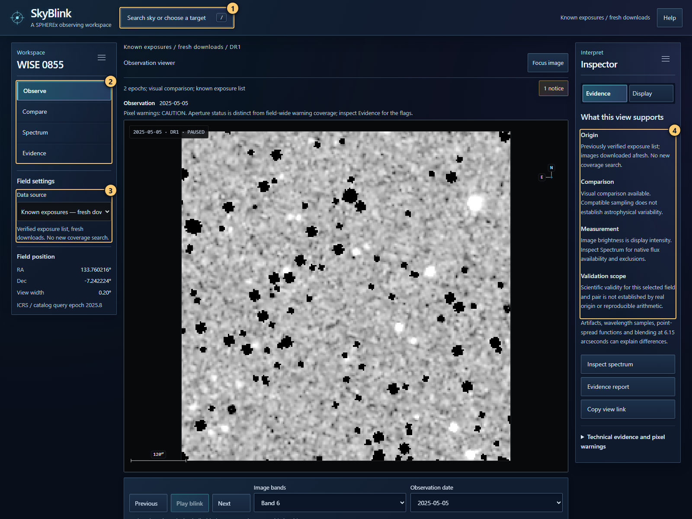
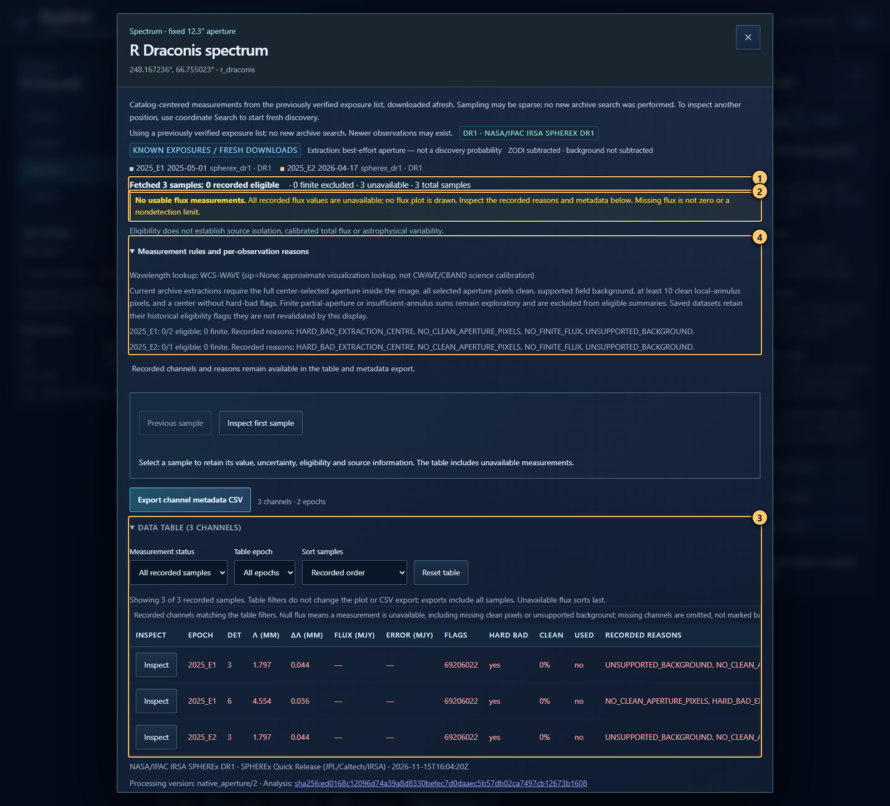

# SPHEREx SkyBlink

**Compare the infrared sky across time. Understand what the data can—and cannot—tell you.**

SkyBlink is an observing workspace for the **NASA Space Apps Challenge 2026: Planet X and SPHEREx**. Enter sky coordinates or choose a challenge target, compare real SPHEREx observations on a shared sky grid, and inspect the source, pixel warnings and measurement limitations behind the view.

The project brings image comparison, spectrum inspection and traceable evidence into one browser interface. It supports exploration; it does not claim to discover Planet X, identify a source automatically or establish astrophysical variability from a blinking image.

[Start here](#start-here) · [Run locally](#run-locally) · [Current status](#current-status) · [7-slide deck (PowerPoint)](docs/presentation/SkyBlink-Space-Apps-2026.pptx) · [Presentation guide](docs/video.md) · [Documentation](docs/README.md)



*Current interface displaying a recorded real WISE 0855 field result. Numbered outlines are teaching annotations. This is retained-response playback, not a new archive request. Reduced motion is enabled in these captures, so automatic Play is disabled; manual date comparison remains available. [Capture provenance](docs/screenshots/guide-20261115/origins.json).*

## Start here

1. **Choose a field.** Use **Search sky or choose a target** (1). Select one of the five catalog targets or enter right ascension and declination in decimal degrees or sexagesimal notation.
2. **Check the source.** The **Data source** selector (3) tells you whether you are requesting a fresh archive search, fresh downloads from a known exposure list, or saved catalog observations. These modes are explicit; a failure never silently substitutes another source.
3. **Choose a task.** Use the left navigation (2): **Observe**, **Compare**, **Spectrum** or **Evidence**. Views start paused. Begin with manual date changes or side-by-side comparison.
4. **Read the evidence.** The Inspector (4) separates where the data came from, whether the images can be compared, what can be measured and what has actually been validated.

The **Help** button opens the same illustrated guide inside the app, with expandable screenshots, numbered explanations and keyboard controls. On smaller screens, use the hamburger controls to reopen the Fields and Inspector panels.

### Choose the appropriate data source

| Source | What happens | Supported fields |
|---|---|---|
| **Online archive — fresh search** | Queries current archive metadata, downloads selected FITS cutouts and runs the processing checks. This is the default. | Catalog targets and arbitrary coordinates; depends on upstream discovery. |
| **Known exposures — fresh downloads** | Uses a bounded, previously verified exposure list and downloads the FITS inputs again. It does not discover newer coverage. | The five catalog targets only. |
| **Saved catalog data** | Loads historical real products shipped with the repository. Their comparisons remain labeled unvalidated. | The five catalog targets only; no archive acquisition required. |

The catalog contains WISE 0855, Barnard’s Star, Epsilon Indi B, RW Aurigae and R Draconis. Archive requests use corrected catalog positions propagated to epoch 2025.8; saved products retain their recorded historical positions. Arbitrary-coordinate searches use the position entered by the user.

### Compare two observations


1. **Choose A and B** in Compare dates. Use **Show A**, **Show B** or **Side by side** to inspect the pair without automatic flashing.
2. **Check the image band.** This recorded example uses **Band 6**, the same detector for both observations.
3. **Read the dates and warnings.** The example compares **5 May 2025** with **11 May 2026**, and both observations carry **CAUTION**.
4. **Check comparison availability.** “Visual comparison” means the retained field samples passed the implemented compatibility checks. It is not a confirmed detection or a measured motion.

Look at the same sky position in both images. Apparent changes can also come from masks, missing coverage, wavelength sampling, image resolution, background or blending. Dark patches are not evidence that an object vanished. No marked point in these screenshots identifies the brown dwarf.

*Recorded real SPHEREx DR1 inputs, displayed in the current interface. The two dates belong to this retained example; a new request may return different observations or fail.*

### Understand a spectrum result



1. **Read the counts separately:** fetched samples, finite values and eligible measurements describe different things.
2. **Read the outcome:** this R Draconis example returned three samples but no usable flux measurements. No flux plot is drawn because every flux value is unavailable.
3. **Inspect the table:** a dash means unavailable, not zero brightness. “Used: no” marks exclusion from eligible measurements.
4. **Open the reasons:** this example includes no clean aperture pixels and a hard-bad extraction center; its D3 samples also lack a supported background estimate.

This is a completed response with unsupported measurements, not a network failure. It does not prove that the star is absent or establish an upper limit. Other fields may return finite but excluded exploratory values, eligible samples, or incomplete spectra. Eligibility is screening, not a guarantee of source isolation or calibrated total flux.

*The unchanged recorded R Draconis spectrum contains three DR1 samples from 1 May 2025 and 17 April 2026. See the [presentation evidence sheet](docs/video.md) and [capture provenance](docs/screenshots/guide-20261115/origins.json).*

## What the workspace provides

- **Temporal comparison:** manual stepping, bounded blink playback, explicit A/B dates, shared-camera side-by-side views and available B-minus-A difference images.
- **Display controls:** available detector bands and composites, colormaps, stretches, contrast, zoom, pan and reference overlays. Display changes do not alter native spectrum measurements.
- **Spectrum inspection:** recorded samples, approximate uncertainties, eligibility and exclusion reasons, a keyboard-accessible table and CSV export. Sampling may be sparse; the app does not promise all 102 mission channels.
- **Evidence and reproducibility:** input hashes, processing identities and source records for current products, an evidence report, and shareable viewing settings. A shared URL can request a new analysis; it is not a loader for pinned historical bytes.
- **Accessible navigation:** paused initial views, manual comparison, visible keyboard focus, responsive panels and reduced-motion support. Blink playback is capped at 8 FPS; that cap is not a photosensitivity safety certification.

## Current status

**Checkpoint: 15 November 2026. API 1.6.0; image method/cache revision 13.**

| Area | Measured state |
|---|---|
| Local application | Current frontend production build and real-data packaging checks pass. The latest local backend regression run passed 321 tests. |
| UI | Navy observatory styling, responsive observing workspace, comparison controls, source recovery and keyboard navigation are implemented. The styling pass checked 36 states across Chromium, Firefox and WebKit with unchanged layout and canvas pixels. |
| Archive discovery | The latest recorded investigation reproduced upstream TAP/SIA and official Explorer failures. A successful known-exposure request does not establish that live discovery has recovered. |
| Known-exposure recovery | Fresh catalog retrieval has produced real matched pairs and spectra within its measured scope. Downloads or scientific comparison checks can still fail. |
| Saved products | Five approved historical real datasets remain unchanged at revision 3 (DR1/QR3). Their existence is not current scientific validation. |
| Scientific scope | Limited independent checks and replay evidence are documented. All-sky reliability, crowded-source calibration, calibrated variability and measured motion are not established. |
| Hosting and submission | No public deployment has been verified in this project record. The current Docker image still needs execution on a Docker-capable host. Recording and submission remain separate tasks. |

Read the [current limitations](docs/current-limitations-and-next-steps.md), [live discovery diagnosis](docs/verification/phase6-live-discovery-diagnosis.md), [renewed archive investigation](docs/verification/phase6-archive-search-renewed.md) and [Phase 6 verification](docs/verification/phase6-verification.md). Historical successful requests and older container measurements retain their original scope.

### Try coordinates outside the catalog

Enter either column pair in Search using **Online archive — fresh search**. These randomly generated ICRS positions are not any of the five catalog targets. Coverage, available epochs and successful comparison have **not** been verified for them.

| Field | RA, degrees | Dec, degrees |
|---|---:|---:|
| A | 241.287641 | −27.534451 |
| B | 52.439772 | −21.874409 |
| C | 117.193946 | 16.266654 |

An upstream search error does not mean that the position contains no observations. Arbitrary coordinates cannot use the catalog-only known-exposure or saved modes. Allow about two minutes for a bounded archive request; cancel stops browser waiting, while shared server work may continue.

## How it works

```text
Browser: coordinates and explicit source choice
    → FastAPI: archive discovery or known-exposure lookup
    → IRSA: real FITS cutout downloads
    → Python: masks, zodiacal/local background subtraction, alignment,
              wavelength compatibility and native photometry
    → Browser: rendered frames, measurements and evidence
```

The **server downloads and processes the scientific files**. React renders the controls, and a persistent Canvas renders the images. Same-band blink images share a display normalization; native flux extraction remains separate from that display scaling.

The server retains input bytes, derived assets and immutable processing records on disk for reproducibility. This storage is not automatically temporary and is not moved to the user’s PC. Admission limits restrict new work when capacity is low; they are not a hard quota and do not automatically delete lineage. Browser query history stores viewing settings, not observation datasets.

The backend uses Python 3.11, FastAPI, Astropy, NumPy and related scientific libraries. The frontend uses React 18, TypeScript and Vite. The repository’s multi-stage Dockerfile builds both and serves them from one origin. See [result meanings](docs/guides/result-meaning.md), [reproducibility](docs/guides/reproducibility.md) and the [deployment guide](docs/guides/deployment.md).

## Run locally

Prerequisites: **Python 3.11**, **Node.js 24**, npm and Git. The source repository is public.

```sh
git clone https://github.com/tureisD/SkyBlink-NASA.git
cd SkyBlink-NASA
python -m venv .venv
```

Activate the environment with `.venv\Scripts\Activate.ps1` in PowerShell or `source .venv/bin/activate` in a POSIX shell. Then, from the repository root:

```sh
python -m pip install -r backend/requirements.txt
npm --prefix frontend ci
npm --prefix frontend run build
python scripts/verify_real_data.py --require-dist
python scripts/serve.py
```

Open **http://localhost:8000**. The server hosts the built frontend and API together. Select **Saved catalog data** explicitly for a local walkthrough without archive access. Fresh archive and known-exposure requests require network access.

For frontend development, keep the Python server running and use a second terminal:

```sh
npm --prefix frontend run dev
```

Open the URL printed by Vite, normally **http://localhost:5173**. Its development proxy forwards `/api` requests to port 8000. After backend source changes, restart the Python process; processing-source protection refuses to silently mix code versions.

### Hosting

The current architecture requires a Python service with writable persistent storage. The repository root `Dockerfile` packages the API, built frontend and approved catalog products; `/data/cache` is the runtime storage mount. Deploy one worker until distributed admission exists, and verify disk ownership, request budgets and restart persistence on the chosen host.

The frontend can be hosted separately, including on Vercel, by setting `VITE_API_BASE` to the deployed backend URL ending in `/api/v1` at build time and configuring `CORS_ORIGINS` on the backend. The current backend is not a drop-in serverless deployment: its persistent filesystem and scientific processing requirements need an appropriate service. The one-origin container avoids that split configuration. [Deployment details](docs/guides/deployment.md).

## Verify a change

Run from the repository root with the Python environment activated:

```sh
python -m pytest backend/tests -q
npm --prefix frontend run test:real-data
npm --prefix frontend run test:wcs
npm --prefix frontend run test:semantics
npm --prefix frontend run test:views
npm --prefix frontend run build
python scripts/verify_real_data.py --require-dist
python scripts/check_docs_links.py
```

Packaging checks verify approved real observation hashes and reviewed UI artwork. Passing them does not establish astronomical validity. Generated edge-case inputs are isolated in tests; product fixtures, illustrative spectra and automatic fallback observations are excluded from normal operation.

The illustrated guide uses unchanged retained real responses with verified asset hashes. Its highlights are HTML annotation overlays captured by the browser, not alterations of the scientific images. The help images are approved only as **educational UI artwork**, never as observation data. [Capture script](scripts/capture_user_guide.mjs), [provenance](docs/screenshots/guide-20261115/origins.json), [real-data policy](docs/guides/real-data-policy.md).

## Repository and documentation

| Path | Purpose |
|---|---|
| `frontend/` | Observing workspace, Canvas, spectrum inspector, illustrated help and UI checks |
| `backend/` | FastAPI routes, archive acquisition, scientific processing, schemas and tests |
| `data/catalog-exposure-index.json` | Bounded metadata index for explicit catalog recovery |
| `golden_cache/` | Five approved historical real target datasets |
| `scripts/` | Local serving, data acquisition, replay, release and inventory tools |
| `docs/` | User guides, decisions, dated verification, evidence and presentation material |

Start with the [documentation index](docs/README.md), [observing guide](docs/guides/observing-guide.md), [contributor guide](docs/guides/contributing.md) or [video script](docs/video.md). `AGENTS.md` records engineering and scientific guardrails; `ROADMAP.md` preserves project context and the original plan.

## Data attribution and license

SPHEREx observations come from **NASA/IPAC IRSA**, using Data Release 1 and Quick Release 3 where recorded. Dataset references: [DR1 spectral images, 10.26131/IRSA678](https://doi.org/10.26131/IRSA678) and [QR3 spectral images, 10.26131/IRSA662](https://doi.org/10.26131/IRSA662). Per-product metadata identifies the actual release and inputs.

> This publication makes use of data products from the Spectro-Photometer for the History of the Universe, Epoch of Reionization and Ices Explorer (SPHEREx), which is a joint project of the Jet Propulsion Laboratory and the California Institute of Technology, and is funded by the National Aeronautics and Space Administration.

> This research uses data products from the NASA/IPAC Infrared Science Archive (IRSA), which is operated by the California Institute of Technology under contract with the National Aeronautics and Space Administration.

Display-only reference products include DSS2 from STScI via NASA/GSFC SkyView, WISE from NASA/JPL-Caltech via SkyView, and Gaia DR3 from ESA/Gaia/DPAC via IRSA. They differ in date, resolution and passband from SPHEREx and are not inputs to the native SPHEREx flux measurements. Full source context is in the [resource review](docs/reference/resource-release-2026-11-13.md).

AI coding assistance was used for implementation, debugging, tests, documentation and interface design. The observation inputs are real archive data; no generative model supplies scientific image pixels, spectra or discovery probabilities. Submission disclosures should describe the team’s actual tools and contributions.

Code is released under the **MIT License**; see [LICENSE](LICENSE). Scientific data retain their source attribution. Registered team names, public hosting and final submission details should be supplied by the team rather than inferred from development records.
