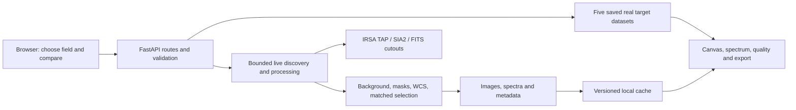

# SkyBlink documentation writing plan

**Current authoring priority (2026-11-15):** start from
[current limitations and next steps](../current-limitations-and-next-steps.md),
[final live comparison results](../verification/phase5-live-comparison-verification.md),
[scoped scientific controls](../verification/phase4-science-online-verification.md) and
[centered workspace verification](../verification/phase5-centered-workspace-verification.md).
The older blocked-science and future-UI statements below describe earlier
checkpoints. A coherent current guide and target-specific interpretation
examples still need to be written; the existence of this plan and many audit
reports does not mean that authoring work is complete. Keep historical failures,
but put current conclusions before the chronological research record.

**Phase 5 implementation:** use [the observing guide](../guides/observing-guide.md), [design decision](phase5-design.md) and [acceptance protocol](phase5-acceptance.md) for current interaction vocabulary. The verification report distinguishes browser/internal checks from unperformed participant studies. Historical proposals below are an authoring plan, not evidence that users passed comprehension tests.

**Phase 4 implementation references:** Start the reproducibility and interpretation chapters from [reproducibility](../guides/reproducibility.md), [result meaning and reason codes](../guides/result-meaning.md), [worked evidence](../guides/phase4-evidence-walkthrough.md), [lineage schema](../reference/phase4-replay-schema.md) and [verification](../verification/phase4-verification.md). These distinguish implemented replay from the still-blocked scientific promotion and the future Phase 5 comprehension tests.

Prepared 2026-11-14 after audit Phase 3. This is an authoring specification,
not a claim that the proposed documentation or UI already exists. The
[audit and remediation plan](../audit-and-remediation-plan-2026-11-14.md) owns
implementation sequencing; its new Phase 5 covers the UI overhaul after
Phase 4. Release verification becomes Phase 6.

The follow-up plan strengthens Phase 4 with a versioned scientific record,
retained real inputs, environment capture, independent replay and evidence
walkthroughs. See [Phase 4 reproducibility requirements](../audit-and-remediation-plan-2026-11-14.md#42-define-a-replayable-scientific-record).
Phase 5 adds an explicit visual direction and three levels of information:
immediate orientation, working explanation and technical inspection. Writing
should support that hierarchy without hiding consequential limitations.

## 1. The story the documentation should tell

Start with the reader's question: **“Did this patch of infrared sky change,
and what evidence would make that conclusion trustworthy?”** Explain how
SkyBlink helps investigate it, then expose the data, processing and limits
behind the answer. Do not start with an inventory of libraries or controls.

Suggested opening, accurate at this checkpoint:

> SkyBlink is a browser tool for exploring real SPHEREx observations across
> time. It aligns images, offers temporal comparisons and approximate aperture
> spectra, and makes measurement warnings available alongside the view. A
> visible difference is a reason to investigate, not a confirmed discovery:
> wavelength selection, artifacts, blending and measurement uncertainty can
> also change the image. The current prototype includes five saved real-data
> examples; arbitrary-position retrieval and scientific acceptance still have
> unresolved validation gates.

The differentiator to explain is the complete path **question → comparable
observations → visible evidence → reliability checks → reproducible report**.
An attractive UI helps people complete that path. More mathematical complexity
or more panels alone does not make the result more useful or credible.

The official [2025 judging guide](https://spaceapps-v2-staging.s3.amazonaws.com/media/documents/Final_Space_Apps_2025_Judging_Guidelines_for_web.pdf)
used holistic assessment informed by impact, creativity, validity, relevance
and presentation; it did not supply the four equal percentage weights quoted
in the historical roadmap. Usability and accessibility also contribute to
validity. This is historical context, **not confirmed 2026 scoring**: the
current challenge and central judging/submission pages returned HTTP 502 during
this review. Reverify the current guides before submission; do not predict
judges' weighting or competitors' capabilities from an assumption about AI coding.

Keep three layers throughout:

1. **Public explanation:** what the operation means and when to use it.
2. **Technical explanation:** inputs, equations, assumptions and software path.
3. **Evidence:** what was actually tested, result, limitation and reproduction.

“A source looks different,” “the difference exceeds approximate noise,” and
“the source genuinely varied” are three different statements. Documentation,
screenshots and demos must preserve those distinctions.

## 2. Audiences and reading paths

| Reader | First question | Recommended path | They should leave able to do |
|---|---|---|---|
| First-time visitor | What am I looking at? | Overview → guided example → interpretation guide | Choose two observations, explain the comparison, find its limitation |
| Curious citizen scientist | Is this interesting change real? | User guide → quality/flags → evidence report | Inspect a candidate without confusing an artifact or missing measurement with a discovery |
| Judge | Does this solve the challenge, and what is distinctive? | Short overview → measured example → design decisions → validation summary | Trace one claim to real inputs and understand the team's contribution |
| Astronomer/reviewer | Are these quantities scientifically defensible? | Data contract → methods → validation → reproducible case | Inspect wavelength selection, masks, aperture, background and approximate errors |
| Developer | How does one request become an image? | Architecture → API → development/operations | Run locally, locate a change, reproduce a failure and preserve invariants |
| Maintainer | What is current and what must be revalidated? | Status/claim ledger → release checklist → decisions | Rebuild safely without silently changing coordinates or science meaning |

Do not force every reader through the methods chapter. Every public page
should have an optional “How this is calculated” link; every methods section
should begin with a plain-language explanation.

## 3. Establish a truthful baseline before drafting

Create a small, dated claim ledger before polishing prose. Record a claim,
scope, code/data version, evidence file or source, measured outcome, permitted
wording, owner and next review trigger. Distinguish **implemented**, **measured
on a stated sample**, **present in the saved cache**, **failed/insufficient**,
**planned**, and **historical**. These labels are not interchangeable.

Initial ledger entries:

| Topic | What can be said now | What must not be inferred |
|---|---|---|
| Data origin | Five approved real DR1+QR3 datasets; 288 saved files unchanged through Phase 3 | Every scientific interpretation is correct; no generated material exists anywhere in tests or history |
| API | 1.3.0 retains field types and requires supported background for usable photometry | Saved revision-3 spectra were recomputed using those new semantics |
| Regression suite | 184 backend tests passed with the downloaded audit inputs; frontend checks passed | Independent scientific acceptance passed; fresh checkout needs no raw audit inputs |
| Coordinate geometry | 1,458 frontend TAN comparisons passed | IRSA succeeds for every coordinate, or every object has usable multi-epoch data |
| Live service | Bounded discovery, deadlines and conservative matching are implemented | Current cold multi-epoch live reliability is proven; Phase 2 probes failed upstream |
| Raw science | Fourteen real cutouts were analyzed; arithmetic agrees under matched assumptions | All exposures, bands, releases or absolute fluxes are calibrated |
| Stability | Locked candidate-control scatter 2.70845 and maximum absolute standardized residual 13.67990 fail fixed limits | Fractional-aperture exploratory improvement is a replacement acceptance pass |
| Astrometry | Nine of ten representative D1 exposures pass; one has insufficient suitable stars | All saved coadds or all detectors pass |
| Target coordinates | WISE 0855 has a roughly 3.60″ discrepancy; R Draconis proper motion needs correction | The frozen reference positions/reticles are externally validated |
| Deployment | No verified public URL at this checkpoint | The historical container is the current audited build |

Use [Phase 3 verification](../verification/phase3-verification.md), [calibration audit](../verification/phase3-calibration-audit.md),
[astrometry results](../verification/phase3-astrometry-results.md), [Phase 2 verification](../verification/phase2-verification.md)
and [real-data policy](../guides/real-data-policy.md) as evidence. Keep failed results
visible after a successful repair; add a new versioned result rather than
rewriting the old result into a pass.

Several existing paragraphs need reconciliation: README's “code and data
complete” table, historical five-target success claims, guarantees about
static-star cancellation, universal ~1 nm wavelength language, “102-channel”
descriptions of a sparse extraction, physical telemetry wording, and the
ROADMAP's target demonstration script. Header caveats alone do not repair
contradictory claims deeper in a document. Inventory and replace them in the
writing task; preserve historical reports with an explicit date and scope.

## 4. Proposed documentation structure

The paths in this table are **planned outputs**, not existing links. Prefer
short focused documents over expanding the already long README. Existing
scientific evidence reports stay in place and are linked, not copied.

| Planned output | Purpose and required contents | Primary evidence | Completion test |
|---|---|---|---|
| Revised `README.md` | One-paragraph purpose; current status; screenshot; three actions; quick start; limits; links to deeper material | Current app, STATUS, release build | New reader can start without reading ROADMAP/AGENTS |
| `docs/index.md` | Audience paths, document map, current API/cache revisions, historical-report index | Claim ledger | Each reader can find a relevant next page in one step |
| `docs/project-overview.md` | Challenge, intended users, problem, core contribution, baseline versus enhancements, non-goals | Official challenge and validated behavior | No claim depends on an unverified discovery |
| `docs/user-guide.md` | Guided comparison; custom coordinates; bands/dates; spectrum; flags; errors; share/export; keyboard/mobile paths | Phase 5 final UI | Every instruction reproduces on the released build |
| `docs/interpreting-results.md` | Observation vs inference; comparison prerequisites; missing/flagged/null data; confounders; follow-up | Methods and validation | Reader can explain why a bright difference need not mean variability |
| `docs/data-reference.md` | Archive products, FITS HDUs, units, flags, reference catalogs, derived files, nulls, lineage | IRSA docs, models, manifests, pipeline | One real input and one output are fully traceable |
| `docs/architecture.md` | Context, components, request sequences, state ownership, cache boundaries, failures, performance choices | Backend/frontend source | Maintainer can locate each processing stage and error boundary |
| `docs/scientific-methods.md` | Equations, assumptions, current algorithms, independent checks, alternatives and limits | Source plus Phase 3 evidence | Every equation has units, variables, implementation and validation |
| `docs/validation-and-limitations.md` | Reproduction matrix, acceptance thresholds, outcomes, sample size, known failures | Versioned audit reports | Code pass and science pass are impossible to confuse |
| `docs/worked-example.md` | One real end-to-end trace and one unusable measurement example | Selected hashed real inputs | Reader can reproduce each reported number |
| `docs/guides/reproducibility.md` | Versioned scientific record, exact-input acquisition/retention, environment and code identity, replay workflow, tolerances, missing-input behavior | Phase 4 R1–R4 outputs | A second person can replay the curated case from a clean environment; artifact identity and scientific validity remain distinct |
| `docs/design-decisions.md` | Why server processing, previews, masks, matched samples, progressive disclosure; rejected alternatives | O1/Phase 3 decisions, Phase 5 decisions | Rationale and tradeoffs are separated from future ideas |
| Revised `docs/guides/contributing.md` and `docs/guides/deployment.md` | Install, run, checks, configuration, provenance gates, release procedures | Actual clean setup and Phase 6 | Commands run on documented platforms; secrets are not needed for saved examples |
| `docs/glossary.md` | Plain definitions, symbols, units, overloaded terms and display names | Data/methods chapters | All public-facing jargon links to a definition |
| `docs/claims-and-sources.md` | Claim ledger, primary citations, data/software attribution, dated verification | Official sources and measured evidence | No quantitative or scientific headline lacks support |
| `docs/demo-and-submission.md` | Short and technical demo scripts, truthful result selection, fallback plan, contribution/SI disclosure | Verified current event rules and release | Demo does not require a favorable live outage or unsupported target story |

Keep AGENTS as an engineering contract and ROADMAP as historical/product
planning. Neither should become the public tutorial. Do not silently change
contract fields while improving documentation; coordinate semantic changes
with the versioned decision process.

## 5. Data chapter: detailed writing brief

### 5.1 Explain what one observation is

Describe SPHEREx's six detector ranges and the linear variable filter (LVF):
the wavelength sampled at a sky position depends on where it lands on the
detector. One Level 2 image is not a complete 102-channel spectrum, and
“same detector” does not establish “same wavelength.” Explain the mission's
102-channel sampling separately from this app's actual per-epoch samples.
Report actual counts from each product rather than promising a fixed count.

Introduce a release/collection table for DR1, QR3 and historical QR2, including
wide/deep discovery, release preference, overlap/deduplication and mixed-release
provenance. Verify release statements against the current
[IRSA release documentation](https://caltech-ipac.github.io/spherex-archive-documentation/spherex-data-releases/).
Do not equate “DR1” with an observation year or an epoch identifier.

### 5.2 Document the source FITS structure

| Named extension | Meaning | Units or representation | Rule to teach |
|---|---|---|---|
| `PRIMARY` | File header | Metadata; no science image | Never obtain science from `hdul[0].data` |
| `IMAGE` | Measured surface-brightness plane | MJy/sr | Zodiacal model is not already subtracted |
| `FLAGS` | Per-pixel bit field | Unsigned interpretation of 32 bits | Decode bits; nonzero does not mean bad |
| `VARIANCE` | Native variance plane | (MJy/sr)² | Describe quality and correlation limitations |
| `ZODI` | Zodiacal-light model | MJy/sr | Subtract before residual sky estimation |
| `PSF` / `EPSF` | Release-dependent point-spread information | QR2 cube vs later binary table | Branch on named extension; not required by current basic extraction |
| `WCS-WAVE` | Compact wavelength/bandwidth lookup | Spectral coordinates with units | Read key `W`, clear SIP; approximation for visualization |

Correct the historical EPSF simplification: the detector-3 11×41 zone grid
has 451 entries; the other detectors use 21×21/441. Do not describe every
451-row table as a cutout accident. Include header keywords for observation
time, spatial WCS, alternate detector coordinates and processing version;
show them from an actual inspected file, with its URI and hash.

Explain CWAVE/CBAND science-calibration products separately, including
release/version matching and original detector-coordinate mapping. Current
calibration checks cover only the recorded D6 subset; they are not production
integration of calibrated wavelengths across all detectors. Link the
[product guide](https://caltech-ipac.github.io/spherex-archive-documentation/spherex-data-products/)
and [Explanatory Supplement](https://irsa.ipac.caltech.edu/data/SPHEREx/docs/SPHEREx_Expsupp.pdf).

### 5.3 Separate four kinds of “data”

1. **Upstream measurements:** original real FITS and catalog records.
2. **Derived scientific quantities:** cleaned arrays, raw differences,
   approximate aperture flux/error, support and quality statistics.
3. **Display products:** 8-bit WebP previews, stretches, colormaps, scaled
   overlays and any normalized telemetry. Pixel appearance is not raw flux.
4. **Metadata/educational elements:** catalog motion vectors, wavelength
   reference markers and trial-motion/parallax geometry. These are not new
   observations or fitted discoveries.

List file formats and consumers: `manifest.json`, `spectrum.json`, WebP,
reference/attribution/Gaia JSON, internal input lineage, validation JSON and
the gzip telemetry sidecar. For telemetry, explain the little-endian sequence
of `width × height` float16 values followed by uint32 flags (six uncompressed
bytes per pixel; 345,600 bytes for 240×240). Document nonfinite values,
orientation, precision and compressed versus uncompressed size. Phase 4 must
settle whether each plane is normalized display intensity or raw surface
brightness before writing a physical-value guarantee. The current writer uses
the normalized display coadd; it does not supply the raw measurement plane.
Document row-major order, no binary header, float16 quantization and clipping
of finite overflow to 65,504. The sidecar never feeds aperture photometry.

For every JSON field document: type, units, nullable/omittable status, scope
(pixel, aperture, band, epoch, whole request), meaning, producer, consumer and
example from an actual response. Distinguish missing band, missing channel,
null flux, finite-but-unused flux, hard-bad center and positive clean fraction
with unsupported background. Never use zero as the example of missing flux.

Include a compact directory tree and a manifest-to-asset diagram. Explain
that output-grid pixels are 3.075″ while native pixels are 6.15″; resampling
does not double the telescope's resolution. A 240-pixel grid is approximately
0.205° across; the requested 0.05–0.2° field is a crop with its own semantics.

### 5.4 Data lineage and real-only scope

Show the chain: archive URI → downloaded bytes/hash → release/processing
version → extraction coordinates/date → masks and calibration → output asset
hash → served response → export. Explain where Phase 4 adds missing per-channel
lineage and stable creation timestamps. Do not fill missing historic metadata
with plausible values; record unknown and rebuild from known inputs.

Both current public routers overwrite `provenance.generated_at` with response
time. Document that limitation now; do not use it as evidence of a data rebuild.
Keep version axes distinct: API 1.3.0, saved release revision 3, internal saved
`golden_cache_version: 2`, live image cache version 8 and spectrum cache version
4 identify different things. Record actual values in a version glossary and
update them when the associated component changes.

Say **“no synthetic observation products or model spectra are shipped.”**
Also disclose mathematical/unit-test inputs and unresolved historical
documentation assets as inventoried. Explain why deterministic tests are
different from fabricated scientific evidence.

## 6. Architecture chapter: diagrams and source map

Start with this conceptual boundary diagram, then replace labels with actual
deployment details after Phase 6:



Explain these actual modules rather than inventing microservices:

| Responsibility | Current source to inspect | Questions the chapter must answer |
|---|---|---|
| App, routes, errors | `backend/app/`, `backend/routers/`, `backend/models/` | Validation, API version, HTTP/status envelopes, asset security |
| Archive discovery | `backend/services/irsa_client.py` | TAP pagination, SIA fallback, deduplication, coverage, time budgets |
| Matched selection | `backend/services/live_selection.py` | Bounded sample versus exhaustive search, coarse/dense checks, time spans |
| Image reduction | `backend/services/spherex_pipeline.py`, `background.py`, `halo.py` | Processing order, separate arrays, masks, normalization and rendering |
| Spectrum | `backend/services/spectrophotometry.py` | Native aperture, background, units, eligibility and errors |
| Telemetry/geometry | `telemetry.py`, `lvf.py` | Sidecar representation, band composition and geometry |
| Saved/live caches | `golden_cache.py`, `singleflight.py`, `core/config.py` | Cache keys/versioning, target-coordinate checks, same-process shared work |
| Frontend orchestration | `frontend/src/App.tsx`, `hooks/useSkyData.ts`, `useSpectrum.ts` | Request state, cancellation, stale results, independent panels |
| Rendering | `components/BlinkCanvas.tsx`, `lib/frames.ts`, `lib/display.ts` | Bitmap lifecycle, persistent rAF, display transfer versus science values |
| Geometry/state | `lib/wcs.ts`, `lib/coordinates.ts`, `hooks/useUrlState.ts` | TAN conversion, RA wrap/poles, parsing, URL limits and restoration |
| User interpretation | `TargetPanel`, `ArtifactShield`, `SpectrumDrawer`, `TriageModal`, `lib/triage.ts` | What is shown, inferred, omitted and exported |
| Build/verification | `scripts/build_golden_cache.py`, `verify_real_data.py`, `scripts/serve.py`, tests | Staging, package inventory, static hosting and verification |

Add three sequence diagrams:

- **Saved target:** target/coordinate validation → load real manifest → apply
  response filters/caveats → fetch assets → decode → display. Mark which
  operations are offline, and separate saved creation time from response time.
- **Live field:** validate → shared-build lookup → discover → bounded candidate
  download → compatible usable selection → reduce/render → cache → display.
  Branch explicitly into no coverage, no comparable sampled pair, upstream
  outage, insufficient measurement support and one-epoch-only data.
- **Spectrum request:** selected position → saved or live extraction → sparse
  channel response → plot/table/export. Clarify whether the UI currently
  measures the field center or a user-picked position; do not promise arbitrary
  click extraction until that path is verified.

Add a reduction diagram that explicitly branches into **measurement arrays**
and **display arrays**, with a separate native-exposure photometry branch.
Spectrum selection and per-visit propagated extraction positions are not
necessarily identical to the sky image pair or band composition; document the
relationship instead of implying that a displayed spectrum measures the exact
currently painted composite.

Include a state-ownership diagram: URL/shareable selection; React UI state;
mutable canvas playback state; server science arrays; cached assets. Explain
why blink ticks avoid React re-mounting, why image fetch/decode should not happen
per tick, and why paused-state annotations must reflect the painted frame.

Document performance with a table of **configured budgets**, **measured
latencies**, and **targets**, never one mixed “fast” number. Current 60/120/130/20
second TAP/backend/frontend/cutout budgets are ceilings, not successful latency
measurements. Singleflight currently shares identical work within a process;
it is not a distributed job queue. Name the external-service bottleneck and
why saved real data is useful without presenting an arbitrary-field failure
as successful retrieval.

## 7. Mathematics chapter: required derivations and examples

Use one consistent notation table: native pixel index `p`, exposure `j`, epoch
`e`, detector `d`, intensity `I`, variance `V`, flags `f`, wavelength `λ`,
bandwidth `b`, solid angle `Ω`, flux `F`, and uncertainty `σ`. For every method
give **purpose → equation → units → implementation → assumptions → evidence →
failure case**. Keep pedagogical approximations separate from production code.

### 7.1 Coordinates and proper motion

Explain ICRS, degrees versus sexagesimal hours, coordinate frame versus
reference epoch, observation dates, MJD and time scales. For intuition only:

```text
Δδ ≈ μδ Δt / 3.6e6                            [degrees]
Δα ≈ μα* Δt / (3.6e6 cos δ)                  [degrees]
μα* = μα cos δ                                [mas/year]
angular drift ≈ sqrt(μα*² + μδ²) Δt / 1000    [arcseconds]
```

State that the linear RA formula is unsuitable near the poles; production
propagation uses Astropy, and epoch/frame/parallax/perspective assumptions
matter. The reticle is catalog-predicted motion, not a measured displacement
from these images. Use the coordinate audit to explain the WISE reference-epoch
error and the R Draconis motion discrepancy without presenting either frozen
coordinate as a corrected solution. Phase 4 must update all dependent products
together.

### 7.2 TAN projection, pixel origin and resampling

For the usual nonpolar tangent-point convention, with angles in radians and
`Δα` wrapped around the field center:

```text
D = sin δ0 sin δ + cos δ0 cos δ cos Δα
ξ = cos δ sin Δα / D
η = (cos δ0 sin δ − sin δ0 cos δ cos Δα) / D
x = CRPIX1 − 1 + degrees(ξ) / CDELT1
y = CRPIX2 − 1 + degrees(η) / CDELT2
```

Explain the valid tangent hemisphere, RA wrapping, FITS one-based CRPIX versus
zero-based arrays, east-left negative CDELT1, and the final image/canvas Y-axis
orientation in the actual renderer. Include a center-point calculation and
one high-declination comparison against Astropy. At the exact north pole,
the implementation applies `poleSign = -1` to both tangent-plane coordinates
to match the FITS orientation; document the LONPOLE convention and include an
exact-pole Astropy example as well. The generic formula alone is not the
complete implementation at that boundary. Discuss interpolation of
surface brightness versus integrated flux, nearest-neighbor flags, footprints
and correlated output noise. Do not claim a new spatial resolution from the
smaller output pixel size.

### 7.3 Masks and background

Write bit eligibility explicitly: `(flags & mask) == 0`, not `flags == 0`.
Separate native display, measurement and background masks. SOURCE remains
measurable but is excluded from background; DICHROIC warnings are excluded
from flux; HALO may be displayed but remains excluded from measurement.

```text
R_p = IMAGE_p − ZODI_p
C_p = R_p − B_p
scalar: B_p = median of eligible sky pixels
plane:  B(x,y) = a + b x_norm + c y_norm
```

Describe spatial support and robust fitting, not just “subtract the median.”
Current minimum scalar support is 11 clean pixels, 5% coverage, three quadrants
and half the native cutout extent along both axes. Support is assessed on the
downloaded array, including padding, not just the requested output FOV.
Explain 4×4 cell estimates, robust plane
selection, fixed checkerboard holdout and the 10% held-out improvement plus
gradient-significance gates by citing `background.py`. Unsupported estimates
must not be described as successful subtraction. Give one scalar case, one
supported gradient case and one insufficient-support case from the real audit.
Discuss extended emission and why the sky model may remove real diffuse flux.

### 7.4 Spectral comparability and time selection

For every retained output location `p`, the current conservative gate is:

```text
|λ1(p) − λ2(p)| ≤ 0.25 min(b1(p), b2(p))
min(b1(p), b2(p)) / max(b1(p), b2(p)) ≥ 0.8
```

Both signatures must be finite and positive. Explain nine-point screening
followed by exact retained-grid checks: 3,364 pixels for 0.05° and 54,756 for
0.2°. A passing geometric gate is not calibrated filter-response equality or
PSF matching. Show why detector-number matching fails using the real D6
example in the calibration audit. Explain bounded search, one exposure per
band/epoch, common band composition and the maximum 30-day within-epoch
composite span. A multiband composite is still not simultaneous.

### 7.5 Coaddition, display scaling and differences

Introduce inverse-variance weighting where used:

```text
w_jp = 1 / max(V_jp, V_floor) for eligible finite pixels; otherwise 0
C_p = sum_j(w_jp I_jp) / sum_j(w_jp)
approximate V(C_p) = 1 / sum_j(w_jp)
D_p = C_later,p − C_earlier,p
approximate V(D_p) = V_later,p + V_earlier,p
```

Explain zero support, shared inputs/correlations and the variance floor.
The current `_combine_arrays` uses `np.nanmean` across contributing bands for
`all`/`thermal`, not a sum or an integrated broadband flux. Do not apply one
formula to all products. The difference-variance expression above explains an
approximation; it is not a claim that a calibrated difference-noise product is
currently served. New selected single-exposure bands are a special case, while saved
legacy products may average many visits.

Document static-source/background normalization, reference epoch, clamping
and status from the actual manifest. Current scaling uses the reference-to-epoch
99.5th-percentile ratio, clipped to 0.5–2, excluding a 61.5″ central radius and
preferring SOURCE pixels before clean-pixel fallback. Catalog membership alone
does not certify those sources as static. Keep display-normalized frames separate
from raw arrays and raw differences. Describe signed positive/negative
residuals, shared symmetric display ranges and the limitations of direct
subtraction without PSF matching. A dipole can arise from motion, misregistration
or PSF differences; it is not automatically a moving object.

### 7.6 Aperture photometry and unit conversion

Show the current center-pixel aperture, eligible-pixel count, native WCS pixel
area, 12.3″ radius and 3–5 native-pixel annulus. Document the special crowded
mode separately where actually selected; do not imply a general deblender.

```text
Ω_pix ≈ (pixel_scale_arcsec / 206264.806)²       [sr]
K = 1e12 Ω_pix                                 [µJy per MJy/sr]
F = K sum_eligible(C_p − b_annulus)              [µJy]
σ_F² ≈ K² [sum_eligible V_p + N_clean² σ_b²]    [µJy²]
clean_fraction = N_clean / N_geometric
```

Explain why `1e12` appears: mega-janskys to janskys and janskys to
microjanskys. A one-native-pixel dimensional check gives approximately
889 µJy for 1 MJy/sr at 6.15″; label this a **unit example, not an observation**.
Use the actual WCS-derived area for the reproducible measured example and
state that a full solid-angle map/aperture correction is not applied.

Define the approximate median-background uncertainty used in code, including
the annulus sample-size requirement and supported field-background fallback:

```text
Var(b) = max[(π/2) mean(V_ann)/N_ann,
             1.2533² MAD_scaled(annulus)²/N_ann]     for N_ann ≥ 10
```

For fewer clean annulus pixels, document the supported field-background
scatter/count approximation and its limitations, rather than claiming a
successful local annulus measurement.
Explain why a shared background offset contributes `N_clean² σ_b²`, and why
this still omits complete plane covariance, detector correlations and blends.
Do not divide partial clean flux by clean fraction as an invented correction.
Finite unused values, negative fluxes and nulls need explicit interpretation.

Describe the independently executed IRSA/Photutils comparison: identical
center-pixel assumptions validate arithmetic; fractional integration tests
different aperture boundaries. The same-ten-control exploratory improvement
is not an independent holdout. An adopted repair requires a documented method
decision, new controls and fresh validation.

### 7.7 Quality and validation statistics

Define standardized residuals `z = (F2 − F1) / sqrt(σ1² + σ2²)` under the
stated approximate independent-error assumption. Explain median bias, robust
scatter (including the exact estimator used), maximum residual, sample size
and predeclared thresholds. Do not convert `z` into a discovery probability.
Include the failed ten-control result and its selection/isolation limitations.

For astrometry, document independently detected image centroids, Gaia matching,
epoch propagation, exclusions, residual vectors, robust RMS including bias
and insufficient-source status. Reprojection round-trip agreement is a
different test. Present temporal-smearing bounds separately from precisely
known observation dates; URI planning weeks are not exact timestamps.

### 7.8 Display transformations and exploratory tools

Document linear/log/asinh/zscale and colormap transformations as display
operations on previews; no recovery of native dynamic range is implied.
Explain trial motion and the parallax overlay as assumed geometry, not fitted
physical parameters. Reference molecular markers indicate where features
may occur, not detected chemistry. Sonification maps available values to
sound; it adds no measurements and must mute unavailable values. These sections
belong after the core measurement explanation, not in the introductory claim.

## 8. Explain the basics and the enhancements separately

| Layer | Baseline capability | Enhancement and reason | Evidence/status to attach |
|---|---|---|---|
| Real observations | Retrieve/display archive data | Remove product fixtures; explicit real provenance and approved package hashes | Phase 1; still disclose generated tests |
| Coordinates | Accept RA/Dec | Exact TAN, wrap/pole tests, target/reference audit | Geometry passes; target corrections pending Phase 4 |
| Live access | Query archive | Bounded pagination/fallback/deadlines/shared identical builds | Phase 2; upstream/live acceptance remains open |
| Time comparison | Flip epochs | Spatial wavelength matching, common bands, shorter time spans | Phase 3 implemented; not all saved products rebuilt |
| Measurement quality | Subtract background and make coadds | Separate native measurement masks, supported 2D/scalar sky, uncertainty term | Real-input tests; controls still fail |
| Interpretability | Show image and spectrum | Phase 5 guided comparison, persistent quality reasons, source-linked evidence | Proposed UI work, not delivered behavior |
| Reproducibility | Save products | Phase 4 complete lineage/stable timestamps and Phase 5 reproducible evidence export | Planned; do not describe current URL as full view serialization |
| Scientific confidence | Unit and display tests | Independent raw controls, official calibration, Gaia centroids | Mixed measured outcomes; retain failures |

Do not sell every feature as novel. State the team's particular integration,
its demonstrated benefits and what remains unproven. For each enhancement,
write a short before/problem → change → observed effect → tradeoff paragraph.

## 9. Worked example and visual asset plan

Select examples **after** Phase 4 validation, based on explicit suitability
criteria, not on which screenshot looks most dramatic. Until then use the
Phase 3 records as an audit example, clearly labeled failed/limited.

The main reproducible example must include: input coordinates and reference
epoch; source IDs/URIs/hashes; observation time range; detector and wavelength
coverage; masks/support; background method; selected pair; raw flux/error;
display settings; comparison status; alternative explanations; export; and
the exact script/command that regenerates the result. Add an example with
no usable measurement to teach correct interpretation of nulls.

Required figures, with a purpose and caption:

1. Current final UI with only four or five numbered interaction regions.
2. LVF schematic showing one sky position sampling different wavelengths.
3. Input → masks/background → common grid → comparable pair → display/spectrum.
4. Native 6.15″ pixels versus 3.075″ output grid, explicitly no resolution gain.
5. The same real image with display warnings and measurement exclusions.
6. Matched A/B/difference triptych with dates, wavelengths and a signed legend.
7. Spectrum with real sample counts, approximate errors, rejected/null states.
8. Quality/evidence panel and a self-contained exported report.
9. Validation figure showing residuals and failed thresholds without clipping.

Use labeled schematic SVG/Mermaid for conceptual diagrams and scientific
plotting tools for measured figures. Never generate an astronomical image to
stand in for real data. Keep original measured arrays, figure script, source
hashes, caption, alt text and crop/stretch settings. Historical screenshots
may depict removed features; recapture after the overhaul and record the build.

## 10. Writing workflow and review order

| Step | Work product | Dependency | Reviewer/check |
|---|---|---|---|
| D0 — evidence inventory | Claim ledger and outdated-copy list | Current audit reports | Science + maintainer agree on status vocabulary |
| D1 — content skeleton | Index, chapter headings, glossary and source map | D0 | One novice and one technical reader can navigate it |
| D2 — stable technical chapters | Data formats, architecture, current methods with caveats | Source inspection | Backend/science check every unit, scope and equation |
| D3 — repaired result chapters | Worked example, replay guide, lineage, validation and limitations | Phase 4 validated staged products and retained curated inputs | Independent clean-environment replay with declared tolerances; retain old failures |
| D4 — user-facing chapters | User guide, three-level interpretation paths, chosen visual rationale, screenshots and labels | Phase 5 UI decisions/build | Task-based novice/expert review across normal and unavailable states; instructions match controls |
| D5 — release and submission | README, operations, demo script, current-rule citations | Phase 6 deploy/release verification | Clean setup, public links, attribution and claim audit |

D0–D2 can be drafted while implementation continues. Do not block those on UI
polish. Mark unresolved decisions visibly. D3–D5 require the actual outputs;
placeholder success numbers or screenshots are not acceptable substitutes.

For each chapter, use this authoring checklist:

- Write a one-sentence reader question and a short answer first.
- List the facts and source/code location needed to support the answer.
- Add one small real example or explicitly labeled mathematical example.
- Name the assumptions and what the example cannot establish.
- Link advanced details and next actions instead of duplicating them.
- Have a second person reproduce the example and flag ambiguous terms.
- Record review date/API/cache revision; add a trigger for future revision.

Suggested reusable section template:

```text
Question this section answers
Plain-language explanation
Inputs and output (units and scope)
Algorithm/equation and implementation link
Real worked example and reproduction command
Known failure cases / what cannot be concluded
Measured validation and remaining work
Primary references and related user action
```

## 11. Acceptance criteria for the finished documentation

- Every current numerical/scientific claim has a dated source or reproducible
  result; planned and historical statements cannot be mistaken for current.
- A novice can explain which observations are compared and why a result may
  be inconclusive without reading equations.
- A technical reviewer can trace one displayed/extracted quantity to upstream
  bytes, units, mask, background, coordinates, method and uncertainty.
- API examples are redacted captures of real responses or explicitly marked
  schema illustrations; unsupported flux is never filled in.
- Every diagram/caption distinguishes display transformations, catalog priors,
  measured quantities and exploratory hypotheses.
- Commands are tested on the named environment; audit-data downloads and
  skips are explained; links and local image references resolve.
- README, Help, export copy, methods and status agree on the same limitations.
- Screenshot alt text and tables support readers who cannot use the visual
  canvas; contrast/motion claims cite actual checks, not just an FPS cap.
- A successful release includes a versioned documentation snapshot, known
  issues and date of official-rule verification. No unverified judging weights,
  public deployment claims or “discovery probability” language remains.

## 12. Immediate authoring tasks

Start with D0: reconcile current versus historical claims and make the index.
Then write the data dictionary and one request walkthrough from actual files;
those give the mathematics and UI explanations a concrete foundation. Draft
methods with the failed controls visible. After Phase 4, turn a validated trace
into the worked example. After Phase 5, write the public guide from actual
user tasks and recapture screenshots. Finally shorten the README to an entry
point and prepare the judge-facing explanation from measured evidence.
