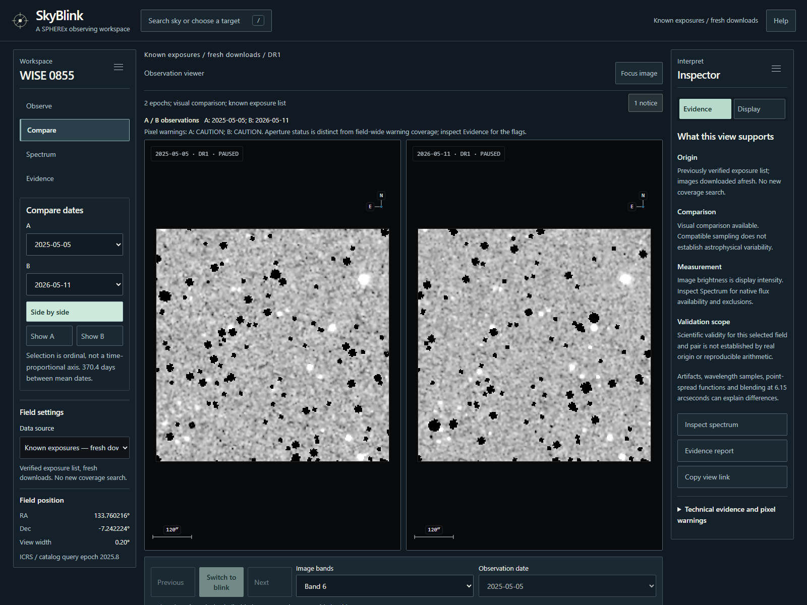
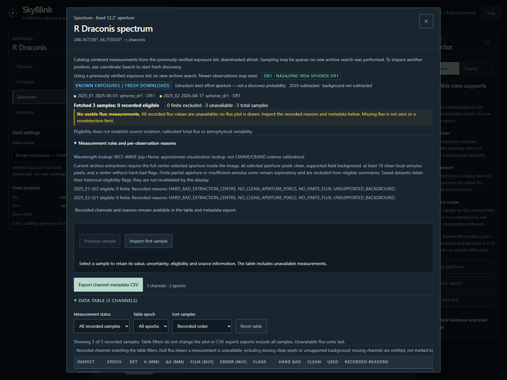

# SkyBlink: presentation examples and two-speaker script

[Documentation home](README.md) · [Current limitations](current-limitations-and-next-steps.md)

Prepared from recorded real results on 15 November 2026. **Speaker 1** introduces
the problem and operates the viewer. **Speaker 2** explains the processing and
what the results mean. Replace those labels with your names when rehearsing.

The two examples are a **successful image comparison** and an **unsuccessful
brightness measurement**. They are not a confirmed discovery and a confirmed
absence of an object. That distinction is central to the presentation.

## Choose the right cut

Use the **under-30-second version** for the submission demo. A 13 November answer
marked “Navigator answered” in NASA's Space Apps discussion specifies a video
under 30 seconds or a presentation of at most seven slides.
[Submission clarification](https://github.com/nasa/spaceapps/discussions/1991).
The main submission-guide site returned an error during this check; follow the
actual project form if its instructions differ.

The longer script below is for a local presentation or an extended walkthrough,
subject to the time Berlin gives you. It is not the short submission video.

## Example 1: a comparison that works — the WISE 0855 field

**Point to make:** two real observations of the same field can be aligned and
compared, with their dates and limitations visible.

| Evidence | Exact recorded result |
|---|---|
| Data | NASA/IPAC IRSA SPHEREx DR1, detector 6 |
| Observation A | 5 May 2025 |
| Observation B | 11 May 2026 |
| Acquisition | Explicit known-exposure list; FITS inputs downloaded online |
| Comparison | `matched_visual`; two real epochs, same detector |
| Integrity | Two input files and 12 served assets verified; strict replay passed |
| Limit | Field comparison only; target detection, motion and variability are not established |

Show the two dates, select **D6**, then use **Show A / Show B** or **Side by side**.
If recording a blink, keep it brief and slow, then pause on the comparison.
Keep the source label and the **CAUTION** status visible. The other attempted
detector, D3, had failed downloads; this result is not a six-detector comparison.

**Say:** “These are two real observations of the WISE 0855 field, taken about a
year apart. We can compare them on the same sky grid.”

**What viewers should notice:** both real images are available, the dates are
different, and the comparison uses a common field and wavelength selection.
Do not point to a bright spot and identify it as the brown dwarf without separate
evidence. A working blink is the success being demonstrated here.
Black patches can be masked or missing pixels; do not point to them as evidence
of an object moving. Some valid low intensities also appear black.

*Retained real-response playback in the current interface, not a new archive
search. The capture provenance is in [origins.json](screenshots/video/origins.json).*

## Example 2: a measurement the data cannot support — R Draconis

**Point to make:** receiving observations is not enough to justify a brightness
measurement. SkyBlink shows the reasons when the measurement cannot be used.

| Evidence | Exact recorded result |
|---|---|
| Data | Three real SPHEREx DR1 samples from a known-exposure request |
| Dates and detectors | 1 May 2025: D3 and D6; 17 April 2026: D3 |
| Finite brightness values | 0 of 3 |
| Eligible measurements | 0 of 3 |
| Flux and uncertainty | All unavailable (`null`), not zero |
| Shared reasons | No clean pixels in the measurement aperture; hard-bad extraction center |
| Additional D3 reason | Unsupported background estimate |

Open **Spectrum** and show **“Fetched 3 samples; 0 recorded eligible”** together
with the unavailable-measurement message. Show the table, then inspect a D3 row
so the reasons are readable. Use **all epochs** and **all measurements** rather
than a filter that hides the failed samples.

**Say:** “The observations came back, but these three samples can't support a
usable brightness measurement. We show the missing values and the reasons.”

**What viewers should notice:** this is a completed data response with unusable
measurements, not a network error or a graph that failed to load. The flags
include overflow and blooming. That does not prove the star is absent, give it
zero brightness, or establish a calibrated upper limit.

*The spectrum is the unchanged retained three-sample response. Any underlying
field image is a separately recorded image product; the screenshot does not
claim its epoch IDs identify the same spectral samples.*

## Submission video: two speakers, about 26–29 seconds

Read conversationally. Leave a short breath at each handover. The wording below
is deliberately short; time the recorded take rather than speeding it up to fit.

| Time | Speaker | Spoken script | Screen |
|---|---|---|---|
| 0–11 s | 1 | “SkyBlink lets you compare real NASA SPHEREx images across time. Here are two aligned observations of the WISE 0855 field.” | Begin directly on the WISE comparison. Show both dates and D6. Step A to B, or show the images side by side. |
| 11–23 s | 2 | “For R Draconis, three samples arrived, but none passed our measurement checks. The interface explains why those brightness values are unavailable.” | Cut to the spectrum count, unavailable values and one expanded reason. Hold long enough to read it. |
| 23–28 s | 1 | “Our aim is to make the sky easier to explore and understand.” | Return to the viewer or a simple title: **SkyBlink — Planet X and SPHEREx**. |

Keep a readable caption on the demonstration footage: **“Recorded real results
· Known exposures · 15 Nov 2026.”** Credit **NASA/IPAC IRSA SPHEREx**. If space
allows, add **“Fresh archive search currently unavailable”** on the closing
frame; include that limitation in the project description in any case.

Do not spend the short video on a loading screen, code, a long introduction or
small diagnostic text. The two results should occupy almost the entire clip.

## Longer presentation: two speakers, about 2½–3 minutes

The stage directions are not spoken. Use the same two examples and screenshots
so the short and long versions make the same claims.

### 1. The problem — Speaker 1

*Open on the WISE comparison, paused.*

“If you want to look for something moving in the sky, you need to compare
observations taken at different times. But those observations arrive as
scientific files, with different positions, wavelengths and quality flags.

“SkyBlink brings those checks into one viewer, so you can start exploring
without first writing your own image-processing pipeline.”

### 2. The solution — Speaker 2

*Point to the field selection, Compare controls and Evidence panel.*

“You choose a field and two dates. You can switch between the images, place them
side by side, and inspect the data behind the view. The basic controls stay
simple. The source files, flags and measurement details are there when you need
them.”

### 3. The successful comparison — Speaker 1

*Show A, then B. Pause on the two dates.*

“Here is the WISE 0855 field in May 2025 and May 2026. These are real SPHEREx
observations in the same detector band, aligned to the same sky grid.

“That gives us a usable visual comparison. It doesn't, by itself, prove that
we've detected the brown dwarf or measured its motion.”

### 4. What happens behind the screen — Speaker 2

*Keep the image visible; briefly open Evidence.*

“Our Python backend downloads the FITS files, subtracts the modeled zodiacal
light and estimates the remaining background. It aligns the images and checks
that their wavelength sampling is close enough for a visual comparison.

“The browser handles the display. For measurements, we keep the original flux
values separate from the brightness scaling used to make the images readable.”

### 5. The unsupported measurement — Speaker 1

*Cut to R Draconis. Show the count, unavailable values and reasons.*

“R Draconis shows the other side of the problem. Three samples came back, but
none supports a usable brightness measurement. The measurement area has no
clean pixels, and two samples also lack a supported background estimate.

“The interface tells you that. An unavailable value doesn't mean zero light.”

### 6. Why it fits the challenge — Speaker 2

*Return to the viewer and source label.*

“The Planet X and SPHEREx challenge asks us to make changes in the sky easier
to explore. We make those comparisons easier to use and easier to check.

“The archive's search service isn't working at the moment, so these examples use
a recorded list of exposures and real downloaded files. Getting fresh search
working is our main engineering priority. Someone can compare two dates, see
what went wrong, and decide what deserves a closer look.”

## Recording steps

1. Use the two supplied screenshots for the dependable presentation cut. They
   show recorded results whose identities are listed below. Do not describe
   screenshot playback as a new live request.
2. For an interactive recording, use the same retained-response capture recipe
   recorded in `screenshots/video/origins.json`, or load a fresh result and check
   its counts and dates before narrating it. A normal share link requests data
   again; its `analysis` parameter is an identity check, not a pinned-result loader.
3. To try a fresh WISE view, choose **WISE 0855** in Search, explicitly select
   **Known exposures — fresh downloads**, open **Compare**, then choose D6 and
   the available dates. Only use the scripted dates if that response contains them.
4. For a fresh R Draconis view, choose the target, keep known-exposure mode, open
   **Spectrum**, and inspect the actual returned counts. If a request fails, it
   is a retrieval failure; do not call it the three-sample result above.
5. Keep image changes manual or use a slow blink. A side-by-side shot makes the
   comparison clear without requiring repeated flashing. Pause before pointing
   at dates or opening details.
6. Record screen footage first, then the voices. Cut out waiting time without
   suggesting that the measured 34-second request was instantaneous. Keep source
   labels, quality warnings and the unavailable values visible.
7. Time the short cut to less than 30 seconds, including any opening or closing
   frames. Add English captions. Put architecture and detailed evidence in the
   project description or the longer presentation.

## Evidence sheet for the presenters

These are production notes, not lines to read aloud.

**WISE image comparison**

- Analysis: `sha256:62409c5a0cd88218662d3420d60ae677366da90d5e66d6d37f21218c9ab625fb`.
- Created: **2026-11-15 16:55:35 UTC**; method `matched_image_comparison/13`.
- Retained response: `backend/.cache/phase6/discovery-diagnosis/known-postfix/wise_0855-response.json`.
- Record served locally at `/api/v1/assets/live_37c143853d7d5104/analysis_62409c5a0cd88218662d3420d60ae677366da90d5e66d6d37f21218c9ab625fb.json`.
- Request took **34.375 seconds**. This run matched in its first candidate round;
  do not claim that the later retry pass caused its success.
- [Independent verification and replay](verification/phase6-live-discovery-diagnosis.md#single-post-fix-runtime-check).

**R Draconis spectrum**

- Analysis: `sha256:ed0168c12096d74a39a8d8330befec7d0daaec5b57db02ca7497cb12673b1608`.
- Created: **2026-11-15 16:04:20 UTC**; method `native_aperture/2`.
- Retained response: `backend/.cache/phase6/spectrum-final/r_draconis-known-response.json`.
- Record served locally at `/api/v1/assets/live_c2b024790ea424f6/analysis_ed0168c12096d74a39a8d8330befec7d0daaec5b57db02ca7497cb12673b1608.json`.
- Exact common reasons: `NO_CLEAN_APERTURE_PIXELS`, `HARD_BAD_EXTRACTION_CENTRE`.
  Both D3 samples also record `UNSUPPORTED_BACKGROUND`.
- [Five-target spectrum verification](verification/phase6-verification.md#runtime-and-retrieval).

**If a judge asks about the mathematics:** we subtract zodiacal and supported
local backgrounds, map observations onto a shared sky grid, and check wavelength
compatibility over retained image pixels. Blink scaling is shared across dates;
measurement flux is extracted separately from un-normalized native data. These
operations support exploration, but do not by themselves calibrate variability,
remove blends or establish a new object. See [result meanings](guides/result-meaning.md).

**If a judge asks about reproducibility:** the records identify input bytes,
processing source, settings and outputs. Replay checks the recorded arithmetic.
An ordinary share URL preserves viewing choices and can obtain a new analysis;
it is not the same as replaying a pinned result. See [reproducibility](guides/reproducibility.md).

**If a judge asks about archive access:** be direct: “Fresh discovery is currently
failing, including through the official Explorer. The catalog workaround uses
a recorded exposure list and downloads real files. Arbitrary coordinates still
need working discovery.” See [the renewed investigation](verification/phase6-archive-search-renewed.md).

**If asked how we built it:** “We used AI coding assistance during implementation,
debugging, testing and documentation. Our observation inputs come from the
archive, and the scientific claims are limited to the checks we have recorded.”
Describe the team's actual contribution and tools in the submission form.

The [challenge page](https://www.spaceappschallenge.org/2026/challenges/planet-x-and-spherex/)
is the authoritative brief. Its live page was unavailable during this writing
check; the project's earlier [resource review](reference/resource-release-2026-11-13.md)
records the source context. Do not claim that the app has already found Planet X,
measured proper motion, produced a complete spectrum or restored all-sky search.
