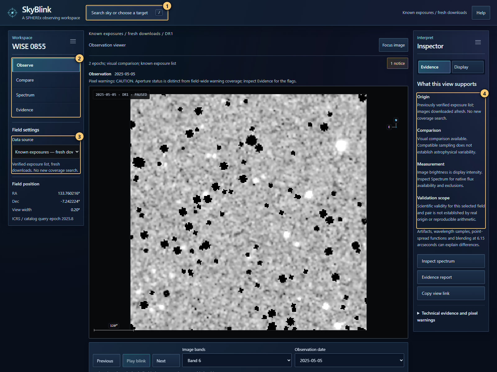
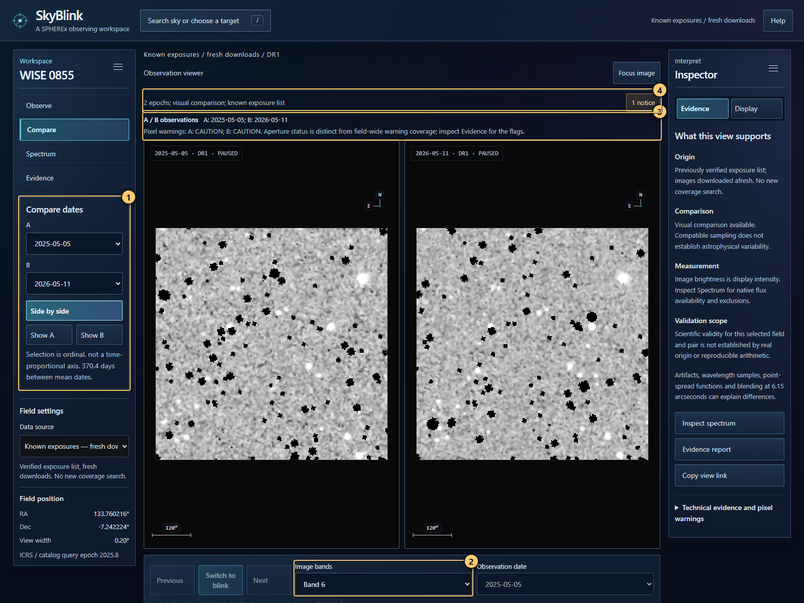
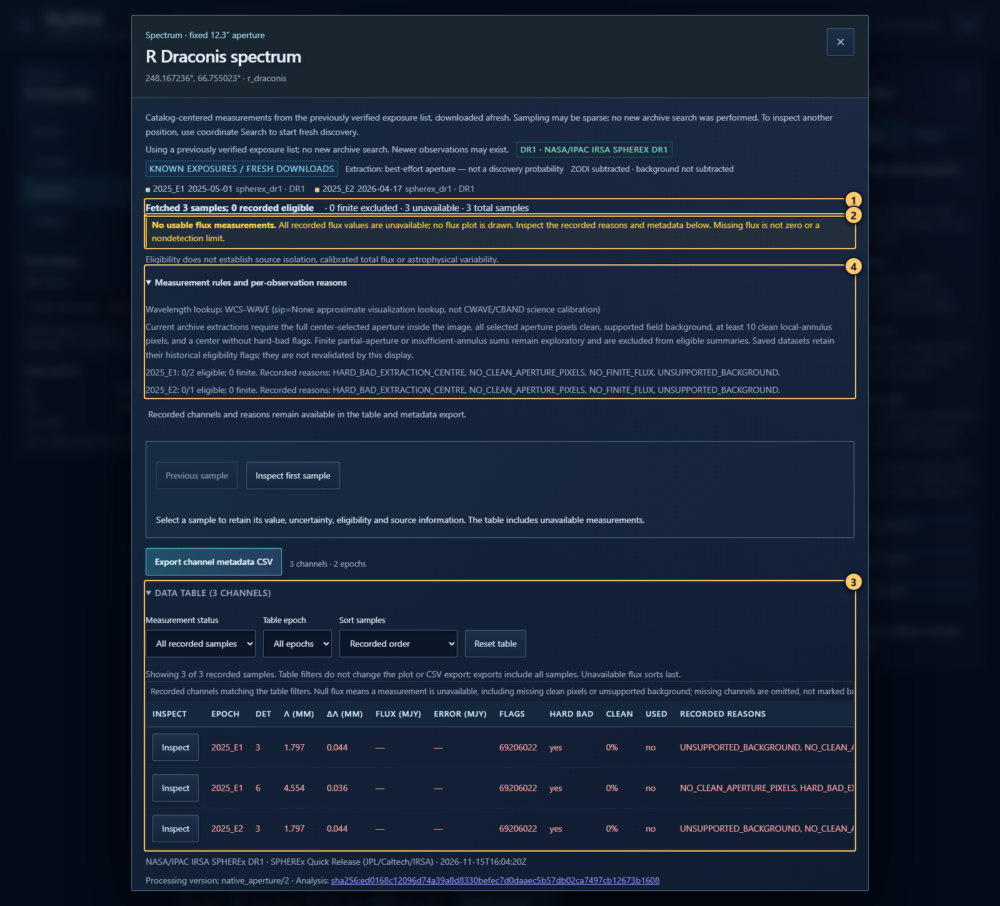

# SkyBlink presentation and recording guide

[Project overview](../README.md) · [Documentation](README.md) · [Result meanings](guides/result-meaning.md)

SkyBlink helps people compare real SPHEREx observations across time and understand when a measurement is usable. Demonstrate three steps: **choose a field, compare dates, inspect the evidence**.

These screenshots show the current interface with recorded real responses from 15 November 2026. Numbered highlights identify controls and evidence, not newly discovered objects. The same images appear in the README and the website's Help guide.

Reduced motion was enabled for these captures, so playback controls are disabled. Manual stepping and Side by side remain available.

## 1. Choose a field and understand the source

1. **Search:** choose a catalog target or enter RA and Dec coordinates.
2. **Task navigation:** Observe displays an image; Compare selects dates; Spectrum inspects brightness measurements; Evidence explains their limits.
3. **Data source:** check how the observations were obtained before interpreting them.
4. **Inspector:** read origin, comparison, measurement and validation separately.

On a phone, use the panel menu buttons to reveal the controls.

| Source | What happens | Available positions |
|---|---|---|
| Online archive — fresh search | Queries the archive and downloads selected inputs for new processing. | Catalog targets or your own coordinates; requires working discovery. |
| Known exposures — fresh downloads | Downloads inputs from a limited, previously verified exposure list and processes them again. | Five catalog targets only; does not discover new coverage. |
| Saved catalog data | Opens shipped historical real observations. | Five catalog targets only; historical comparisons remain unvalidated. |

**Say:** “Choose a patch of sky, then check where the observations came from. SkyBlink keeps fresh searches, known-exposure downloads and saved observations clearly labeled.”

The screenshot replays an existing known-exposure response. Its source label describes the original acquisition; taking this screenshot did not make a new archive request. A live failure never silently selects a different source.

## 2. Compare two dates in the WISE 0855 field

1. **Choose A and B:** open Compare, select the two observations, then use Show A, Show B or Side by side.
2. **Keep the detector consistent:** this example selects Band 6 in Image bands.
3. **Read the actual dates and CAUTION labels:** the observations are from 5 May 2025 and 11 May 2026.
4. **Check comparison status:** this result contains two epochs accepted for visual comparison using a known-exposure list.

Both observations are real NASA/IPAC IRSA SPHEREx DR1 data. Compare the same sky location across the dates while holding the band and display settings constant. A feature that appears to shift or brighten needs further investigation of flags, wavelength sampling, blending and processing.

The annotations identify controls, not the brown dwarf. This result does not establish a detection of WISE 0855, measured motion or astrophysical variability. Black patches can mean masked pixels, missing coverage or low display intensity; they do not demonstrate disappearance. D3 downloads failed in the original request, so this is not a six-detector comparison.

**Say:** “These are real observations of the same field, taken about a year apart. We align them and check their wavelength sampling before comparing them. A visible difference is a starting point for investigation, not a discovery claim.”

## 3. Explain an unavailable measurement in R Draconis

1. **Read the counts:** three samples arrived; none has finite flux or an eligible measurement.
2. **Read the message:** No usable flux measurements describes a completed response, not a loading failure.
3. **Check the table:** unavailable flux is shown as a dash; Used is no. Keep all epochs and all measurements visible.
4. **Expand the reasons:** the samples lack clean aperture pixels and have a hard-bad extraction center. Both D3 samples also lack a supported background estimate.

| Recorded samples | Result |
|---|---|
| 1 May 2025 | D3 and D6; flux unavailable |
| 17 April 2026 | D3; flux unavailable |
| Total | 3 real DR1 samples; 0 eligible measurements |

Unavailable flux is not zero brightness. This result does not prove the star is absent and is not a calibrated upper limit. Any field image behind the spectrum is a separate image product.

**Say:** “Three samples arrived, but none supports a usable brightness measurement. SkyBlink shows the missing values and the reasons, rather than turning them into a misleading result.”

## Short demonstration: two speakers, about 28 seconds

The 13 November response marked “Navigator answered” recommends a video shorter than 30 seconds or a presentation of at most seven slides. Check the final submission form before uploading. [Submission clarification](https://github.com/nasa/spaceapps/discussions/1991).

Record the screen first, then read these lines conversationally. Time the final edit, including captions and the closing frame.

| Time | Speaker | Spoken script | Screen action |
|---|---|---|---|
| 0–10 s | 1 | “SkyBlink makes real NASA SPHEREx observations easier to explore. Here, we compare the same field on two dates, using the same detector.” | Begin on the WISE comparison. Show dates and Band 6; switch A to B once, or hold Side by side. |
| 10–22 s | 2 | “For R Draconis, three samples arrived, but none passed the measurement checks. We show why the values are unavailable, so missing data never becomes a false discovery.” | Show counts, unavailable values and highlighted reasons. |
| 22–28 s | 1 | “Explore the sky. Compare the observations. Check the evidence.” | Return to the workspace with the project name and source visible. |

Keep a readable caption: **Recorded real results · Known exposures · 15 November 2026**. Credit **NASA/IPAC IRSA SPHEREx**. Include the last verified archive-search limitation in the project description; these examples do not demonstrate restored arbitrary-coordinate search.

## Extended walkthrough: about two minutes

Use this version for a local presentation when a longer demonstration is allowed. Speaker labels are placeholders for the actual team members.

**Speaker 1 — The problem.** “Spotting change in the sky means comparing observations taken at different times. Those observations arrive as scientific files with different sky projections, wavelengths and quality flags. SkyBlink brings them into an accessible observing workspace.”

**Speaker 2 — The workflow.** “Choose a target or enter coordinates. Check the data source, then choose two dates. You can inspect each observation manually or place them side by side. The source, dates and limitations stay visible, so a clear picture is accompanied by an explanation.”

**Speaker 1 — The comparison.** “This recorded WISE 0855 field contains observations from May 2025 and May 2026. Both use detector six and have passed our field-comparison checks. We can explore their appearance on the same sky grid. That does not by itself identify the brown dwarf or measure its motion.”

**Speaker 2 — The processing.** “Our server downloads selected FITS cutouts from IRSA, subtracts modeled zodiacal light and a supported local background, aligns the images and checks wavelength compatibility. The browser displays the processed frames. Brightness scaling for the display stays separate from native flux measurements. The server retains inputs and processing records for reproducibility.”

**Speaker 1 — The measurement.** “R Draconis illustrates why receiving data is not enough. These three samples have no usable brightness measurements. The interface explains the rejected pixels and background problems. Unavailable means we cannot support that measurement; it does not mean the star emits no light.”

**Speaker 2 — The value and next step.** “SkyBlink makes comparisons easier to use and easier to check. In our last verified tests, fresh archive discovery was failing, so these examples use a recorded exposure list and real downloads. Reliable arbitrary-coordinate discovery and broader scientific validation remain work to complete.”

## Recording checklist

1. Use the annotated captures to explain the interface, or record the current app. These are documentation images, not substitute observations loaded by the viewer.
2. To record these exact results, use the [capture provenance](screenshots/guide-20261115/origins.json) and its capture script. It replays retained real responses in an isolated browser. Required local inputs are listed there and are not all shipped in Git.
3. For a genuinely fresh request, explicitly choose Known exposures — fresh downloads and verify the returned dates, bands and counts before narrating them. They can differ from these examples, or retrieval can fail.
4. Keep source and quality labels visible. Use manual stepping or Side by side; keep any automatic blink brief and slow. Pause before explaining details.
5. Enlarge controls for the video while retaining source, date and warning context. Do not circle an astronomical object without independent identification.
6. Remove waiting time without suggesting instant processing. The original WISE request took 34.375 seconds.
7. Add readable English captions and test the final video at its submission size and volume.

## Evidence behind the examples

These are new UI captures of existing results. Observation bytes and scientific interpretation are unchanged. [Capture provenance](screenshots/guide-20261115/origins.json) records input and image hashes; [original video evidence](screenshots/video/origins.json) retains the earlier captures.

| Product | Recorded identity |
|---|---|
| WISE image comparison | `sha256:62409c5a0cd88218662d3420d60ae677366da90d5e66d6d37f21218c9ab625fb`; created 2026-11-15 16:55:35 UTC; `matched_image_comparison/13`. |
| R Draconis spectrum | `sha256:ed0168c12096d74a39a8d8330befec7d0daaec5b57db02ca7497cb12673b1608`; created 2026-11-15 16:04:20 UTC; `native_aperture/2`. |

The WISE record has two verified inputs and twelve verified output assets; strict replay passed. Its pair succeeded in the initial candidate round, so the recovery pass must not be credited for that success. [WISE verification](verification/phase6-live-discovery-diagnosis.md#single-post-fix-runtime-check).

The R Draconis samples record `NO_CLEAN_APERTURE_PIXELS` and `HARD_BAD_EXTRACTION_CENTRE`; both D3 samples also record `UNSUPPORTED_BACKGROUND`. [Spectrum verification](verification/phase6-verification.md#runtime-and-retrieval).

## Questions from reviewers

| Question | Answer |
|---|---|
| Does a changing image prove a moving object? | No. Wavelength sampling, artifacts, blending and processing can change appearances. Visual comparisons need further scientific investigation. |
| Does a shared link reproduce exactly the same bytes? | No. It preserves viewing choices and may check an expected analysis identity. Archive requests can produce new results; pinned replay is separate. |
| Are files processed on the user's computer? | The server fetches and processes FITS inputs and retains records. The browser handles interactive display. |
| Can users enter arbitrary coordinates? | Yes, through Search. They require live discovery; the last verified discovery outage remains unresolved. |
| Was AI used? | AI coding assistance supported implementation, debugging, testing and documentation. Observation inputs are real archive data. Describe actual team contributions in the submission. |

Do not claim a Planet X discovery, measured proper motion, complete 102-channel spectra, universal calibrated photometry or restored all-sky search. See [result meanings](guides/result-meaning.md), [reproducibility](guides/reproducibility.md) and [current limitations](current-limitations-and-next-steps.md).
